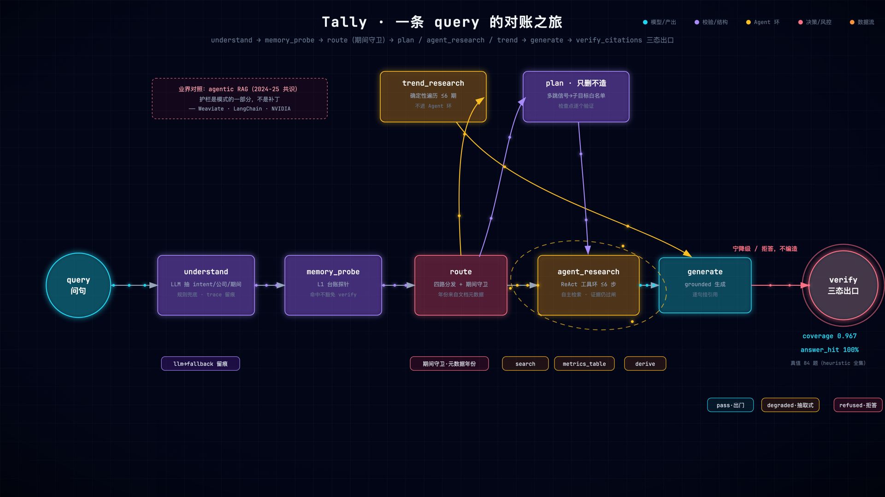
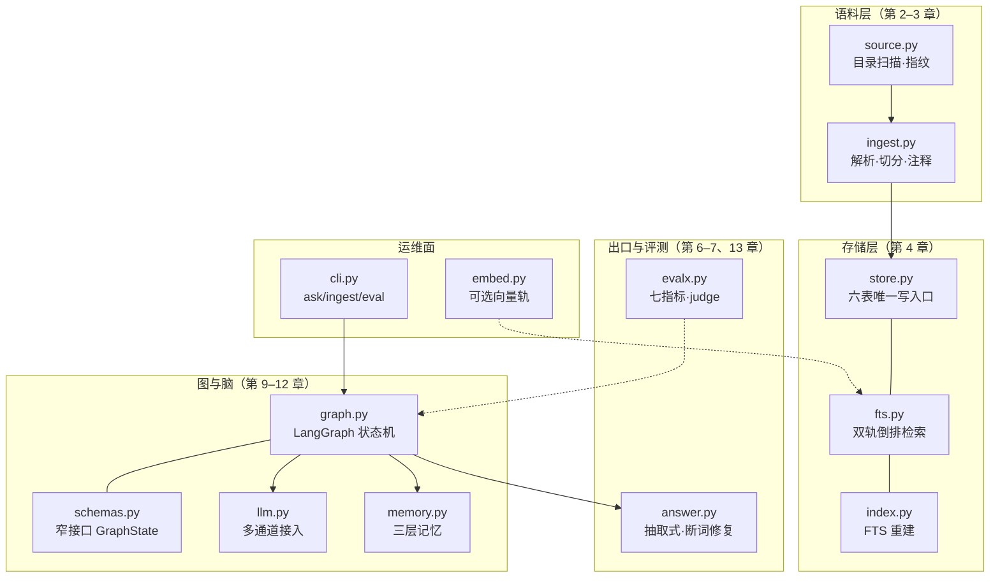

# 第 1 章 系统全景：从 RAG 到 Agentic RAG

> 状态：v0.5 · 所属：第一部分 全景：Agentic RAG 设计地图 · 先修：会 Python、调过 LLM API

!!! info "本章导读"

    学完本章你能：①亲手跑出一个 naive RAG 的三类失败，说出 Demo 与
    生产系统的本质差距；②用自己的话讲清 RAG 四代谱系与「封闭世界
    契约」；③解释什么是三态出口、为什么错误代价决定信任分级；④读懂
    Tally 的全拓扑与 14 模块 harness 总图；⑤按四条阅读路径选一条出发。

## 1.1 失败先行：亲手造一个坏的

全书从「先造坏」开始。下面这个 `naive_rag.py`（教程仓
`experiments/`，约 100 行）就是你在大多数「10 分钟 RAG Demo」教程里
会写出来的东西：关键词打分取 top-1 块，抠一个带数字的句子当答案，
**永不拒答**。它刻意不用 Tally 的任何智能——没有分词词典、没有公司
过滤、没有口径意识、没有对账、没有拒答路径。

在 Tally 仓库根目录跑（已 `pip install -r requirements.txt` 且
`ingest samples/`）：

```bash
python3 naive_rag.py --db tally.db
```

三个问题的实测输出（你的运行应该一模一样——确定性，没有模型参与）：

```text
Q：海伦哲营收变动的主要原因
   检索：中际旭创_2024FY 第31页 …相关数据同比发生重大变动的主要影响因素…
   回答：相关数据同比发生重大变动的主要影响因素说明 …现金流量净额比上年
         同期增加 66.81%，主要原因是本期业务增长带来的销售回款增加
   ← 失败① 检索失败：没有公司/期间过滤，海伦哲的问句答成了
     中际旭创 2024 年报——公司、指标全错，但句式「看起来」完全对题

Q：欧科亿 2026 年半年度扣除非经常性损益的净利润
   检索：日联科技_2026H1E 第1页 …与上年同期相比，将增加4,520.64万元左右…
   回答：与上年同期相比，将增加4,520.64万元左右，同比增加约54.60%
   ← 失败② 口径失败：真值是欧科亿的扣非数（≈-1,914.72 万元）；
     naive 连公司都没锁住，答了日联科技的同比增加数

Q：欧科亿 2030 年净利润预测
   检索：欧科亿_2026H1E 第1页 …证券代码：688308 证券简称：欧科亿…
   回答：证券代码：688308 证券简称：欧科亿 公告编号：2026-026
   ← 失败③ 无据硬答：语料里没有 2030 年，naive 照样出「答案」——
     没有拒答路径是 naive 管线的本体特征
```

三个失败对应 Demo 与生产的三条鸿沟：**不知道自己不知道**（无拒答）、
**口径混淆**（语义相近的兄弟数冒充）、**不可靠环节交给不可靠组件**
（词面检索承担了它扛不动的理解任务）。naive_rag 还挂着「出处」——
但没有任何东西校验它。**引用 ≠ 对账**，这是全书要填的坑。

## 1.2 知识点：RAG 四代谱系与本书的位置

RAG（Retrieval-Augmented Generation）由 Lewis et al. 2020 年提出
（[arXiv:2005.11401](https://arxiv.org/abs/2005.11401)）：生成前先
检索，用外部知识约束模型输出。此后业界走出一条清晰的谱系（Gao
et al. 综述 [arXiv:2312.10997](https://arxiv.org/abs/2312.10997)）：

| 代际 | 形态 | 典型特征 | 没解决的问题 |
|---|---|---|---|
| ① Naive RAG | 检索→拼接→生成 | 一把向量库一把 prompt | 检索到的就答，没检索到也答 |
| ② Advanced RAG | 查询改写、重排、混合检索 | 上下文工程 | 检索更好了，但出口没人管 |
| ③ Modular RAG | 路由、纠错环、模块编排 | 控制流开始可组合 | 链更长，失败怎么传播？ |
| ④ Agentic RAG | LLM 决定检索控制流 + 工具 + 规划 | 何时检索/查什么/调哪个工具/何时收手 | 自主性放大了每一步的误差 |
| **⑤ 可信出口（本书立场）** | **确定性闸门 + 归因 + 拒答** | **答案凭什么出门** | —— |

2024–2025 年，LangChain / Weaviate / Qdrant / NVIDIA 已把 ③+④ 收敛
为一个词条：**agentic RAG**（定义综述见
[Weaviate](https://weaviate.io/blog/what-is-agentic-rag)）。更值得
记住的是共识的**后半句**：这些教程无一例外把护栏列为模式本身的一
部分——有界步数、幂等、确定性出口闸不是补丁，是 agentic RAG 的
定义性特征。前四代都在回答「怎么查得更好」；本书加第五层，回答
「答案能不能出门」。这不是标新立异——教程生态自然集中于前四代
（有现成框架和明确指标），而第五层需要你拥有一个敢被评测出错的
系统，这就是本书用真实项目当载体的原因。

Anthropic 在 [Building Effective Agents](https://www.anthropic.com/engineering/building-effective-agents)
里的建议与此同构：从能工作的最简单结构开始（workflow），只在评估
证明需要时再加自主性（agent）。Tally 的立场一句话：**自由规划、
强制对账**——控制流可以给模型，出口必须留给代码。

## 1.3 知识点：封闭世界、错误代价与三态出口

**封闭世界 vs 开放世界。**开放世界里，验证永远证伪不了「模型碰巧
知道」：答案对了，你无法区分它是检索到的（可信）还是编得恰好对了
（不可信）。封闭世界把「对账」变成可判定问题：答案句 → 证据池 →
找得到/找不到，二值。这也是 Tally 与 CRAG 这类「检索不够就上网补」
路线（[arXiv:2401.15884](https://arxiv.org/abs/2401.15884)）的根本
分野：金融场景里，一个语义相近的网页比一句「找不到依据」危险得多。
**宁缺毋滥是领域知识，不是技术缺陷。**

**错误代价分级决定信任分级。**不是所有子系统都配得上同等的信任。
把任务按错误代价排一排：

| 错误代价 | 例子 | 该交给谁 |
|---|---|---|
| 高（错一句就是事故） | 数字事实、口径、期间 | 确定性代码（闸门/差分算子） |
| 中（错一句要人复核） | 检索路由、证据够不够 | LLM 提议 + 规则裁决 |
| 低（错了无伤大雅） | 叙述措辞、句式组织 | LLM 全权（仍过数字闸） |

这张表是全书架构决策的总纲：**信任分级是设计决定，不是模型能力
决定**——0.8b 小模型 + 严闸 的组合，可靠性高于 100b 大模型裸奔。

**三态出口。**一个可信系统的每个回答只能是三种状态之一：
`pass`（过闸逐句对账）/ `degraded`（降级为纯引用原文的抽取式）/
`refused`（对不上账，拒答）。拒答在封闭世界里是能力不是失败——
SQuAD 2.0（[arXiv:1806.03822](https://arxiv.org/abs/1806.03822)）
把「无可答段落时回答 无解」纳入评测，就是同一个思想在学术界的
落点。拒答的设计目标不是消灭，是**让拒得有用**（指名缺什么、列出
现在有什么）。

## 1.4 知识点：harness 立论——你要造的不是模型，是挽具

把 1.3 的信任分级推到底，会得到一个有点反直觉的结论：

> **你要造的不是模型，是挽具（harness）。**

模型是马，会换、会跑偏、会受惊；挽具是把马的力量变成可控运输的
那套结构。表现在工程上：模型选型是**运营决策**（换档只改一行环境
变量），闸门与评测是**产品资产**（沉淀在代码里不随模型变）。长链
任务的可靠性不取决于单步多聪明，取决于错误怎么传播——单步 95%
可靠的任务，20 步只剩 ~36% 成功率（0.95²⁰）；把「错而存活」的
概率用闸门压到 2%，20 步仍是 ~98% 可靠，且失败形态退化为安全的
降级/拒答。这条公理（eₖ·gₖ）是第 14 章的收口论点，此处先立论：
**可靠性由架构保证，不靠模型堆料。**评测你的挽具的那套东西本身
也是挽具——第 13 章会对照 lm-evaluation-harness / HELM / SWE-bench
讲评测 harness 的共同骨架。

## 1.5 本项目：Tally 三条契约与对账思想

Tally（中世纪符木 tally stick：债权双方把数目刻在木棍上劈成两半，
对账时合上——**刻痕对得上，账才算数**）的 v0.7 封闭世界契约只有
三条，却是全系统成立的前提：

1. **事实只来自内部 RAG 证据**——LLM 的参数知识可以组织语言，
   永远不产出事实。它可以说「以上数据显示…」，不可以说「据我所知…」。
2. **工具白名单只有内部动作**（search / metrics_table / derive）——
   永无浏览器、外部 API、模型生成的代码。模型无权自造工具。
3. **只有 verify:pass 的结构化事实进长期记忆**——记忆是加速器，
   不是后门（第 12 章展开：写闸、读不豁免、指纹失效）。

这个思想在学术界有个正式名字：**归因（Attribution）**。Rashkin
et al. 的 AIS 框架（[arXiv:2112.12870](https://arxiv.org/abs/2112.12870)）
把标准定为「一个知情读者会同意：根据来源 s，陈述 z 成立」。Tally
的 verify 闸门是 AIS 的工程化：**每句答案必须能在证据池里对上
刻痕**；对不上，降级抽取式；连原文都没有，拒答。「模型不编」和
「系统保证模型不编」是两回事：前者靠祈祷，后者靠结构——本书讲
后者。

## 1.6 本项目：一张图看全书 + 14 模块 harness 总图

**过程视角**（一条 query 的旅程，运行时顺序）：

```
离线：PDF/MD ─→ 文件名元数据 ─→ 页眉剥离 ─→ 表格感知分块 ─→ 数字归一化
                （SHA-256 指纹增量：增/改/删自适应）          ← 第 2、3 章
                     ↓
              SQLite（六表 + FTS5 双轨倒排）                   ← 第 4 章

在线（LangGraph 状态机）：
  问题 → understand（LLM 理解 + 八守卫）                     ← 第 9 章
        → memory_probe → route（期间守卫）
        ├── 多跳信号 → plan（只删不造）→ agent_research（ReAct）← 第 10、11 章
        ├── heuristic → retrieve（双轨 FTS + RRF）→ grade ⇄ rewrite ← 第 5 章
        ├── trend → trend_research（确定性遍历 + 单季差分）
        └── other → refuse
        → generate（grounded，逐句带 [公司_报告期 第N页] 引用）  ← 第 6 章
        → verify_citations（覆盖率 <0.45 降级 / 无据拒答）       ← 第 7 章
                                                              ← 评测：第 13 章 · 可靠性：第 14 章
```

读这张图的三个要点：**所有路径汇入同一个出口**（verify_citations）
——Agent 自主检索、记忆命中、差分派生，谁也别想绕过闸门；**同一张
图、两个大脑**（LLM 模式与零 key 规则模式跑同一套节点与闸门，
heuristic 是全书实验的确定性对照组）；**离线层决定在线层的天花板**
（第 2 章的确定性元数据，在第 9 章兑现成确定性期间守卫）。



*一条 query 的对账之旅（[▶ 动画版](anim/journey.html)，可暂停/重播）：understand → memory_probe → route（期间守卫）→ plan / agent_research / trend 三路 → generate → verify_citations 三态出口。*

**结构视角**（14 个模块怎么组成本书要讲的 harness——注意：这是
静态分工图，上面那张才是运行时过程图）：



`tally/` 全部 14 个 `.py`（含 `__init__.py` 包入口，图略）——与
附录 C 生成脚本同一计数口径；第 14 章总装走读时这 14 个模块会在
一条 trace 里各出现一次。

## 1.7 动手：跑通 + 三类失败 + 第一次拒答

```bash
git clone https://github.com/Ming-H/tally.git && cd tally
pip install -r requirements.txt
python -m tally.cli ingest samples/    # 30 秒：摄取 3 家公司 5 份样例财报

python -m tally.cli ask "欧科亿 2026 年半年度预计净利润多少"
# → 预计净利润 36,000 万元至 42,000 万元（约 3.60 亿元至 4.20 亿元）
#   [欧科亿_2026H1E 第1页]

python3 naive_rag.py --db tally.db     # 1.1 的三类失败（教程仓 experiments/）

python -m tally.cli ask "欧科亿 2030 年净利润预测"
# → 库里没有 2030 年期间的报告（现有期间：2024FY…2026Q1）。
#   对不上账，不硬答。   ← 拒答三细节：指名缺什么/列出现有什么/代价为零

python -m tally.cli eval    # 七数据集 84 题评测，一条命令复现全部指标
```

`eval` 的输出是全书的「体温计」——retrieval@3 / answer_hit / refusal /
citation_coverage / chunk P/R@8 / steps 是第 13 章逐个拆解的对象。

!!! tip "诊断态三档"

    Tally 的观测性是分层的，后面章节会反复用到：`ask "…"` 产品态
    （干净答案）；`ask "…" -v` 诊断态（stderr 打印 trace 每节点耗时，
    如 `understand:rule(0ms) → route:compare(36ms) → decompose:… →
    verify:pass(0.962)`）；`ask "…" --json` 机器态（整态 JSON，修前
    修后对比可脚本化）。**读 trace 是本书实验课的基本功。**

## 1.8 阅读路径：四条路出发

| 路径 | 章 | 适合谁 |
|---|---|---|
| 通读 | ch01 → ch14 顺序 | 默认路径；每章实验跟着做 |
| RAG 面 | ch02–07 | 语料/检索/生成/验证一条龙，零 key 可跑全程 |
| Agent 面 | ch08–12 | 已有 RAG 基础，直奔四支柱 |
| 快线 | ch01 → 05 → 07 → 11 → 14 | 两小时搞懂这本书的主张 |

教学序 ≠ 运行序：运行时 understand→route 先于检索，但本书把生成/
验证（ch06–07）放在理解/路由（ch09）**之前**讲——因为 ch06–07 全程
可用规则脑（`--mode heuristic`）跑，第 8 章才接 LLM。规则脑不是
降级兜底，是教学脚手架。

## 1.9 小结

- naive 三失败 = Demo 与生产的三条鸿沟：不知无知、口径混淆、不可靠
  环节放错位置；引用 ≠ 对账；
- RAG 谱系四代 + 本书第五层立场：护栏是 agentic RAG 的定义性特征；
- 封闭世界让对账可判定；错误代价分级 → 信任分级 → 三态出口；
- harness 立论：模型会换，挽具沉淀——可靠性由架构保证；
- 双脑同图同闸；14 模块 = 本书要带你造的那副挽具。

## 常见误区

**误区一：「RAG = 向量库 + 生成」。**RAG 的本体是「检索增强
**生成**」——检索只是手段，生成的**可信**才是目的。把注意力全放在
检索层而不管出口，等于花了 90% 力气修门、却没装锁。

**误区二：「检索质量好，答案就对」。**检索只保证证据在池子里，
不保证生成选了正确的句（口径混淆，第 7 章）、答案真的回应了问题
（compare 撞上限，第 14 章）、模型没把两个数拼成第三个数（算术
幻觉，derive 的存在理由）。检索指标与答案正确率之间的缝隙，正是
第三部分的存在理由。

**误区三：「换个更强的模型就没事了」。**强模型降低错误**频率**，
不改变错误**形态**。本书的路线是把形态改成确定性的三态出口，让
正确性与模型档位解耦：0.8b 也能全对（答案丑一点），100b 也不能编
（闸门同一把）。

**误区四：「拒答是失败」。**一个不会说「不知道」的系统，用户要用
一次事故才能发现它不知道。拒答的设计目标是**让拒得有用**。

## 延伸阅读

- Lewis et al. 2020, *RAG*：<https://arxiv.org/abs/2005.11401>
- Gao et al., *RAG for LLMs: A Survey*：<https://arxiv.org/abs/2312.10997>
- Weaviate, *What is Agentic RAG*：<https://weaviate.io/blog/what-is-agentic-rag>
- Anthropic, *Building Effective Agents*：<https://www.anthropic.com/engineering/building-effective-agents>
- Rashkin et al., *Measuring Attribution (AIS)*：<https://arxiv.org/abs/2112.12870>
- Rajpurkar et al., *SQuAD 2.0（knowing what you don't know）*：<https://arxiv.org/abs/1806.03822>
- tally `docs/INTRODUCTION.md` 与 `docs/DESIGN-v0.7-agent.md` §0–§3
