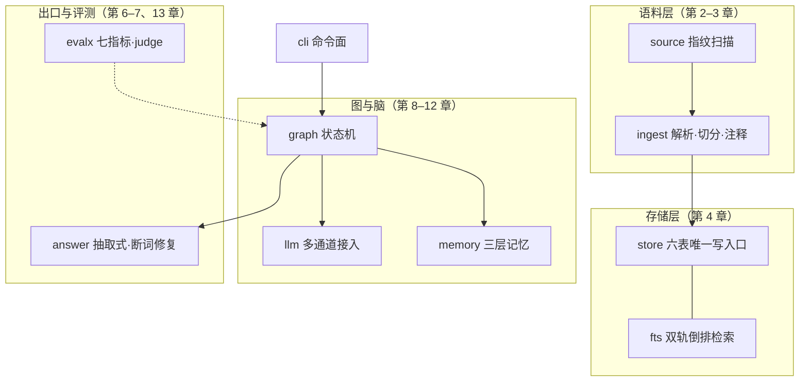

# 第 1 章 系统全景：从 RAG 到 Agentic RAG

> 状态：v0.6 · 所属：第一部分 全景：Agentic RAG 设计地图 · 先修：会 Python、调过 LLM API

!!! info "本章导读"

    学完本章你能：①说出 RAG 四代谱系与 agentic RAG 的业界共识；②用
    错误代价分级决定信任分级；③解释三态出口为什么是可信系统的输出
    契约；④讲清「harness（挽具）」这个贯穿全书的立论，以及生产级
    harness 的五个组件；⑤按四条阅读路径选一条出发。

## 1.1 RAG 四代谱系：每一代解决了什么、留下了什么

RAG（Retrieval-Augmented Generation，[Lewis et al. 2020](
https://arxiv.org/abs/2005.11401)）的核心思想一句话：生成前先检索，
用外部知识约束模型输出。此后五年，业界走出一条清晰的谱系（综述见
[Gao et al., arXiv:2312.10997](https://arxiv.org/abs/2312.10997)）：

| 代际 | 形态 | 解决了什么 | 留下了什么 |
|---|---|---|---|
| ① Naive RAG | 检索→拼接→生成 | 知识注入，幻觉初步受控 | 检索到的就答，没检索到也答 |
| ② Advanced RAG | 查询改写、重排、混合检索 | 检索质量 | 出口依然没人管 |
| ③ Modular RAG | 路由、纠错环、模块编排 | 控制流可组合 | 链更长，失败开始复合 |
| ④ Agentic RAG | LLM 决定检索控制流 + 工具 + 规划 | 何时查/查什么/何时收手 | 自主性放大每步误差 |
| ⑤ 可信出口（本书立场）| 确定性闸门 + 归因 + 拒答 | **答案凭什么出门** | —— |

2024–2025 年，LangChain / Weaviate / Qdrant / NVIDIA 把 ③+④ 收敛为
一个词条：**agentic RAG**（定义综述见
[Weaviate](https://weaviate.io/blog/what-is-agentic-rag)）。更值得
记住的是共识的**后半句**：这些教程无一例外把护栏列为模式本身的一
部分——有界步数、幂等、确定性出口闸不是补丁，是 agentic RAG 的
定义性特征。前四代都在回答「怎么查得更好」；第五层回答「答案能
不能出门」——这是本书的位置。

Anthropic 的工程建议（[Building Effective Agents](
https://www.anthropic.com/engineering/building-effective-agents)）
与这个立场同构：从能工作的最简单结构（workflow）开始，只在评估
证明需要时再加自主性（agent）。控制流可以给模型，出口必须留给
代码。

## 1.2 封闭世界与信任分级：两个前置设计决定

**封闭世界 vs 开放世界。**验证一个答案，开放世界里永远证伪不了
「模型碰巧知道」：答案对了，你无法区分它是检索到的（可信）还是
编得恰好对了（不可信）。封闭世界——事实只能来自指定证据源——
把「对账」变成可判定问题：答案句 → 证据池 → 找得到/找不到，二值。
封闭世界不是限制，是把验证从概率问题变成结构问题的**前提**。哪些
场景天然封闭：内部文档问答、财报/法律/医疗条文问答、工单检索；
哪些天然开放：闲聊、创作、开放域搜索。

**错误代价分级决定信任分级。**不是所有子系统都配得上同等的信任。
把任务按错误代价排一排：

| 错误代价 | 例子 | 该交给谁 |
|---|---|---|
| 高（错一句就是事故）| 数字事实、口径、期间、金额 | 确定性代码（闸门/算术）|
| 中（错一句要人复核）| 检索路由、证据够不够 | LLM 提议 + 规则裁决 |
| 低（错了无伤大雅）| 叙述措辞、句式组织 | LLM 全权（仍过数字闸）|

这张表是全书架构决策的总纲：**信任分级是设计决定，不是模型能力
决定**。小模型 + 严闸的组合，可靠性高于大模型裸奔——不是因为小
模型更好，是因为错误穿不过闸门。

## 1.3 三态出口：可信系统的输出契约

一个可信系统的每个回答，只能是三种状态之一：

| 出口 | 含义 | 用户看到 |
|---|---|---|
| pass | 过闸对账 | 正常回答 |
| degraded | 对不上账 | 降级产物（原文证据直出）|
| refused | 无证据可用 | 拒答 + 指名缺什么 |

拒答在可信系统里是**一等能力**。学术出处是 SQuAD 2.0
（[arXiv:1806.03822](https://arxiv.org/abs/1806.03822)）：阅读理解
界用 5 万+「看似可答、实则不可答」的对抗题立了规矩——系统必须
**弃权**而不是编一个像样的答案。拒答的设计目标不是消灭，是**让
拒得有用**：指名缺什么（哪一年？哪个实体？）、列出现有什么、把
拒绝的代价降到「用户知道下一个该问什么」。

三态出口把「失败」从贬义变成接口的一部分：降级（degraded）输出
仍满足系统不变量（每句有出处），拒绝（refused）携带可行动信息。
**安全失败设计**——失败形态本身就是设计对象——是第 14 章的主题，
此处先立契约。

## 1.4 harness 立论：你要造的不是模型，是挽具

把 1.2 的信任分级推到底，得到一个反直觉的结论：

> **你要造的不是模型，是挽具（harness）。**

模型是马，会换、会跑偏、会受惊；挽具是把马的力量变成可控运输的
那套结构。这套话语已经是业界共识：李博杰《深入理解 AI Agent》
（[ai-agent-book](https://github.com/bojieli/ai-agent-book)）开篇
即讲「Harness 工程才是竞争力」；LangChain 内部落地的公司级 harness
（[博客 2026-10](https://www.langchain.com/blog/components-building-company-harness)）
总结了五个组件——

1. **驻留现场**（lives where people work）：agent 活在用户已有的
   工作界面里（Slack/钉钉），不是又一个新入口；
2. **身份代行**（on-behalf-of）：哪些操作代表用户、哪些用服务身份，
   按工具逐个决定；
3. **分层记忆**（global / user 两层）：事实记忆按作用域隔离；
4. **沙箱执行**：代码在沙箱里跑，凭证走代理；
5. **定时运行**（ambient agents）：大量运行是调度触发而非用户
   显式调用。

本书教的是这五个组件的地基那一层——检索、生成、验证、自主循环、
记忆、评测；生产化的五组件在附录 G 与第 14 章收口。模型选型是
**运营决策**（换档改一行配置），闸门与评测是**产品资产**（沉淀在
代码里不随模型变）。Chip Huyen 在《AI Engineering》
（[aie-book](https://github.com/chiphuyen/aie-book)）里的态度同源：
讲 fundamentals 不讲工具——工具很快过时，基础更耐用。

## 1.5 案例研究：Tally——本书的贯穿案例

!!! note "案例研究：Tally（v0.7，封闭世界财报事实 Agent）"

    全书用一个真实开源项目做贯穿案例：
    [Tally](https://github.com/Ming-H/tally)——中文财报问答系统，
    名字取自中世纪符木（tally stick）：债权双方把数目刻在木棍上劈成
    两半，对账时合上，**刻痕对得上，账才算数**。它的 v0.7 封闭世界
    契约三条：

    1. **事实只来自内部 RAG 证据**——LLM 参数知识只组织语言，
       永不生产事实；
    2. **工具白名单只含内部动作**（search / metrics_table / derive）
       ——永无浏览器、外部 API、模型生成代码；
    3. **只有 verify:pass 的结构化事实进长期记忆**——记忆是
       加速器不是后门。

    为什么值得当案例：它有 26 个实测决策记录（D1–D26）、3 次事故
    复盘、40 道人工核对真值题、7 个评测数据集 84 题随 CI 跑——
    **每个设计决策背后有一组可复现的数字**。它也足够小（约
    4,700 行源码），读得完。

    与业界默认的分歧（详见附录 E）：向量检索默认关（消融实测净负）、
    trend 不进 agent 环（确定性遍历）、LLM 裁判只能否决、自主严格
    有界。每条分歧都有实测押注。

**一张图看全书（案例的过程视角）**：

```text
离线：文档 → 元数据契约 → 去噪 → 表格感知分块 → 数字归一化注释
      （内容指纹增量：增/改/删自适应）                    ← 第 2、3 章
                ↓
         SQLite（六表 + 双轨倒排索引）                    ← 第 4 章

在线（状态机）：
  问题 → 查询理解（LLM 抽取 + 规则守卫）                 ← 第 9 章
        → 路由（期间守卫：年份来自元数据）
        ├── 多跳信号 → 规划（只删不造）→ 工具循环（ReAct）← 第 10、11 章
        ├── 单跳 → 检索（双轨词法 + RRF）→ 分级 → 有界改写 ← 第 5 章
        ├── 趋势 → 确定性期间遍历 + 差分派生
        └── 其他 → 拒答
        → 生成（逐句带 [公司_报告期 第N页] 引用）          ← 第 6 章
        → 出口验证（覆盖率闸门 + 口径防线）                 ← 第 7 章
                                                 评测 → 第 13 章 · 可靠性 → 第 14 章
```

**结构视角**（14 个模块怎么组成这副挽具）：



Tally 的关键性质：**同一张图、两个大脑**——LLM 模式与零 key 的
规则模式（heuristic）跑同一套节点与闸门。heuristic 既是可复现的
回归基线（全书实验的确定性对照组），也是教学脚手架（第三部的
生成/验证全程可零 key 跑通，第 8 章才接 LLM）。

## 1.6 动手：跑通案例 + 亲手造一个坏的

**① 30 秒跑通案例**（完整环境说明见附录 B）：

```bash
git clone https://github.com/Ming-H/tally.git && cd tally
pip install -r requirements.txt
python -m tally.cli ingest samples/    # 摄取 3 家公司 5 份样例财报

python -m tally.cli ask "欧科亿 2026 年半年度预计净利润多少"
# → 预计净利润 36,000 万元至 42,000 万元（约 3.60 亿元至 4.20 亿元）
#   [欧科亿_2026H1E 第1页]

python -m tally.cli ask "欧科亿 2030 年净利润预测"
# → 库里没有 2030 年期间的报告（现有期间：…）。对不上账，不硬答。
#   ← 三态出口的 refused：指名缺什么、列出现有什么、代价为零

python -m tally.cli eval    # 七数据集 84 题评测，一条命令复现全部指标
```

**② 亲手造一个坏的**（教程仓 `experiments/naive_rag.py`，约 100
行，零 LLM）：关键词打分取 top-1 块、抠一个带数字的句子当答案、
**永不拒答**——这是你在多数「10 分钟 RAG Demo」教程里会写出来的
东西。实测三类失败（你的运行应完全一致——确定性）：

```text
Q：海伦哲营收变动的主要原因
   回答：…现金流量净额比上年同期增加 66.81%，主要原因是本期业务增长…
   ← 检索失败：没有公司/期间过滤，海伦哲的问句答成了另一家的年报

Q：欧科亿 2026 年半年度扣除非经常性损益的净利润
   回答：与上年同期相比，将增加4,520.64万元左右…
   ← 口径失败：连公司都没锁住，答了第三方的同比数

Q：欧科亿 2030 年净利润预测
   回答：证券代码：688308 证券简称：欧科亿…
   ← 无据硬答：语料里没有 2030 年，照样出「答案」
```

三个失败对应 1.1 表中前三代遗留的三个问题：不知道自己不知道、
口径混淆、无拒答路径。**引用 ≠ 对账**——naive_rag 也挂「出处」，
但没有任何东西校验它。全书要填的就是这些坑。

**③ 观测三档**（后面每章都用）：`ask "…"` 产品态；`-v` 诊断态
（trace 每节点耗时）；`--json` 机器态（可脚本化对比）。

## 1.7 阅读路径：四条路出发

| 路径 | 章 | 适合谁 |
|---|---|---|
| 通读 | ch01 → ch14 顺序 | 默认路径；每章实验跟着做 |
| RAG 面 | ch02–07 | 语料/检索/生成/验证一条龙，零 key 可跑全程 |
| Agent 面 | ch08–12 | 已有 RAG 基础，直奔 LLM 接入与四支柱 |
| 快线 | ch01 → 05 → 07 → 11 → 14 | 两小时搞懂这本书的主张 |

教学序 ≠ 运行序：运行时查询理解先于检索，但本书把生成/验证
（ch06–07）放在理解/路由（ch09）**之前**讲——因为前者全程可用
规则脑跑，第 8 章才接 LLM。每个案例小节都可跳过（「删例不塌」）：
不读 Tally，你仍能读完本书的全部知识。

## 1.8 小结

- RAG 四代谱系各解决了上一代的问题、也各留下一个新问题；第五层
  （可信出口）回答「答案凭什么出门」——护栏是 agentic RAG 的
  定义性特征，不是补丁；
- 封闭世界让对账可判定；错误代价分级 → 信任分级 → 三态输出契约
  （pass/degraded/refused），拒答是一等能力；
- harness 立论：模型会换，挽具沉淀；生产 harness 五组件是本书
  地基之上的下一层；
- 案例载体 Tally：三条封闭世界契约、双脑同图、26 个实测决策——
  每章以「案例研究」小节穿插。

## 常见误区

**误区一：「RAG = 向量库 + 生成」。**RAG 的本体是「检索增强
**生成**」——检索只是手段，生成的**可信**才是目的。把注意力全放
在检索层而不管出口，等于花了 90% 力气修门、却没装锁。

**误区二：「换个更强的模型就没事了」。**强模型降低错误**频率**，
不改变错误**形态**。三态出口把形态改成确定性的：小模型也能全对
（答案丑一点），大模型也不能编（闸门同一把）——正确性与模型
档位解耦。

**误区三：「拒答是失败」。**一个不会说「不知道」的系统，用户要
用一次事故才能发现它不知道。拒答的设计目标是**让拒得有用**。

**误区四：「先选模型再想系统」。**反了：先定错误代价与信任分级，
模型只是分级表里「低代价区」的一个可替换执行件。

## 延伸阅读

- Lewis et al. 2020, *RAG*：<https://arxiv.org/abs/2005.11401> · Gao et al., *RAG Survey*：<https://arxiv.org/abs/2312.10997>
- Weaviate, *What is Agentic RAG*：<https://weaviate.io/blog/what-is-agentic-rag> · Anthropic, *Building Effective Agents*：<https://www.anthropic.com/engineering/building-effective-agents>
- SQuAD 2.0（abstention 学统）：<https://arxiv.org/abs/1806.03822>
- LangChain, *The five components of building a company harness*：<https://www.langchain.com/blog/components-building-company-harness>
- Chip Huyen, *AI Engineering*（[aie-book](https://github.com/chiphuyen/aie-book)）· 李博杰《深入理解 AI Agent》（[ai-agent-book](https://github.com/bojieli/ai-agent-book)）
