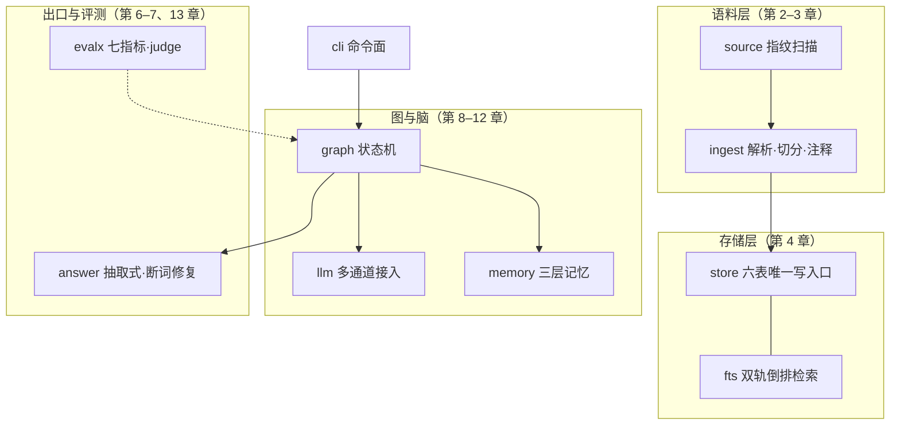

# 第 1 章 系统全景：从 RAG 到 Agentic RAG

> 状态：v0.8 · 所属：第一部分 全景：Agentic RAG 设计地图 · 先修：会 Python、调过 LLM API

!!! info "本章导读"

    学完本章你能：①讲清 RAG 四代谱系每一代的代表技术与遗留问题，
    以及 agentic RAG 的业界共识定义；②用错误代价分级决定信任分级，
    解释封闭世界为什么让验证可判定；③说出三态出口的学术学统
    （abstention）与工程含义；④讲清 harness（挽具）立论与生产级
    harness 的五个组件；⑤跑通贯穿案例并亲手造一个坏的 naive RAG。

## 1.1 RAG 的思想与四代谱系

**RAG 的原点问题**：语言模型的知识在参数里，参数不会更新、无法
引用、领域外就编。RAG（Retrieval-Augmented Generation，[Lewis
et al. 2020](https://arxiv.org/abs/2005.11401)，Facebook）的答案：
生成前先检索，用外部知识约束输出——模型从「知识容器」变成
「带引用的推理器」。这个思想本身不新（开放域问答早有 retrieve-
then-read），2020 年的新东西是**端到端可训练**（检索器与生成器
联合学习）；2023 年后 LLM 够强，检索器不必训练了，工程重心移到
**检索质量与系统结构**。

五年谱系（综述 [Gao et al., arXiv:2312.10997](
https://arxiv.org/abs/2312.10997)；每一代用「解决了什么/留下了
什么」双栏记住）：

| 代际 | 代表技术 | 解决了什么 | 留下了什么 |
|---|---|---|---|
| ① Naive（2020–22）| 检索 top-k → 拼接 → 生成 | 知识注入，幻觉初步受控 | 检索到的就答，没检索到也答 |
| ② Advanced（2022–23）| 查询改写/重排/混合检索（HyDE、multi-query、cross-encoder）| 检索质量 | 出口依然没人管 |
| ③ Modular（2023–24）| 路由、纠错环（CRAG/Self-RAG）、模块编排 | 控制流可组合 | 链更长，失败开始复合 |
| ④ Agentic（2024–25）| LLM 决定检索控制流 + 工具 + 规划（ReAct、Plan-and-Execute）| 何时查/查什么/调哪个工具/何时收手 | 自主性放大每步误差 |
| ⑤ 可信出口（本书立场）| 确定性闸门 + 归因 + 拒答 | **答案凭什么出门** | —— |

**Agentic RAG 的共识定义**（2024–2025，LangChain / Weaviate /
Qdrant / NVIDIA 各自收敛到同一句话）：agent 主导检索——何时
检索、查什么、调哪个工具、证据够不够、何时收手——取代固定的
retrieve-once-then-generate 流水线（综述见
[Weaviate](https://weaviate.io/blog/what-is-agentic-rag)）。
共识还有**后半句**，教程生态常漏掉：护栏是模式本身的一部分——
有界步数、幂等、确定性出口闸不是补丁，是 agentic RAG 的定义性
特征。

**Anthropic 的工程立场**（[Building Effective Agents](
https://www.anthropic.com/engineering/building-effective-agents)）
值得整段记住，它是第 9–11 章的判定线来源：workflow（代码编排
LLM 走预定义路径）适合可预测任务；agent（LLM 自己决定过程）
留给需要弹性的场景；**从最简单能工作的结构开始，只在评估证明
需要时再加自主性**。控制流可以给模型，出口必须留给代码。

### 演练：同一道题的四代之旅

拿一道真实题目看四代系统的行为差异——「**对比 A、B 两家公司 2026
年一季度的净利润**」（库里只有 A 的 Q1 披露，B 只有年报）：

| 代际 | 系统行为 | 用户看到的 |
|---|---|---|
| ① Naive | 一次检索取 top-k（大概率只命中 A）→ 直接生成 | 流畅地只谈 A，绝口不提 B——**沉默的缺口** |
| ② Advanced | 查询改写（「A B 净利润 对比」）+ 重排，检索面更全 | 还是只谈 A，但引用更准了——缺口依旧 |
| ③ Modular | 路由发现 compare → 按公司分解 → 各自检索 | 检索到 B 缺 Q1 → 重试 → 仍空——开始知道缺什么 |
| ④ Agentic | 分解 + 工具循环：查 A ✓ → 查 B 空 → 换角度查年报 → 仍无法单季化 | 差分派生（FY−Q3）或显式声明「B 的 Q1 无单季披露」|
| ⑤ 可信出口 | ④ 之上：答案逐句对账；派生值出口重算 | A 有据，B 显式缺口或带出处的差分——**三态出口** |

四代解决的是「查得更好」，第五代解决的是「缺的时候怎么说」。这道
题的演进路径就是全书的目录。

### 2026 年的工程全景栈（去哪儿找每个部件）

把本书的部件放回业界工具地图（选型时按层认亲，不是背品牌）：

| 层 | 开源代表 | 商用代表 |
|---|---|---|
| 编排/状态机 | LangGraph、LlamaIndex Workflows | LangSmith（观测）|
| 检索 | FTS5/ES + RRF、Qdrant/Milvus | Weaviate 混合、Cohere Rerank |
| 解析/切分 | Docling、Unstructured、MinerU | LlamaParse |
| 记忆 | Mem0、Zep、Letta（MemGPT）| LangGraph Store、Claude memory tool |
| 工具互操作 | MCP（开放标准）| 各家 function calling |
| 推理服务 | vLLM、SGLang、Ollama | 各云厂商 |
| 评测 | RAGAS、lm-eval-harness、HELM | LangSmith Evals |

原则不变：先学层（本书），再挑件（这行表），最后换件不换层。

## 1.2 封闭世界与信任分级

**为什么验证 LLM 的答案这么难**：开放世界里，你永远证伪不了
「模型碰巧知道」——答案对了，无法区分它是检索到的（可信）还是
编得恰好对了（不可信），而两者的可靠性模型完全不同。

**封闭世界**（closed world）是解法：预先声明「事实只能来自指定
证据源」（内部文档、给定语料），验证就从概率问题变成可判定
问题——答案句 → 证据池 → 找得到/找不到，二值。适用面比想象广：
内部文档问答、财报/法条/医疗条文问答、工单检索都天然封闭；
闲聊、创作、开放域搜索天然开放。**封闭不是限制，是把「对账」
变成可计算的前提**——这也是本书案例选封闭世界的原因。

**错误代价分级 → 信任分级**。不是所有子系统都配得上同等的信任。
把任务按错误代价排序：

| 错误代价 | 例子 | 该交给谁 | 本书对应 |
|---|---|---|---|
| 高（错一句就是事故）| 数字事实、口径、期间、金额 | 确定性代码（闸门/算术）| 第 7 章出口闸 |
| 中（错一句要人复核）| 检索路由、证据够不够 | LLM 提议 + 规则裁决 | 第 9–11 章 |
| 低（错了无伤大雅）| 叙述措辞、句式组织 | LLM 全权（仍过数字闸）| 第 6 章生成 |

这张表是全书架构决策的总纲，值得在每个设计点上重新画一遍。
核心结论：**信任分级是设计决定，不是模型能力决定**——小模型 +
严闸的组合，可靠性高于大模型裸奔，因为错误穿不过闸门；正确性
与模型档位解耦。

## 1.3 三态出口：可信系统的输出契约

一个可信系统的每个回答，只能处于三种状态之一：

| 出口 | 含义 | 用户看到 | 什么时候发生 |
|---|---|---|---|
| pass | 过闸对账 | 正常回答 | 生成对得上账 |
| degraded | 对不上账 | 降级产物（原文证据直出，丑但真）| 引用漂移/编造/派生值对不上 |
| refused | 无证据可用 | 拒答 + 指名缺什么 | 检索空手/期间外/域外 |

**拒答的学统**：SQuAD 2.0（[arXiv:1806.03822](
https://arxiv.org/abs/1806.03822)，ACL 2018）用 5 万+「看似可答、
实则不可答」的对抗题给阅读理解立规——系统必须**弃权**
（abstain）而不是编一个像样的答案；不答的题不扣分，编答案才扣。
这是第 13 章陷阱题设计的学术出处。

**拒答的设计目标不是消灭，是让拒得有用**：指名缺什么（哪一年？
哪个实体？）、列出现有什么（现有期间清单）、把拒绝的代价降到
「用户知道下一个该问什么」。三态出口把「失败」从贬义变成接口的
一部分：degraded 产物仍满足系统不变量（每句有出处），refused
携带可行动信息——**安全失败设计**，第 14 章展开为公理。

## 1.4 harness 立论：你要造的不是模型，是挽具

把 1.2 推到底，得到全书立论：

> **你要造的不是模型，是挽具（harness）。**

模型是马：会换、会跑偏、会受惊。挽具是把马的力量变成可控运输
的那套结构。这个话语已是业界共识：李博杰《深入理解 AI Agent》
（[ai-agent-book](https://github.com/bojieli/ai-agent-book)）开篇
即讲「Harness 工程才是竞争力」——agent 的差异不在模型，在围绕
模型建的工程结构。

生产级 harness 长什么样？LangChain 把公司内部 agent（营销/销售/
工程三个团队）落地后总结出**五个组件**（[company harness 博客](
https://www.langchain.com/blog/components-building-company-harness)，
2026-10）：

1. **驻留现场**（lives where people work）：agent 活在用户已有
   界面（Slack）里，不是又一个新入口；频道协作可见（同事看到
   彼此怎么用 agent，是最好的推广）；
2. **身份代行**（on-behalf-of）：哪些操作代表用户（DM 里发邮件
   用用户身份）、哪些用服务身份（频道里查 Salesforce 用固定
   凭证）——**按工具逐个决定**，这是 agent 权限设计的核心难题；
3. **分层记忆**（global / user 两层）：事实按作用域隔离（第 12
   章）；
4. **沙箱执行**：代码在沙箱跑、凭证走 secret proxy——agent 写
   代码执行时的安全边界；
5. **定时运行**（ambient agents）：大量运行是调度/事件触发而非
   用户显式调用（PR 到了自动 review、每天定时发简报）。

本书教的是这五组件的**地基层**——检索、生成、验证、自主循环、
记忆、评测；五组件本身在附录 G（生产清单）与第 14 章收口。配套
的方法论态度来自 Chip Huyen《AI Engineering》（
[aie-book](https://github.com/chiphuyen/aie-book)）：讲 fundamentals
不讲工具——工具会过时，基础更耐用；模型选型是**运营决策**
（换档改一行配置），闸门与评测是**产品资产**（沉淀在代码里不随
模型变）。

## 1.5 案例研究：Tally——贯穿全书的案例

!!! abstract "案例研究：Tally（v0.7，封闭世界财报事实 Agent）"

    [Tally](https://github.com/Ming-H/tally)：中文财报问答系统。
    名字取自中世纪符木（tally stick）——债权双方把数目刻在木棍
    上劈成两半，对账时合上，**刻痕对得上，账才算数**。项目名即
    契约：每个答案必须能对回原文。

    **封闭世界契约三条**（全系统成立的前提）：

    ```text
    1. 事实只来自内部 RAG 证据——LLM 参数知识只组织语言，永不生产事实
    2. 工具白名单只含内部动作（search / metrics_table / derive）
       ——永无浏览器、外部 API、模型生成代码
    3. 只有 verify:pass 的结构化事实进长期记忆——记忆是加速器不是后门
    ```

    **为什么值得当贯穿案例**：26 个实测决策记录（D1–D26）、3 次
    事故复盘（P1–P3）、40 道人工核对真值题、7 个评测数据集 84 题
    随 CI 跑——每个设计决策背后有一组可复现的数字；约 4,700 行
    源码，读得完。**与业界默认的四个分歧**（详见附录 E）：向量
    检索默认关（消融实测净负）、trend 不进 agent 环（确定性遍历）、
    LLM 裁判只能否决、自主严格有界——每条分歧都有实测押注。

    **双脑同图**：LLM 模式与零 key 的规则模式（heuristic）跑同一
    套节点与闸门。heuristic 是可复现的回归基线（全书实验的确定性
    对照组），也是教学脚手架（第三部零 key 跑通，第 8 章才接
    LLM）。

**过程视角**（一条 query 的旅程，运行时顺序）：

```text
离线：文档 → 元数据契约 → 去噪 → 表格感知分块 → 数字归一化注释
      （内容指纹增量：增/改/删自适应）                    ← 第 2、3 章
                ↓
         SQLite（六表 + 双轨倒排索引）                    ← 第 4 章

在线（状态机）：
  问题 → 查询理解（LLM 抽取 + 规则守卫）                 ← 第 9 章
        → 路由（期间守卫：年份来自元数据）
        ├── 多跳信号 → 规划（只删不造）→ 工具循环（ReAct）← 第 10、11 章
        ├── 单跳 → 检索（双轨词法 + RRF）→ 分级 → 有界改写 ← 第 5 章
        ├── 趋势 → 确定性期间遍历 + 差分派生
        └── 其他 → 拒答
        → 生成（逐句带 [公司_报告期 第N页] 引用）          ← 第 6 章
        → 出口验证（覆盖率闸门 + 口径防线）                 ← 第 7 章
                                                 评测 → 第 13 章 · 可靠性 → 第 14 章
```

**结构视角**（14 个模块组成这副挽具；教学序 vs 运行序的差异见
1.7）：



## 1.6 动手：跑通案例 + 亲手造一个坏的

**① 30 秒跑通**（环境细节见附录 B）：

```bash
git clone https://github.com/Ming-H/tally.git && cd tally
pip install -r requirements.txt
python -m tally.cli ingest samples/    # 摄取 3 家公司 5 份样例财报

python -m tally.cli ask "欧科亿 2026 年半年度预计净利润多少"
# → 预计净利润 36,000 万元至 42,000 万元（约 3.60 亿元至 4.20 亿元）
#   [欧科亿_2026H1E 第1页]

python -m tally.cli ask "欧科亿 2030 年净利润预测"
# → 库里没有 2030 年期间的报告（现有期间：2024FY…2026Q1）。
#   对不上账，不硬答。        ← 三态 refused：指名缺什么/列出现有什么

python -m tally.cli eval    # 七数据集 84 题评测，一条命令复现全部指标
```

**② 亲手造一个坏的**（`experiments/naive_rag.py`，约 100 行，零
LLM）——「10 分钟 RAG Demo」的标准形态：关键词打分取 top-1、抠
一个带数字的句子当答案、**永不拒答**。实测三类失败（确定性，
你的运行应逐字一致）：

```text
Q：海伦哲营收变动的主要原因
   检索：中际旭创_2024FY 第31页 …（没有公司过滤——张冠李戴）
   回答：…现金流量净额比上年同期增加 66.81%，主要原因是本期业务增长…
   ← 失败① 检索：词面命中≠对题，公司/期间都没锁住

Q：欧科亿 2026 年半年度扣除非经常性损益的净利润
   检索：日联科技_2026H1E 第1页 …（真值块排名第三）
   回答：与上年同期相比，将增加4,520.64万元左右…
   ← 失败② 口径：语义相近的兄弟数（还是别家的）冒充答案

Q：欧科亿 2030 年净利润预测
   回答：证券代码：688308 证券简称：欧科亿 公告编号：2026-026
   ← 失败③ 无据硬答：没有拒答路径，硬抠公告头当答案
```

三个失败精确对应 1.1 表的前三代遗留；且 naive_rag 也挂「出处」
——**引用 ≠ 对账**，没有任何东西校验它。全书要填的就是这些坑。

**③ 观测三档**（后续每章都用）：`ask` 产品态；`-v` 诊断态
（trace 每节点耗时，如 `understand:rule(0ms) → route:compare(36ms)
→ verify:pass(0.962)`）；`--json` 机器态（修前修后可脚本化对比）。

## 1.7 阅读路径：四条路出发

| 路径 | 章 | 适合谁 |
|---|---|---|
| 通读 | ch01 → ch14 顺序 | 默认路径；每章实验跟着做 |
| RAG 面 | ch02–07 | 语料/检索/生成/验证一条龙，零 key 可跑全程 |
| Agent 面 | ch08–12 | 已有 RAG 基础，直奔 LLM 接入与四支柱 |
| 快线 | ch01 → 05 → 07 → 11 → 14 | 两小时搞懂这本书的主张 |

**教学序 ≠ 运行序**：运行时查询理解先于检索，但本书把生成/验证
（ch06–07）放在理解/路由（ch09）之前——因为前两部全程可零 key
跑通，第 8 章才接 LLM；先有可信出口，再谈自主大脑。每章的案例
研究小节可整节跳过（「删例不塌」）：不读 Tally，你仍能读完本书
的全部知识。

!!! tip "设计清单（把本章变成你的检查单）"

    - [ ] 我的场景错误代价是什么？三行分级表（高/中/低）能列出来吗
    - [ ] 封闭世界的证据源清单——允许哪些来源进系统
    - [ ] 三态出口的用户文案：degraded 长什么样？refused 说清缺什么吗
    - [ ] 我在造哪一层（检索/验证/记忆/评测）？它在全景栈的对应开源件是谁
    - [ ] 「换模型不改代码」——模型相关配置收敛到几处


## 1.8 小结

- 四代谱系各解决上一代的问题、各留下一个新问题；第五层（可信
  出口）回答「答案凭什么出门」——护栏是 agentic RAG 的定义性
  特征；
- 封闭世界让对账可判定；错误代价分级 → 信任分级 → 正确性与
  模型档位解耦；
- 三态出口（pass/degraded/refused）是输出契约；拒答有学统
  （SQuAD 2.0 abstention），设计目标是「拒得有用」；
- harness 立论：模型会换，挽具沉淀；生产 harness 五组件是本书
  地基之上的下一层；
- 案例 Tally：三条封闭契约、双脑同图、26 个实测决策——每章以
  「案例研究」穿插，可跳过。

## 常见误区

**误区一：「RAG = 向量库 + 生成」。**RAG 的本体是「检索增强
**生成**」——检索只是手段，生成的**可信**才是目的。注意力全放
检索层而不管出口，等于修了门没装锁。

**误区二：「换个更强的模型就没事了」。**强模型降低错误**频率**，
不改变错误**形态**。三态出口把形态改成确定性的：小模型也能全对
（答案丑一点），大模型也不能编（闸门同一把）。

**误区三：「拒答是失败」。**不会说「不知道」的系统，用户要用
一次事故才能发现它不知道。拒答的设计目标是**让拒得有用**。

**误区四：「先选模型再想系统」。**先定错误代价与信任分级；模型
只是分级表「低代价区」的可替换执行件。

**误区五：「agentic = 更先进，一步到位」。**业界共识恰好相反：
从最简单能工作的结构开始，按评估增量放权（第 9 章判定线）。
直接上 agent 循环的系统，多数死于没有地基的自主。

## 延伸阅读

- Lewis et al. 2020, *RAG*：<https://arxiv.org/abs/2005.11401> · Gao et al., *RAG Survey*：<https://arxiv.org/abs/2312.10997>
- Weaviate, *What is Agentic RAG*：<https://weaviate.io/blog/what-is-agentic-rag> · Anthropic, *Building Effective Agents*：<https://www.anthropic.com/engineering/building-effective-agents>
- SQuAD 2.0：<https://arxiv.org/abs/1806.03822>
- LangChain, *The five components of building a company harness*：<https://www.langchain.com/blog/components-building-company-harness>
- Chip Huyen, *AI Engineering*（[aie-book](https://github.com/chiphuyen/aie-book)）· 李博杰《深入理解 AI Agent》（[ai-agent-book](https://github.com/bojieli/ai-agent-book)）
