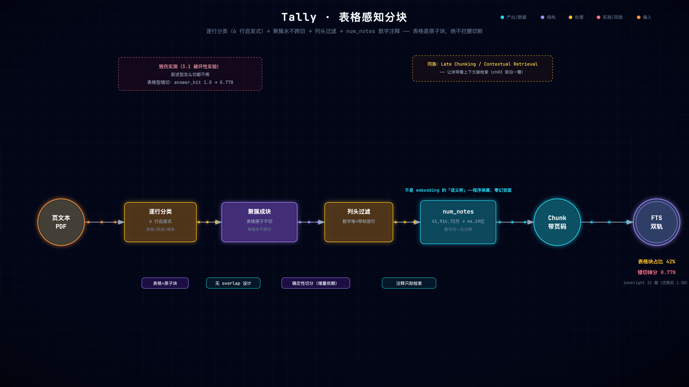

# 第 3 章 文本切分：语义单元与表格感知分块

> 状态：v0.3 · 所属：第一部分 语料工程：从文档到可检索的证据 · 前置：第 2 章

!!! info "本章导读"

    学完本章你能：①对任意语料回答「它的语义单元是什么」——切分
    选型的第一问；②说出六种业界切分方法各自的软肋；③读懂 Tally 的
    逐行表格启发式与列头过滤；④解释数字归一化注释为什么不是
    embedding；⑤亲测「关掉表格感知」的两种语料形态差异。

## 3.1 失败先行：亲手毁掉一份财报

全书最疼的实验（2026-10-22 实测数字）。把 `tally/ingest.py` 的
`_is_table_line` 改成第一行 `return False`，重建库跑评测：

```bash
bash experiments/ch03-table-collapse.sh
# 脚本自动完成：改代码 → 重建 /tmp 库 → 双语料摄取 → eval → 还原
```

| 语料 | 块数 | answer_hit | retrieval@3 |
|---|---|---|---|
| samples（叙述型预告）基线 → 关闭 | 310 → 76 | 1.0 → **1.0** | 1.0 |
| innolight（表格重）基线 → 关闭 | 7,873+ → 4,075 | 1.0 → **0.778** | 1.0 → 0.963 |

两个结果都是课：

- **叙述型语料根本不疼**——业绩预告的事实住在句子里（「预计净利润
  36,000 万元至 42,000 万元」），关掉表格感知只是块变少（310→76），
  指标纹丝不动；
- **表格重语料当场崩**——年报/季报的「主要会计数据」表被撕碎，
  31 题掉 7 题（0.778），门槛 `--min-hit 1.0` 非零退出。

**毁伤面取决于语料形态**——这个实测结论比「切分很重要」的空话
诚实得多，也更有用：它告诉你**先做语料形态分析，再选切分器**。

## 3.2 业界视角：切分方法全景

!!! note "背景速览"

    切分（chunking）是 RAG 里被讨论最多的低层决策，业界谱系六代：

    | 方法 | 代表实现 | 思路 | 软肋 |
    |---|---|---|---|
    | 固定长度 | 朴素 token 切分 | 简单、可并行 | 拦腰斩断语义单元 |
    | 递归分隔 | [LangChain RecursiveCharacterTextSplitter](https://python.langchain.com/docs/how_to/recursive_text_splitter/) | 段落→句子→字符逐级回退 | 仍不识表格结构 |
    | 句子/语义窗口 | [LlamaIndex SentenceSplitter](https://docs.llamaindex.ai)、语义分块（Kamradt） | 按句/按嵌入相似度断点 | 表格行≠句子；嵌入断点贵 |
    | 版面感知 | [Unstructured chunk_by_title](https://unstructured.io) | 按标题/布局聚块 | 依赖上游版面分析 |
    | 命题级 | Dense X Retrieval（命题=原子事实句） | 一句一命题 | 块数爆炸、丢上下文 |
    | 迟到切分 | Late Chunking（[arXiv:2409.04701](https://arxiv.org/abs/2409.04701)） | 整文嵌入后按块池化 | 需长上下文嵌入模型 |

    经验参数：主流实践落在 **256–1024 token、overlap 10–20%**——但
    这些数字全部来自**叙事文本**的直觉（overlap 是为了缓解斩断，
    本身就是「切错了再补救」的设计）。**选切分方法的第一问永远是：
    这个语料的语义单元是什么？**财报的语义单元是「表格行」（标签+
    数值+同比），不是 N 个字符——所以 Tally 的答案是表格感知聚簇。

## 3.3 为什么：毁证据的三种死法

```
营业收入 520,053,589.94  345,593,109.95  50.48%
```

固定 512 字符边界切这一行的三种死法：

1. **指标与数值分家**：切点落在「营业收入」和数字之间——检索
   「营业收入」命中一个没有数字的块，检索数字命中一个没有标签的块，
   谁也组装不出事实；
2. **同行三数分离**：本期/上年/同比被分进两块——「营收 5.2 亿」和
   「同比增长 50.48%」从此是两个孤儿；
3. **切在千分位逗号后**：`520,` 和 `053,589.94`——两个块各自都是
   不可读的碎片，连人眼都无法还原。

Tally 全库实测：**42.1% 的块是完整表格块**——毁掉它们，检索层再好
也答不对（3.1 的 0.778 就是代价）。



*表格感知分块管线（[▶ 动画版](anim/chunking.html)）：逐行分类 → 聚簇永不跨切 → 列头过滤 → num_notes——右下是毁伤实测的账。*

## 3.4 决策：逐行分类聚簇（6 行启发式）

三个备选的取舍：①固定长度（毁表格，3.1 已证）；②语义模型切分
（贵、慢、不可控——切分是离线高频操作，每天跑 `--watch` 的管线
不适合挂模型）；③**逐行分类聚簇**（本文）。

核心是表格行判定——数字密集、无句末标点、短行：

```python
# tally/ingest.py: _is_table_line（判定骨架）
def _is_table_line(line: str) -> bool:
    s = line.strip()
    if not s or len(s) > 120:            # 太长不是表格行（PDF 行粘连）
        return False
    if _SENT_END.search(s):              # 有句末标点 → 叙述句
        return False
    digits = len(_TABLE_HINT.findall(s))
    return digits >= max(2, len(s) * 0.25) or ("  " in s and digits >= 2)
```

配套三件：

- **连续表格行聚成原子块，永不跨切**（`chunk_page` 的聚簇循环）；
- **`keep_block` 过滤纯列头块**：「项目 2026年半年度 2025年半年度」
  这种无数字的列头对检索是噪声，还会凭「公司名+期间词」的完美
  词面挤掉真值块（页眉块的词面永远完美——第 7 章 front_key_table
  的引子）；
- **正文按段落边界切 ~420 字**：正文块的语义单元是段落，420 是
  实测平衡点（太大稀释检索、太小丢上下文；DESIGN-v0.6 §5 有切分
  审计：真实 420 字溢出切割占正文块 30%——数字是权衡不是拍脑袋）。

## 3.5 数字归一化注释：不是 embedding 的「语义桥」

一个容易被忽略的细节。用户问「欧科亿预计净利润多少亿」，原文写
「41,914.72 万元」——**词面零重叠**。Tally 在摄取时给每块附程序
换算的注释（`normalize_numbers`）：

```python
_NUM_RE = re.compile(r"([1-9]\d{0,2}(?:,\d{3})+(?:\.\d+)?)\s*(亿元|万元|元)")
# 41,914.72 万元 → ≈4.19亿
# 644,051,473.82 元 → ≈6.44亿
# 1,234.56 亿元 → ≈1,234.56亿（亿元原样）
```

设计细节三则：①只匹配**带千分位**的大数（`[1-9]\d{0,2}(,\d{3})+`）
——避免把「2026 年」这类年份误换算；②每块至多 6 条（防大表刷屏）；
③它是**换算出来的字符串，不是向量**——不进 FTS 索引，在下游打分
加权（answer.py 的 1.4×/0.2 权重）与 LLM 证据里出现。**各司其职：
检索靠词面命中、量级靠注释衔接、语义靠查询扩展（第 5 章）**——
三层各干各的，谁也不越界。

## 3.6 已知边界：这门课不装完美

超长表格（>840 字）切块后**后块丢表头**——列头在第一块，后几块是
无列名的裸数字行，检索命中后模型读不懂「第三列是什么」。这个坑
Tally 知道、没修、写进了边界账本（第 13 章正式讨论）。教学点：
**工程教程最值钱的部分是「知道哪里没修好」以及为什么暂时不修**
（修它需要表头复制进每块——又会引入重复块污染检索的副作用，
权衡后挂账）。

## 3.7 动手实验（还原后）

```bash
# 表格块的形态：chunk_id 连号（p3#4、p3#5…）= 同一表格连续行聚簇
sqlite3 tally.db "SELECT chunk_id, is_table, substr(text,1,40)
  FROM chunks WHERE doc_id='海伦哲_2026Q1' AND is_table=1 LIMIT 5"

# 数字注释在场：问「多少亿」的量级问法
python -m tally.cli ask "欧科亿 2026 年半年度预计净利润多少亿元"
# 答案里的「约 3.60 亿元至 4.20 亿元」正是归一化注释的下游呈现

# 自测语料形态（决定你要不要表格感知）
sqlite3 tally.db "SELECT doc_id,
  ROUND(100.0*SUM(is_table)/COUNT(*),1) AS tbl_pct FROM chunks GROUP BY doc_id"
```

!!! note "前沿一瞥：Contextual Retrieval——给块补上下文的业界正名"

    「块脱离上下文就检索不准」这个痛点，Anthropic 2024 年给了
    正式解法与实测：索引前给每块 prepend 一段 LLM 生成的上下文
    （[Contextual Retrieval](
    https://www.anthropic.com/research/contextual-retrieval)），
    top-20 检索失败率 **5.7% → 3.7%**（仅上下文嵌入）→ **2.9%**
    （+上下文 BM25）→ **1.9%**（+rerank）。

    Tally 的 `num_notes` 是它的**确定性轻量变体**：不生成上下文，
    只在块尾附加程序换算的数字注释（`41,914.72 万元` → `≈4.19亿`）
    ——零 LLM 成本、零幻觉面，只补「量纲鸿沟」这一种最痛的缺。
    `stitch_adjacent`（ch07）则是同页标签/数字块的重接。取舍表：

    | 方案 | 补什么 | 成本 | 幻觉面 |
    |---|---|---|---|
    | Contextual Retrieval | 任意缺失上下文 | 每块一次 LLM 调用 | 生成的上下文可能错 |
    | num_notes（Tally） | 量纲/单位鸿沟 | 零（程序换算） | 零 |

    同族还有延伸阅读里的 Late Chunking（先编码全文再切）——共同
    思想：**让块带着上下文被检索**。

## 3.8 小结

- 切分选型第一问：**语料的语义单元是什么**（财报=表格行）；
- 六种业界方法各有所长，共同的坑是把叙事直觉套在表格文档上；
- 表格感知 = 6 行启发式 + 聚簇永不跨切 + 列头过滤，零模型零成本；
- 数字归一化注释是程序换算的语义桥——不是 embedding，不进索引；
- 毁伤面实测：叙述型不疼、表格型崩（0.778）——先分析语料再选器。

## 常见误区

**误区一：「chunk 越小检索越准」。**小块确实提升检索精度（信噪比
高），但摧毁上下文：一个孤立的数字块没有标签就不可读，抽取式
选不出、LLM 读不懂。切分是在**检索精度**与**上下文完整性**之间
找平衡，方向由语料的语义单元决定，不是越小越好。

**误区二：「overlap 是万能解药」。**overlap 缓解斩断，但它的本质
是**复制内容**——同一句出现在两个块里，检索时互相竞争、引用时
重复计数。它是「切错了再补救」的设计；表格感知这类「按语义单元
切」的方案根本不需要 overlap。

**误区三：「语义切分（embedding 断点）总是更好」。**语义切分对
叙事文本确实更优，但：①成本高一个量级（每句要嵌入）；②对表格
无效（表格行的「语义相似度」测不出列结构）；③断点不稳定——
同一文档两次切分可能不同，破坏增量幂等。**先问语料形态，再选
切分器**（3.1 的实测就是教训：叙述型怎么切都不疼，表格型错切
掉 22 个点）。

## 延伸阅读

- LangChain 文本切分器：<https://python.langchain.com/docs/how_to/recursive_text_splitter/>
- LlamaIndex 分块：<https://docs.llamaindex.ai>
- Late Chunking：<https://arxiv.org/abs/2409.04701>
- Unstructured, *Chunking for RAG*（structure-aware 实践）：<https://unstructured.io/blog/chunking-for-rag-best-practices>
- tally `docs/DESIGN-v0.6.md` §5（切分审计：420 字溢出切割 30% 实测）
