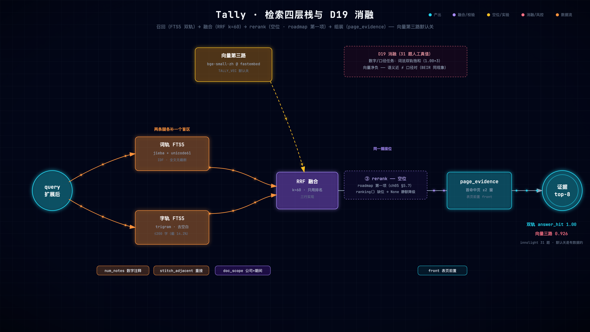

# 第 5 章 检索策略：双轨词法、RRF 融合与 embedding 消融

> 状态：v0.3 · 所属：第一部分 语料工程：从文档到可检索的证据 · 前置：第 4 章
> ★ 本书最反共识的一章：词法饱和时，向量是净负贡献——用消融实验说话

!!! info "本章导读"

    学完本章你能：①直观解释 BM25 与 RRF（能手算一个融合例子）；
    ②说清双轨各自兜底的失败路径与查询构造；③完整复述 D19 消融的
    实验设计与结论，并知道什么时候该开向量；④读懂 tally/fts.py
    全文；⑤给自己的项目设计一次消融。

## 5.1 失败先行：字轨整段短语的坑

v0.4 初版把字轨查询写成「空格整段短语」：

```
查询：预计净利润多少
字轨 MATCH: "预计净利润多少"        ← 作为连续 trigram 短语
原文：…预计 2026 年半年度净利润为…  ← 中间隔着「2026年半年度」
```

子串**永远不存在**——答案块在字轨零命中，RRF 融合后只剩词轨一条
腿，排序崩塌。修复写进了 docstring：

```python
# tally/fts.py: char_expr
def char_expr(query: str) -> str:
    """字级轨道：≥2 字词 token 做 trigram 短语 OR（子串命中，跨词边界）。
    不能用空格整段短语——「预计净利润多少」在原文里被年份隔开，
    整段短语永远不命中。"""
    segs = [char_text(t) for t in word_tokens(query)]
    segs = [s for s in segs if len(s) >= 2]
    return " OR ".join(_quote(s) for s in dict.fromkeys(segs))
```

**通用教训：换检索引擎时，查询语义的等价性要逐轨道验证，不能只看
接口签名。**这是 D2 决策记录的原文精神。

## 5.2 业界视角：检索模型谱系

!!! note "背景速览"

    RAG 检索三大流派（决定你在第 4 章要什么存储）：

    | 流派 | 代表 | 原理直觉 | 强项 | 弱项 |
    |---|---|---|---|---|
    | 稀疏/词法 | **BM25**（FTS5/ES 内置）、SPLADE（[arXiv:2107.05720](https://arxiv.org/abs/2107.05720)） | 罕见词更有区分度（IDF） | 精确词面、数字、专名 | 词面鸿沟 |
    | 稠密/语义 | BGE 系列、OpenAI embeddings | 语义相近 → 向量相近 | 同义改写、跨语言 | 数字/口径混淆 |
    | 混合 + 融合 | BM25 + dense → **RRF** | 排名互补 | 互补 | 两套索引成本 |

    **BM25 一句话直觉**：一个词在全部文档里越罕见（IDF 高）、在
    当前文档出现越多（TF 饱和递减）、文档越短（长度归一）——它对
    这篇文档的得分越高。财报里的精确数字（如 1,568,385,287）是
    IDF 极高的「罕见词」——这正是词法检索在数字任务上难以被向量
    击败的原因。

    **RRF（Reciprocal Rank Fusion）**，Cormack et al., SIGIR'09
    （[ACM 论文](https://dl.acm.org/doi/10.1145/1571941.1572114)·
    [作者站 PDF](https://cormack.uwaterloo.ca/cormacksigir09-rrf.pdf)）：

    $$score(d) = \sum_{r \in R} \frac{1}{k + rank_r(d)},\quad k=60$$

    **手算一个例子**（k=60，三轨）：

    | chunk | 词轨排名 | 字轨排名 | 向量排名 | RRF 得分 |
    |---|---|---|---|---|
    | A（真值块）| 1 | 3 | 9 | 1/61+1/63+1/69 = **0.0472** |
    | B（页眉块）| 2 | 1 | — | 1/62+1/61 = **0.0325** |
    | C（语义近块）| — | — | 1 | 1/61 = **0.0164** |

    A 两轨都靠前，融合登顶；B 词面完美但只有两轨；C 向量第一但
    孤掌难鸣。**RRF 只用排名不用分数**——不需要跨系统的分数可比性
    （BM25 分和 cosine 分根本不可比），实现三行，这是它成为业界
    默认（ES/Weaviate/LangChain 混合检索内置）的原因。

## 5.3 双轨设计：两条腿各补一个盲区

中文词法检索的两条失败路径，恰好各由一轨兜底：

| 失败路径 | 例子 | 兜底的轨道 |
|---|---|---|
| 分词错误（术语被切碎）|「归属于母公司所有者权益」被切飞 | **字轨**（trigram 子串命中，对分词免疫）|
| 词面鸿沟（问法≠写法）|「营收」vs「营业收入」 | **词轨 + 查询扩展**（expand_query 同义映射）|

词轨的查询构造还有一处小而关键的清洗（`word_expr`）：

```python
def word_expr(query: str) -> str:
    """查询侧清洗：丢单字中文 token（的/年/亿等虚词与切割碎片，
    idf 极低却稀释 MATCH；数字与英文单字保留）。"""
    toks = [t for t in dict.fromkeys(word_tokens(query))
            if not (len(t) == 1 and "一" <= t <= "鿿")]
    return " OR ".join(_quote(t) for t in toks)
```

「的/年/亿」这类单字 token 几乎每篇文档都有（IDF≈0），进 MATCH
只会稀释排序。融合侧不调权重——`for ranking in rankings: for rank,
row in enumerate(...): rrf[cid] += 1/(60+rank)`，三轨同律，
排名互补是免费的鲁棒性。

工程细节一处：两轨各取 top k×3 只拿**轻列**（chunk_id+rowid），
正文延后到融合后一次性取 top-k——避免两轨各拖 24 条长文本。
（`fts.py: one_track` 的两阶段取数。）



*检索四层栈（[▶ 动画版](anim/retrieval-stack.html)）：召回（FTS5 双轨）→ 融合（RRF k=60）→ rerank 空位 → 组装（page_evidence）；向量第三路默认关——D19 的数字就在右下角。*

## 5.4 重头戏：embedding 消融（D19）

教科书说 RAG 要上向量。Tally 完整实现了向量第三路（bge-small-zh
@ fastembed ONNX，512 维，同律 RRF），然后在 31 题人工核对真值集
上消融：

| 数据集 | 双轨 answer_hit | 向量三路 answer_hit |
|---|---|---|
| default 10 | **1.00** | 0.875 |
| agent 8 | **1.00** | 0.833 |
| innolight 31 | **1.00** | 0.926 |

**读数三步**：

1. 三连 1.00 = 词法双轨在此任务上**饱和**——天花板已到，加第三路
   只可能持平或变差（数学上没有上升空间）；
2. 掉分机制：bge 的语义泛化把「同文档里语义相近但**口径不同**」的
   块拉近，挤掉精确命中——被害题恰好全是为口径守卫修过的类型
   （年报营收、同比增长、归因句）。**在数字与口径的精确匹配任务上，
   语义相近恰恰是风险而非收益**；
3. 决策：**默认关闭，`TALLY_VEC=on` 显式 opt-in**。「用数据决定
   关掉一个 feature」——比「又接了一个向量库」的含金量高得多。

!!! tip "什么时候该开向量"

    D19 的结论**不是**「向量没用」，是「在词法饱和 + 口径敏感的
    任务上没用」。这些场景向量仍是正解：语义泛化问法（「为什么/
    怎么样」）、词面零重叠语料（口语问答社区）、跨语言。可迁移的
    是方法学：**先建真值集，再跑消融，让数据替你选**——本章实验
    就是让你亲手走一遍这个流程。

## 5.5 消融方法学（可以抄走的五条）

1. **固定对照组**：heuristic 模式（零 LLM 方差）——对照组自身会
   抖动的实验没有结论力；
2. **真值纪律**：关键词人工核对到分位（与年报分季度表交叉验证）；
3. **单变量**：一次只动向量轨开关；
4. **被害题分析**：不只看总分——被害的都是哪类题？为什么？
   （这步把「掉分」变成「机制认知」）；
5. **结论入档**：写成决策记录（D19），默认行为跟着结论走——
   半年后有人想「顺手打开」时，先撞见 docstring 里的数字。

## 5.6 动手：读通向量路的接入代码（讲解型）

本节的「实验」是**读代码**——嵌入全库在作者机上内存开销大（bge
模型加载 ~18s + 全库前向），权威数字以 D19 实测存档为准（5.4 的
表）。有闲置机器的读者可以跑 `experiments/ch05-embedding-ablation.sh`
复现，跑不了也不损失任何理解——三段代码就是全部故事。

**第一段：开关的两问分离**（`tally/embed.py`）——「装没装」和
「开没开」是两个独立的问题，混在一起就会出现「没装依赖的机器上
查询报错」：

```python
def installed() -> bool:
    """可选依赖是否在（CLI embed 建索引只看这个）。"""
    try:
        import fastembed  # noqa: F401
        return True
    except ImportError:
        return False

def enabled() -> bool:
    """查询路是否启用：显式 TALLY_VEC=on（opt-in）且依赖在。
    默认关闭是消融定的……向量第三路把语义相近但口径不同的块拉近、
    挤掉精确命中——0.875/0.833/0.926。"""
    return os.environ.get("TALLY_VEC") == "on" and installed()
```

注意 `enabled` 的 docstring 把**决策依据（消融数字）直接写进了
代码**——半年后有人想「顺手打开向量」时，会先撞见这段数字。

**第二段：查询侧排名**——向量路不建新引擎，cosine 算完只交出一个
`chunk_id` 降序列表，与词法两轨同构：

```python
def ranking(con, docs, query, doc_filter, doc_scope, limit=24):
    """查询侧：embed query → doc 过滤后取库内向量 → cosine top。
    返回 chunk_id 相似度降序列表（三路 RRF 第三排名）；任何前置
    条件不满足返回 None（调用方退回双轨）。"""
    ...
    mat = np.frombuffer(b"".join(r[1] for r in rows),
                        dtype=np.float32).reshape(len(rows), DIM)
    norms = (mat * mat).sum(axis=1) ** 0.5
    sims = (mat / norms[:, None]) @ _query_vec(query)
    order = sorted(range(len(rows)), key=lambda i: -sims[i])[:limit]
    return [rows[i][0] for i in order]
```

两个工程细节值得抄：①向量以 `float32 blob` 存在 SQLite `vecs` 表
（512 维 ≈ 2KB/块，万级块 ~16MB——不引入独立向量库的容量代价）；
②**返回 None 即静默退回双轨**——CI 没装 fastembed 照常全绿，
可选功能不能变成部署门槛。

**第三段：融合同律**——回看 5.3 的 RRF 循环：`rankings` 列表里
词轨、字轨、向量轨**地位完全平等**。这就是「融合协议不变」的含义：
将来换 sqlite-vec/faiss，只动 `ranking` 的实现，一行融合代码不改。

## 5.7 前沿拓展：rerank——检索栈的下一层

本章回答了「要不要向量」（D19：默认不要）。但检索栈还有一层
Tally 没占——**rerank（重排）**。它是 Tally roadmap 的第一项，
这一节把它讲透：坐标、原理、风险，和一份可以抄走的实验设计。

**先给 D19 盖章**：[BEIR](https://arxiv.org/abs/2104.08663)
（NeurIPS 2021，18 个异构数据集零样本评测）的著名结论——
**BM25 是稳健基线**，击败绝大多数 MS MARCO 上训练的稠密检索器，
且恰是在罕见词/精确匹配/域外任务上（SciFact/BioASQ/ArguAna）。
D19 不是孤例，是这个结论在「财报数字+口径」单语料上的复现。
而 BEIR 系研究同时指出词法之后的增益来源：**精排**。

**cross-encoder 为什么准、为什么只能排小集合**：

| | 双塔（bi-encoder） | 交叉编码器（cross-encoder） |
|---|---|---|
| 打分方式 | query/doc 分别编码，算 cosine | query+doc 拼接进 transformer，attention 全交互 |
| 精度 | 中（两文本从未「见过面」） | 高一个量级（逐 token 交互） |
| 成本 | 可预计算 + ANN，毫秒级 | 每对一个前向，只能排 top 20–100 |
| 角色 | 召回（第一层） | 精排（最后一层） |

业界标准四层栈：**召回（便宜、多路）→ 融合（RRF）→ rerank
（贵、准）→ 生成**。代表模型：Cohere Rerank（商业）、
bge-reranker-v2-m3（开源，FlagEmbedding）。Contextual Retrieval
的实测数字也给 rerank 的位置背书：检索失败率 5.7% → 2.9%
（上下文 BM25）→ **1.9%（+rerank）**——最后一刀是 rerank 砍的。

**风险预告（D19 的教训直接适用）**：reranker 也是语义模型——
bge-reranker 与 bge-embedding 同源同偏见。「语义近、口径错」的
块在 embedding 那里被拉近（D19 掉分机制），在 cross-encoder 这里
**同样可能被抬名次**。「加 rerank 必涨分」不成立，必须消融——
这是它放在「前沿拓展」而不是正文的原因：**没实测的层不进正文**。

**代码对照**：`fts.py: ranking()` 已经留好座位——向量路缺依赖/
未嵌入时返回 None、静默降级双轨；rerank 用同一个模式接：RRF
融合后取 top-N 过 cross-encoder，reranker 缺位返回 None 降级回
RRF 序，融合与上层零改动。对照表：

| 业界四层 | Tally 现状 |
|---|---|
| 召回 | FTS5 双轨 ✓ |
| 融合 | RRF（k=60）✓ |
| 精排 | **（空位，ranking() 插拔口）** |
| 生成前置 | `front_key_table` ✓（其实是一段**确定性精排**——把关键表页顶上去） |

**若在 Tally 上继续做**（roadmap 第一项的实验设计，量尺全现成）：

1. 接入点：`ranking()` 融合后、`page_evidence` 之前；
2. 对照组：同一候选池（RRF top-24）RRF 序 vs rerank 序；
3. 量尺：`chunk_p@8` / `answer_hit` / 真值三集，**口径题
   （innolight 31）单独看**——reranker 语义偏见的暴露面就在这；
4. 判定：answer_hit 不降且 chunk_p@8 上升才收；两种结局都有
   价值：涨 → 收进默认栈；不涨/掉 → 又一份 D19 式「用数据关掉
   一个 feature」的存档。

## 5.8 小结

- BM25 的 IDF 直觉解释了词法在数字任务上的韧性；
- RRF 只用排名、三行实现、手算即懂——融合的默认答案；
- 双轨各补一个盲区：字轨免疫分词错误，词轨+扩展接词面鸿沟；
- D19：饱和点之上加路只会变差；口径敏感任务上语义相近=风险；
- 方法学五条：固定对照/真值纪律/单变量/被害题分析/结论入档。


## 常见误区

**误区一：「向量检索总比词法好」。**向量的强项是语义泛化
（同义改写、跨语言）；它的弱项恰恰是精确匹配——数字、编号、
专名、**口径**。BGE 把「归母净利润」和「扣非净利润」嵌到几乎
同一个位置，这正是 D19 消融里向量净负的机制。任务偏精确匹配
时，词法是地板不是过渡方案。

**误区二：「混合检索一定提升」。**混合的前提是两路各有不可替代
的命中面。一路已经饱和（D19 的 1.00×3）时，加另一路只会引入
噪声挤占精确命中——**饱和点之上没有免费午餐**。先测单路，再测
混合，让数据说话。

**误区三：「RRF 的 k 需要精调」。**k=60 来自原论文，作用只是
把排名映射到温和的权重区间（第 1 名 1/61，第 10 名 1/70）。
它对具体值不敏感（60 换 80 结果几乎不变）——**别把精力花在
不敏感的参数上**，花在两路各自的查询构造上（5.1 的整段短语坑
就是查询构造的锅）。

## 工程检查清单
## 工程检查清单

- [ ] 你的任务偏精确匹配还是语义泛化？有消融数据吗？
- [ ] 每一路检索的查询构造，逐轨道验证过等价性吗？
- [ ] 混合的两路各自贡献了哪些独占命中？（被害题分析）
- [ ] 换 embedding 模型时旧向量作废了吗？（维度与语义空间都变了）
- [ ] 可选检索路缺依赖时，系统是降级还是崩溃？
- [ ] 检索层的指标（P@k/R@k）与答案层指标（hit）分开统计吗？

## 延伸阅读

- RRF 原论文（SIGIR'09）：<https://dl.acm.org/doi/10.1145/1571941.1572114>
- SPLADE：<https://arxiv.org/abs/2107.05720> · ColBERT：<https://arxiv.org/abs/2004.12832>
- HyDE（假设文档嵌入）：<https://arxiv.org/abs/2212.10496>
- BEIR（BM25 稳健基线，D19 业界同现象）：<https://arxiv.org/abs/2104.08663>
- Cohere Rerank：<https://docs.cohere.com/docs/rerank-overview> · bge-reranker：<https://github.com/FlagOpen/FlagEmbedding>
- tally `docs/DESIGN-v0.6.md` §8.3（D19 消融原始数据）
