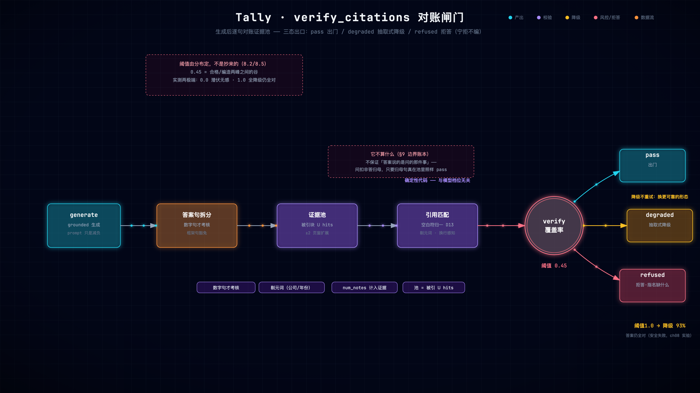
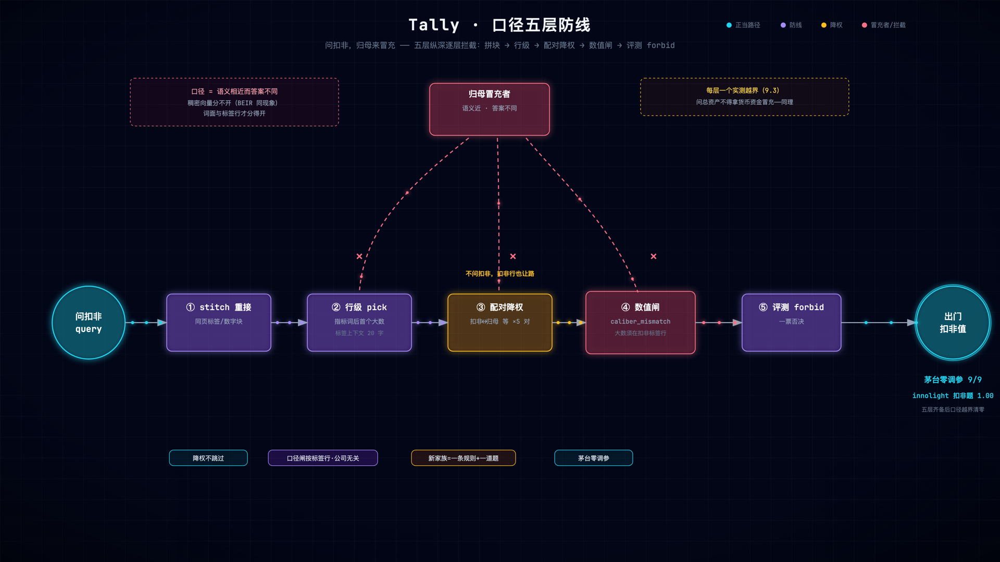

# 第 8 章 输出验证：覆盖率闸门、降级与拒答

> 状态：v0.3 · 所属：第二部分 生成与验证：让答案有据可查 · 前置：第 7 章
> ★ 全书中心思想落地的一章——答案凭什么出门

!!! info "本章导读"

    学完本章你能：①解释三态出口（pass/degraded/refused）各自的
    语义与用户所见；②手推一次覆盖率的计算（哪些句计入、哪些 token
    剔除）；③复述阈值两极端的实测结果及其反直觉解读；④说清
    「降级不重试」的设计理由；⑤界定 verify 管什么、不管什么。

## 8.1 失败先行：两种灾难形态（实测）

把 `tally/answer.py` 的 `COVERAGE_THRESHOLD` 调成两个极端，各跑一遍
innolight 31 题（2026-10-22 实测，heuristic 模式）：

| 阈值 | citation_coverage | answer_hit | 解读 |
|---|---|---|---|
| 0.45（基线）| 1.000 | 1.0 | 正常 |
| **0.0**（什么都放行）| 1.000 | 1.0 | **与基线完全相同！** |
| **1.0**（近乎全拒）| **0.074** | **1.0** | 93% 答案降级，但答案仍然全对 |

两个反直觉结果都是课：

- **阈值 0.0 在 heuristic 下毫无症状**——抽取式答案本来就 grounded，
  闸门形同虚设也不出事。危险是**潜伏的**：LLM 生成路径上，一个
  编造但挂了引用的答案会畅通无阻（第 9 章口径灾难全回来）。
  **启示：闸门的价值要在它防的那条路径上测**——heuristic 基线
  全绿 ≠ 闸门可有可无。这句线在 v0.7.1 的远端实测里得到了实弹
  证明：glm-5.3 生成的两道 compare 题正是被 0.45 阈值打成 degraded
  降级抽取式、答案仍然全对（DESIGN-v0.7 §8.3）。
- **阈值 1.0 时 coverage 崩到 0.074 但 answer_hit 仍是 1.0**——
  93% 的答案被降级成抽取式，而抽取式每句带引用、数字全来自原文，
  所以「丑但全对」。**降级 = 安全失败**的活教材：闸门收紧惩罚的
  是形态（pass 率），不是正确性。

0.45 本身不是玄学，是实测分布：合格答案的覆盖率聚在 0.5–0.95，
编造答案聚在 0.2 以下——0.45 在两峰之间的谷。**阈值是工程：由
数据分布决定，由回归测试锁定。**

## 8.2 业界视角：可验证 RAG 的三条路线

!!! note "背景速览"

    「怎么保证生成不编」的三条代表路线：

    | 路线 | 代表 | 机制 | 代价 |
    |---|---|---|---|
    | 自反思 | [Self-RAG](https://arxiv.org/abs/2310.11511) | 模型生成反思 token 自评检索/生成质量 | 要微调；**自己批自己的卷子** |
    | 纠错环 | [CRAG](https://arxiv.org/abs/2401.15884) | 检索评估器打分，差则重检/上网补 | 开放世界假设 |
    | **事后归因闸** | Tally / AIS 工程化 | 生成后逐句对账证据池，不过则降级/拒答 | 需要独立验证器（本文）|

    Tally 选第三条的深层理由：**验证器不能和生成器是同一个大脑**。
    Self-RAG 让模型自评，等价于让学生批自己的卷子——模型犯错的
    相关性会让自评跟着错。事后闸用确定性代码算覆盖率，与模型
    能力无关：0.8b 也好、100b 也好、换了厂商也好，**闸门同一把
    尺子**。而 CRAG 的「上网补」违反封闭世界契约（第 1 章）——
    检索不到正确口径时，降级到原文比补一个语义相近的网页安全。

    评测侧对应物：[RAGAS](https://docs.ragas.io) 的 faithfulness 把
    答案拆成 claims 逐条问 NLI 模型「证据是否蕴含」——语义级但
    依赖裁判模型（有方差）；Tally 的 `citation_coverage` 是 token
    重叠——可计算、零依赖、但更粗。**知道自己的指标在谱系里的
    位置，比指标的绝对值重要**（所以它从 faithfulness 改名，
    见 8.4）。



*对账闸门全景（[▶ 动画版](anim/verify-gate.html)）：generate 的答案逐句拆分 → 对账证据池（被引 ∪ hits）→ 覆盖率裁决 → pass / degraded / refused 三态出口。*

## 8.3 三态出口：全图唯一闸门

verify_citations 是**全图唯一出口**——heuristic 检索、Agent 自主
检索、记忆命中、差分派生，任何路径都必须过它：

```python
# tally/graph.py: verify_citations（骨架）
    pool = list(state.get("evidence") or []) + list(state.get("hits", []))
    verdict, cov = ans.verify(a, pool)          # 引用覆盖率对账
    # 派生值出口对账：登记的派生数按证据池重算，操作数必须真在场
    if verdict == "pass" and not _derived_ok(state.get("derived"), pool):
        verdict = "degraded"
    if verdict == "pass":
        ...
    elif verdict == "refused":
        return refuse(...)                       # 无据 → 拒
    else:
        body, cited = ans.extractive_answer(state, state["hits"])
        # degraded：降级为抽取式（永远有真凭实据），不是打回重写
```

| 出口 | 含义 | 用户看到 | 什么时候发生 |
|---|---|---|---|
| pass | 覆盖率 ≥ 0.45 | LLM 组织的完整回答 | 生成对得上账 |
| degraded | 对不上账 | **证据池原句**（丑但真）| 引用漂移/编造/派生值对不上 |
| refused | 无证据可用 | 拒答 + 现有期间提示 | 检索空手/期间外/域外 |

**degraded 的关键设计：降级不是重试。**为什么不把答案打回模型
改写？①小模型会把同一件事编得更圆（重试=二次编造机会）；②错在
检索/证据层时，重写生成治不了根；③抽取式答案结构上不可能编造
——每句带引用、每个数字来自原文。**可靠性由结构保证，不靠模型
自觉**——这句话是全书的题眼。

另一个容易忽略的点：证据池 = `evidence ∪ hits`（页窗口自动扩展
到整页）——extractive 从 hits[:8] 抽句，第 5–8 名块支撑的句子若
不计入池，自家答案会被自家 verify 误判（实测教训）。**验证器和
被验物必须看同一个世界。**

## 8.4 覆盖率怎么算（以及它不算什么）

`citation_coverage` 的口径（`tally/answer.py`，docstring 值得全文
读），拿一句话走一遍：

```
答案句：「扣非净利润 1,568,385,287.19 元 [中际旭创_2025Q1 第3页]」
证据池含块：「归属于上市公司股东的扣除非经常性损益的净利润（元）
            1,568,385,287.19 990,216,569.13 58.39%」
→ 数字句（含数字）✓ 计入考核
→ 剔除元词后 token 重叠：{扣非,净利润,1,568,385,287.19} 全命中
→ 该句覆盖率 1.0
```

四条口径规则：

1. **只考核数字句**——框架句（「根据提供的证据…」）不要求重叠，
   否则 LLM 的行文结构会被误杀；
2. **两侧剔除元词**（公司名/年份/期间）——「欧科亿 2026 年」不
   构成证据相关性，数字与指标词才是（与 extractive 打分同口径）；
3. **数字归一化注释计入证据**——LLM 常答「6.44亿」而非原文全数字
   （第 3 章的注释在这里接上）；
4. **证据池=被引块∪hits**（页窗口扩展，见 8.3）。

**它不算什么**（诚实边界，第 13 章展开）：不保证「答案说的是问的
那件事」——问扣非答归母，只要归母句真在证据池，verify 照样 pass。
这道缝隙由第 9 章口径守卫补，补不完的写进边界账本。指标名也由此
改过一次：`faithfulness → citation_coverage`——它测引用对账，
不测语义忠实（RAGAS 用户一眼能拆穿的牛不能吹）。

## 8.5 动手实验

```bash
bash experiments/ch08-threshold-extremes.sh
# 自动跑 0.45 / 0.0 / 1.0 三档，输出三行指标——对照 8.1 的表
# （脚本改代码后自动还原；也可以手动：
#  sed -i '' 's/COVERAGE_THRESHOLD = 0.45/COVERAGE_THRESHOLD = 0.0/' tally/answer.py）
```

## 8.6 前沿拓展：faithfulness 的度量谱系与 judge 的脾气

本章的闸门给了「有出处」的硬保证；这一节把它放回业界度量谱系，
看清三个邻居长什么样、Tally 为什么这样选。

**RAGAS 四指标 vs Tally 七指标**（[RAGAS, arXiv:2309.15217](
https://arxiv.org/abs/2309.15217)——无参考评估的代表，不需要
人工真值）：

| 问题 | RAGAS | Tally |
|---|---|---|
| 答案被证据支撑吗 | faithfulness：答案拆 claims，逐条 NLI 蕴含判定（裁判模型） | `citation_coverage`：数字句 token 重叠（确定性代码） |
| 检索捞到对的了吗 | context precision / recall（判 relevant 块） | `chunk P/R@8`（真值承载块 = doc∈期望 ∧ 含关键词） |
| 答案回应问题了吗 | answer relevancy（反向生成问题算相似度） | `answer_hit` + `forbid` 一票否决（人工核对关键词） |
| 该拒的拒了吗 | ——（不测） | `refusal`（陷阱题一等指标） |

取舍：无参考便宜、可大规模跑，但**裁判模型自带方差**；领域
真值贵（人工对库核对），但能抓住「扣非句真在池里、问的却是
归母」——NLI 裁判看不出这个缝隙（8.4 的「不算什么」在 RAGAS
同样存在）。Tally 的选择不是「更原始」，是**换掉了裁判**：
确定性代码替代 NLI 模型——方差归零，代价是量尺更粗。

**SQuAD 2.0：拒答的学统**（[arXiv:1806.03822](
https://arxiv.org/abs/1806.03822)，ACL 2018）：阅读理解界用
5 万+ 人工构造的「看似可答、实则不可答」对抗题立了规矩——
系统必须**弃权**而不是编一个像样的答案。陷阱题设计（未来期间/
语料外/域外）与 refusal 一等指标，是这条学统在 RAG 里的延续；
「拒答是能力」（ch01 误区四）的学术出处。

**LLM-as-judge 的脾气清单**（[MT-Bench, arXiv:2306.05685](
https://arxiv.org/abs/2306.05685)）：强 judge 与人一致率可超
80%，但有三类**系统性偏差**——位置偏（先看的答案占优）、
冗长偏（长的赢）、自增强偏（偏爱自己风格的输出）。工程结论
不是「别用 judge」，是**别给 judge 油门**。`_self_check` 的
非对称信任是这个结论的闸门版：只能否决不能解锁（sensitive →
剥句不重写；不忠实 → 有界修复 1 次 → 退骨架）；judge 跑在
确定性闸门**之后**——它省的是叙述层的坏句子，永远碰不到
事实层的错数字。

**若在 Tally 上继续做**：把 RAGAS 式语义 faithfulness 当
**离线诊断**而不是在线闸门——对 §9 边界账本的样本（verify:pass
但语义可疑）批量跑 NLI 蕴含，看能捞出多少闸门缝隙。度量的
下游是「边界账本再收口」，不是「换掉闸门」：语义判据有方差，
进 CI 会抖。

## 8.7 小结

- 三态出口：pass（正常）/ degraded（抽取式兜底）/ refused（明说
  没有）——全路径唯一闸；
- 降级不重试：结构保证可靠，不给模型二次编造机会；
- 覆盖率四口径：数字句/剔元词/含注释/池=被引∪hits；
- 阈值由分布定、回归锁；两极端实测：0.0 潜伏无感（要在 LLM 路径
  测）、1.0 全降级仍全对（安全失败）；
- verify 管「有出处」，不管「对题」——后者是第 9 章。

## 常见误区

**误区一：「verify 是可选的锦上添花」。**没有 verify 的 RAG 把
「答案对不对」全部押在生成层的自觉上——而自觉是 prompt，换模型
就变天。verify 是把正确性从概率问题变成结构问题的那道门；
Demo 和生产的分水岭（第 1 章的论断在此落地）。

**误区二：「阈值可以抄别人的」。**覆盖率阈值取决于**你的**覆盖率
分布——合格答案和编造答案在你的语料、你的生成器下聚在哪里，
只有实测分布能回答。Tally 的 0.45 是两峰之间的谷；你的谷可能在
0.3 或 0.6。抄阈值的本质是抄别人的分布。

## 延伸阅读

- Self-RAG：<https://arxiv.org/abs/2310.11511> · CRAG：<https://arxiv.org/abs/2401.15884>
- Rashkin AIS：<https://arxiv.org/abs/2112.12870> · RAGAS：<https://docs.ragas.io>（论文 <https://arxiv.org/abs/2309.15217>）
- SQuAD 2.0（拒答学统）：<https://arxiv.org/abs/1806.03822> · MT-Bench（judge 偏差清单）：<https://arxiv.org/abs/2306.05685>
- tally `docs/DESIGN-v0.6.md` §9（gate ≠ correctness——动 verify 前必读）
- tally `docs/DESIGN-v0.7-agent.md` §8.3（远端实测：两道 degraded 的实弹记录）


<!-- 待重排：旧第 9 章口径内容，重写时并入 7.4–7.6 -->

# 第 9 章 领域口径：语义相近的风险与多层防御

> 状态：v0.3 · 所属：第二部分 生成与验证：让答案有据可查 · 前置：第 8 章

!!! info "本章导读"

    学完本章你能：①定义「口径」并解释它为什么是语义检索的天敌；
    ②逐层复述五层防线各自防什么、代价是什么；③读懂六对配对降权
    的注释案例库；④回答「第三家公司进来要修多少规则」并给出证据。

## 9.1 失败先行：verify:pass(0.529) 的错答案

第 8 章的缝隙，具体长这样：

```
问：中际旭创 2025Q1 扣除非经常性损益后的净利润
答：归属于上市公司股东的净利润 1,582,876,128.67 元
    [中际旭创_2025Q1 第3页]          ← 引用真实、页码正确
verify：覆盖率 0.529 → pass ✓        ← 闸门说没问题
真值：1,568,385,287.19               ← 差了整整一个口径
```

数字真在证据池、真有出处——闸门管「有出处」，不管「对题」。这类
错误有个统一的名字：**口径混淆（caliber confusion）**。

更扎心的是：**语义检索越好，这种错越严重**——归母和扣非在向量
空间里几乎贴着（都是净利润！）。第 5 章 D19 消融的被害题恰好全是
口径题，不是巧合：语义相近恰恰是口径任务的风险源。这是一个
**检索范式的结构性盲区**，不是调参能解决的。

## 9.2 业界视角：口径问题为什么没有现成轮子

!!! note "背景速览"

    口径是财经领域的土话（同族指标的分支），学界近邻与差距：

    | 近邻问题 | 业界常规解法 | 为什么不够用 |
    |---|---|---|
    | 实体消歧 | NER + entity linking | 消歧「贵州茅台（公司）」≠ 区分「归母/扣非（指标）」|
    | 属性对齐 | Table QA（表格骨架）| 假设问题直指表格行，兜不住叙述句与散文化数字 |
    | 元数据过滤 | 向量库 filter（doc 级）| 过滤文档级，不滤句级口径 |
    | Prompt 约束 | few-shot「注意区分口径」| 生成层自觉，不被信任为边界（第 7/8 章已立论）|

    结论：**口径守卫是领域自建的空白区**——这既是本章的存在理由，
    也是你迁移到其他领域的机会清单：找到你的语料里「语义相近而
    语义价值相反」的词对家族（医疗：肌酐/尿素氮？法务：原告/
    上诉人？），就是你的口径清单。



*五层防线与冒充者（[▶ 动画版](anim/caliber.html)）：问扣非时归母来冒充——拼块/行级/配对降权/数值闸/评测 forbid 逐层拦截（✕ 处）。*

## 9.3 五层防线：从拼块到评测

Tally 的答案是五层防线，每层对应一类实测越界：

| 层 | 位置 | 防什么 | 代价 |
|---|---|---|---|
| ① stitch_adjacent 拼块 | 检索后 | 标签与数值分家——拼不回去连「选哪行」都无从谈起 | 块变长 |
| ② 行级抽取+标签上下文 | trend pick | 「指标词后第一个大数」+前邻 20 字口径检查 | —— |
| ③ 配对口径降权 ×6 对 | answer.py | 问 X 时同胞指标 Y 的句子 ×0.3 | 规则维护 |
| ④ caliber_mismatch 数值闸 | graph.py（D22）| 问具名口径→答案大数必须在该口径标签行里，否则降级 | 误杀风险 |
| ⑤ forbid_keywords | evals/*.json | 评测层反向断言：问扣非的答案不得出现归母的数 | —— |

第③层的六对「家族降权」，注释本身就是案例库（节选两对）：

```python
# tally/answer.py（节选——注释即实测档案）
# ① 问扣非：无「扣除/扣非」的净利润句是归母口径（茅台 2026H1 实测
#    445.17 亿散文句顶掉 44,464,207,646.01）
if (("扣非" in q_raw or "扣除非" in q_raw)
        and "净利润" in s and "扣除" not in s and "扣非" not in s):
    score *= 0.3
# ③ 问总收入：营业收入句是子口径不是总口径（真值 92,278,072,083.21
#    被营业收入行冒充，2026H1 p30）
if "总收入" in q_raw and "营业收入" in s and "总收入" not in s:
    score *= 0.3
```

两个设计取舍值得抄：

- **降权不跳过**（×0.3 而非 continue）——双口径问句（「扣非和归母
  差多少」）仍要看到对方。规则惩罚的是「冒名顶替」，不惩罚
  「同场出现」；
- **注释里带实测数字**——每对降权都能溯源到一次真值集失败
  （哪家公司、哪一页、哪个数顶掉了哪个数）。半年后你怀疑某条
  规则多余时，先跑注释里的案例再删。

第④层（D22 数值闸）是「gate≠correctness 的第一处收口」：问具名
口径（扣非/总收入/净资产/总资产）时，答案的大数必须出现在**该口径
的标签行**里（来源=页集∪hits，含下行拾取与切段处理）——把
「数字在场」升级成「数字在正确的行里」。不过 → 降级抽取式。

第⑤层把防守知识共享给评测（9.4）。

## 9.4 第⑤层：评测层的负向断言

```json
{
  "q": "中际旭创 2025 一季度扣除非经常性损益后的净利润多少",
  "expect_keywords": ["1,568,385,287"],
  "forbid_keywords": ["1,582,876,128"]
}
```

答案出现 forbid 的数（归母姊妹值）→ 一票否决。**防守和评测共用
同一套口径知识**——单测层的负向断言（`test_extractive_caliber_
guard_koufei_vs_revenue` 断言错数不在答案）上移到 eval 层，成为
每次 CI 都跑的防线。这是「评测即测试」的微观样本（第 12 章宏观
展开）。

## 9.5 泛化的诚实：第三家公司要修多少规则？

六对降权是两家公司语料（中际旭创+贵州茅台）喂出来的。第三家会
带来新家族吗？会。但有两层兜底：

1. ④层口径闸按「标签行验证」工作，**不依赖具体公司**——它对第
   N 家公司同样生效；
2. 每对新家族的成本 = 一条降权 + 一道 forbid 题——**修一台新电梯，
   不是重盖楼**。

**最好的证据是茅台零调参 9/9**：新公司（贵州茅台）十份文档进语料，
九道真值题全对，没改一行检索代码——D20–D22 那批「多公司泛化」
修复在第二家公司上一次性验收。这也是面试里回答「你这套换家公司
还行不行」的王牌。

## 9.6 动手实验

```bash
bash experiments/ch09-caliber-guard.sh
# 输出实录：
#   A: · 归属于上市公司股东的扣除 非经常性损益的净利润 （元）
#      1,568,385,287.19 990,216,569.13 58.39% [中际旭创_2025Q1 第3页]
#   OK 含扣非真值
#   OK 不含归母姊妹数

# 破坏实验（手动）：删掉 answer.py 第①对降权，重问看归母数回来
# 污染答案——然后 git checkout 还原
```

!!! note "前沿一瞥：语义检索的结构性盲区，学界早有账"

    「语义相近而答案不同 → 向量反而有害」不是本仓库的孤例。
    **BEIR**（[NeurIPS 2021](https://arxiv.org/abs/2104.08663)，
    18 个异构数据集零样本评测）的著名结论：**BM25 是稳健基线**——
    击败大多数在 MS MARCO 上训练的稠密检索器，且正是在罕见词、
    精确匹配、域外词汇主导的任务上（SciFact / BioASQ / ArguAna）。
    口径混淆（扣非 vs 归母）是同一现象在财报域的形态：两个词语义
    几乎重合、语义价值相反——稠密向量天然分不开，词面与标签行
    才分得开（ch05 D19 的消融就是它的单语料复现）。

    诚实标注：`caliber_mismatch` 这类**结构守卫**没有 canonical
    论文——它是工程实践，出处是本仓实测（D22，茅台语料）。学术
    界给的是「为什么需要它」（BEIR），「怎么做」目前是各域自己的
    手艺。

## 9.7 小结

- 口径=同族指标的分支；语义相近而答案不同——语义检索的结构性盲区；
- 五层防线：拼块/行级/降权/数值闸/评测 forbid——每层一个实测越界；
- 降权不跳过（双口径问句仍需对手在场）；注释带实测案例；
- 泛化两兜底：口径闸按标签行工作（公司无关）+ 新家族成本一条规则
  一道题；茅台零调参 9/9 是证据。

## 常见误区

**误区一：「口径问题在 prompt 里提醒一句就行」。**「注意区分归母
和扣非」能降低频率，不能建立边界——生成层的自觉从不被信任为
安全边界（第 7、8 章已反复立论）。口径要修在**检索打分层**
（降权）、**数值校验层**（标签行验证）、**评测层**（forbid），
prompt 只是第一道便宜的门帘。

**误区二：「这是财报域的特殊问题」。**口径的学名是「同族实体/
属性的粒度混淆」，每个领域都有自己的版本：医疗（肌酐 vs 尿素
氮、血清 vs 全血）、法务（原告 vs 上诉人）、电商（GMV vs 净销
售额）。识别方法相同：找「语义相近而语义价值相反」的词对家族。

## 延伸阅读

- tally `docs/DESIGN-v0.6.md` §10（D20–D22 多公司泛化批，茅台实测）
- tally `tally/graph.py: caliber_mismatch`（D22 数值闸全文）
- BEIR（BM25 稳健基线，D19 的业界同现象）：<https://arxiv.org/abs/2104.08663>
