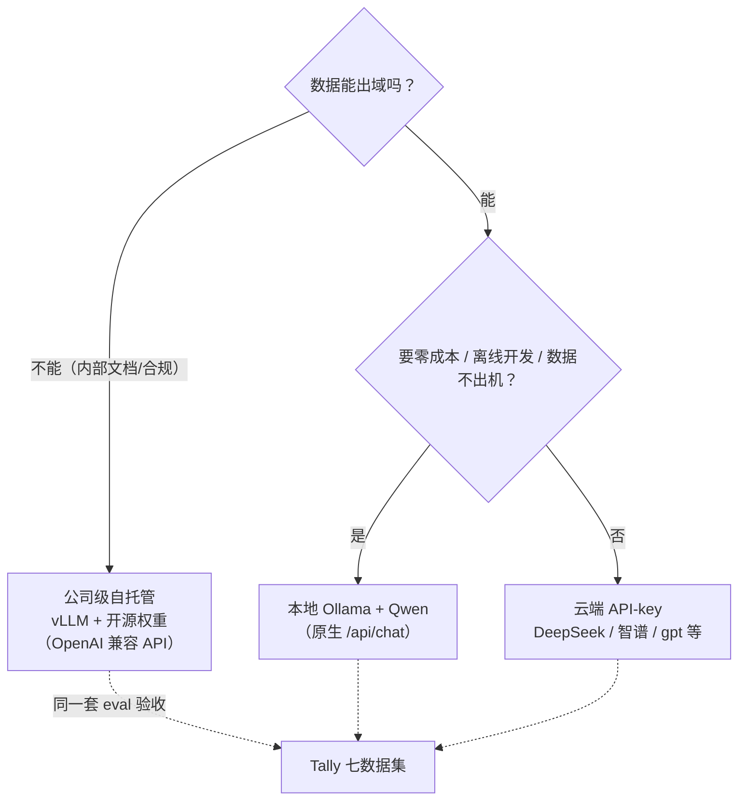

# 第 8 章 LLM 接入层：模型选型与多通道适配

> 状态：v0.5 · 所属：第四部分 Agent 架构：自主而不失控 · 前置：第 7 章
> ◆ 从本章起系统接上 LLM 脑——前三部的固定管线在规则脑上已全部跑通

!!! info "本章导读"

    学完本章你能：①用五个维度给一个具体任务选模型形态（云 API /
    本地 / 自托管）；②解释 OpenAI 兼容协议为什么是事实标准、代价是
    什么；③说出结构化输出三条路线的原理与取舍；④读懂 Tally 的通道
    判定、容错解析与消息归一化；⑤用同一套 eval 对比三档通道的正确率
    × 延迟 × 成本。

## 8.1 知识点：选型五维与三种接入形态

模型选型不是「哪个最强」，是五个维度的联立求解：

| 维度 | 问什么 | 典型权衡 |
|---|---|---|
| 任务 | 要理解、生成还是工具调用？ | 结构化抽取对小模型更友好；叙述对大模型更敏感 |
| 能力 | 档位够不够过你的闸门？ | 本书立场：闸门兜底后，档位只影响「讲得好不好」 |
| 成本 | 单价 × 调用次数 × token 长度 | agent 环一次问答 = 5–10 次调用，成本放大系数先算 |
| 延迟 | 用户等多久？长尾多长？ | 远端尾延迟 20s+ 实测存在——重试与超时是必需品 |
| 数据边界 | 语料/问题能出域吗？ | 财报是公开语料；换成内部文档，云端选项直接出局 |

前两维决定「能不能用」，后三维决定「怎么接」。落到接入形态，就是
一棵三叉决策树：



三种形态没有优劣，只有场景匹配：**本地 Ollama** 零 key 零费用零外呼，
代价是档位受本机算力限制；**云端 API** 给最强能力，代价是成本、延迟
长尾和数据出域；**公司级 vLLM**（[arXiv:2309.06180](
https://arxiv.org/abs/2309.06180)）自托管开源权重，吞吐与数据都不
妥协，代价是运维一个推理服务。注意决策树的最后一层：**不管选哪档，
用同一套 eval 验收**——这是 Tally 双脑架构的直接红利（换档不改代码，
`TALLY_LLM_MODEL` 一行环境变量的事）。

## 8.2 知识点：协议事实标准与结构化输出三路线

**OpenAI 兼容协议是事实标准。**2024–2025 年的现实现状：几乎所有
模型服务商（DeepSeek、智谱、vLLM、Ollama、各大云厂商）都提供
OpenAI 兼容的 `/v1/chat/completions` 端点。工程含义：**接入层写一次，
换服务商改一个 `base_url`**。Tally 只对两种情况例外（8.3）：
本地 Ollama 走原生 `/api/chat`（兼容层丢参数，见 8.5）、Anthropic
兼容端点走 Messages 协议。

Agent 应用还要「让模型可靠地输出结构化数据」，三条路线：

| 路线 | 机制 | 可靠性 | 代价 |
|---|---|---|---|
| prompt 约束 | 「只输出 JSON」+ few-shot | 最低：围栏、夹带说明、字段漂移 | 零依赖 |
| JSON mode / function calling | 服务端保证合法 JSON / 参数 schema | 高：协议层保证 | 依赖服务商支持 |
| 受限解码 | 在解码器层面约束语法（[outlines](https://arxiv.org/abs/2307.09702)、guidance）| 最高：不可能输出非法格式 | 要控制解码器，云 API 给不了 |

Tally 的分层选择：**结构化调用用协议层（JSON mode），解析用防御性
代码（8.4 的 `_parse_json`），不追求受限解码**——因为每个结构化
调用点都有规则兜底（第 9 章），解析失败的代价是降级而非崩溃。
这个「可靠性靠结构不靠解码」的姿态与全书一致。

## 8.3 本项目：通道判定与五环境变量

接入层的全部配置就五个环境变量，通道识别完全自动（`tally/llm.py`）：

| 变量 | 默认 | 作用 |
|---|---|---|
| `TALLY_LLM_API_KEY` | 空 | **只放 `.env`（gitignored），永不进代码/git**；本地端点免填 |
| `TALLY_LLM_BASE_URL` | `http://localhost:11434/v1` | 通道识别的唯一输入 |
| `TALLY_LLM_MODEL` | `qwen3.5:0.8b` | 换档只改这一行 |
| `TALLY_LLM_MAX_TOKENS` | 按档位 | 生成预算（Anthropic 通道自动 ×8 的例外见 8.5）|
| `TALLY_LLM_THINKING` | disabled | 仅影响生成；结构化调用永远关 |

通道判定是两个纯函数，**没有配置项、没有 if 用户选**——host 和
路径即协议：

```python
# tally/llm.py
def _use_local() -> bool:
    return "localhost" in _base_url() or "127.0.0.1" in _base_url()

def _use_anthropic() -> bool:
    """Anthropic 兼容端点（含 /api/anthropic）走 Messages 协议。"""
    return "/api/anthropic" in _base_url()
```

localhost → 原生 `/api/chat`；路径含 `/api/anthropic` → Messages
协议；其余 → OpenAI 兼容 SDK。密钥纪律只有一条但不可破：key 只在
`.env`（`llm._load_dotenv` 装载，环境变量优先），任何示例命令、
文档、测试里都不出现真 key——`conftest` 在测试里剥 key 封网，让
「测试永不真调 LLM」成为可能。

## 8.4 本项目：容错解析与消息归一化

**`_parse_json`——防御性解析。**小模型「输出 JSON」的三种真实形态：
裸 JSON、```json 围栏包裹、JSON 前后夹说明文字。解析器不抱怨、
只提取（剥围栏 → 取首个花括号平衡块），失败抛 `ValueError` 由调用
节点降级到规则——**解析失败是预期事件，不是异常**：

```python
# tally/llm.py: _parse_json（骨架）
fence = re.search(r"```(?:json)?\s*(.+?)\s*```", s, re.S)
if fence:
    s = fence.group(1)
start = s.find("{")
# …花括号深度平衡扫描，取第一个完整对象
```

**`_normalize_tool_messages`——宽松格式 → OpenAI 协议。**agent 环
内部用宽松消息格式（第 11 章），远端 function calling 要严格协议
（`tool_calls` 项必须带 `id+type`、`arguments` 必须是 JSON 字符串、
`tool` 消息必须回指 `tool_call_id`）。归一化器按位置确定性生成 id
（`call_1..call_N`——协议只要求单请求内自洽），不就地修改入参
（本地通道继续用宽松格式）。这是 v0.7.1 接通远端 function calling
的钥匙：**内部格式自由、边界格式严格**。

**超时与重试治理。**远端尾延迟实测 20s+（智谱偶发慢响应），无超时
会把单问拖到 30s+。SDK 层 `timeout=60.0, max_retries=1` 砍长尾；
本地 HTTP 层 `_http_post_json` 独立超时。重试只 1 次——重试是止血
不是治病，超过 1 次说明该降级了（与全书「纠正环有界」同一纪律）。

**显式失败优于半成品。**Anthropic 兼容通道的 tools 尚未接通——
`chat_with_tools` 对它显式 `NotImplementedError`，agent 环捕获后
走固定管线兜底，答案同闸（DESIGN-v0.7 §8.3）。修之前远端 OpenAI
兼容通道也一样（显式失败 → fallback）。**接入层的第一美德不是
全覆盖，是失败得明明白白**：一个抛异常的通道是可诊断的，一个
「看起来能调通但参数被静默吞掉」的通道是定时炸弹（8.5 的 `/v1`
吞 `think` 参数就是实例）。

## 8.5 本项目：thinking 分层——三个实测换来的纪律

思考预算（thinking/reasoning tokens）是 2025 年模型的标配，但
**通道间的行为差异大到必须实测**（D7，DESIGN-v0.5——改 llm.py 前
先读）：

1. **Ollama 的 OpenAI 兼容 `/v1` 端点忽略 `think` 参数**——只有原生
   `/api/chat` 认。这就是本地通道绕过 SDK、直接 POST 原生端点的
   原因（`_local_chat`）。
2. **Qwen3.5 的 `/no_think` 软开关已死**——prompt 里写什么都没用，
   开关在 API 参数上。
3. **thinking 计入 `max_tokens`**——常思模型开思考，512 预算会被
   思考吃光、正文为空（Anthropic 通道实测）。该通道预算自动 ×8
   （`TALLY_LLM_MAX_TOKENS` 显式设置时不放大）。

由此沉淀出**分层纪律**（`_thinking_off`）：**结构化调用永远关思考**
（廉价枚举任务，思考只花钱不加分），**生成路径默认也关**（本地 0.8b
开思考延迟约 ×5：14s vs 3s 实测；生成垮了由 verify 降级兜底——系统
纪律本来就兜得住），`TALLY_LLM_THINKING=enabled` 留给「想看看更强
模型开思考的叙述质量」的场景。温度同构：结构化调用 `temperature=0`，
生成 `0.2`——凡是要确定性的地方，一点温度都不给。

## 8.6 动手实验：三档对比

**① 三行接云端 provider**（`cp .env.example .env` 后填三行）：

```bash
TALLY_LLM_API_KEY=你的key
TALLY_LLM_BASE_URL=https://open.bigmodel.cn/api/coding/paas/v4
TALLY_LLM_MODEL=glm-5.3
python -m tally.cli ask "对比欧科亿和海伦哲 2026 一季度谁赚得多" -v
# trace 里 understand/route 换成 llm 脑，出口仍是 verify_citations
```

**② 公司级 vLLM 挂载 + 三档同 eval 对比**（部署速查见附录 B）：

```bash
bash experiments/08-channel-compare.sh
# 对本地 Ollama / 云端 /（可选）vLLM 各跑一遍 eval，
# 输出三行对照表：answer_hit × 平均延迟 × 每百题成本（有 key 时）
```

**③ 思考开关对比**（本地档最直观）：

```bash
TALLY_LLM_THINKING=disabled python -m tally.cli ask "欧科亿 2026 年半年度预计净利润多少" -v
TALLY_LLM_THINKING=enabled  python -m tally.cli ask "欧科亿 2026 年半年度预计净利润多少" -v
# 观察两点：延迟差（约 ×5）；答案质量差——以及 verify 的 verdict
# 是否兜住了思考开/关两种形态（指标不该抖）
```

实验②的正确率列大概率三档一致（闸门兜底）、延迟成本列差异显著——
**这正是「档位只改善叙述、不改变能不能出门」的量化证明**。

## 8.7 小结

- 选型五维（任务/能力/成本/延迟/数据边界）× 三形态（云/本地/自托管）
  ——决策树的收束是「同一套 eval 验收」；
- OpenAI 兼容协议是事实标准，例外只有两类（本地原生、Anthropic
  Messages）——判据是 host 与路径，不是配置项；
- 结构化输出三路线：Tally 用协议层（JSON mode）+ 防御性解析
  （`_parse_json`），可靠性靠结构不靠解码；
- thinking 分层：结构化永远关、本地默认关（×5 延迟实测）、Anthropic
  预算 ×8——三个实测换一条纪律；
- 接入层第一美德：显式失败优于半成品。

## 常见误区

**误区一：「接最强模型再说」。**接入层的设计决定了换模型的成本。
把通道、密钥、参数硬编码进业务代码，每次换档都是一次回归测试；
像 Tally 这样五个环境变量 + 自动判定，换档是运维动作不是开发动作。

**误区二：「兼容协议 = 行为一致」。**`/v1` 端点「能调通」不代表
参数生效——`think` 被静默吞掉就是实例。每个通道的每个关键参数都要
实测验证，不能信文档信到裸奔。

**误区三：「解析失败要更长的 prompt 修」。**更长的 prompt 降低失败
频率、不改变失败形态。结构化输出的正解是协议层保证 + 防御性解析 +
规则兜底三层叠，prompt 只是第一层便宜的门帘（与第 7 章口径误区
同构）。

## 延伸阅读

- vLLM（PagedAttention）：<https://arxiv.org/abs/2309.06180> · Ollama：<https://ollama.com>
- OpenAI function calling 指南：<https://developers.openai.com/api/docs/guides/function-calling>
- Outlines（受限解码）：<https://arxiv.org/abs/2307.09702>
- Anthropic define-tools：<https://platform.claude.com/docs/en/agents-and-tools/tool-use/define-tools>
- tally `docs/DESIGN-v0.5.md` D7（LLM 通道实测——本章 8.5 的出处）
- tally `docs/DESIGN-v0.7-agent.md` §8.3（v0.7.1 远端 function calling 实测）
