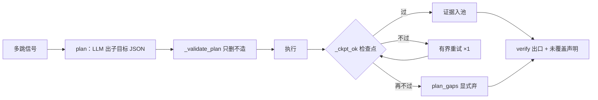

# 第 10 章 任务规划：多跳分解与只删不造

> 状态：v0.6 · 所属：第四部分 Agent 架构：自主而不失控 · 前置：第 9 章

!!! info "本章导读"

    学完本章你能：①复述规划谱系（Plan-and-Solve / ReWoo /
    plan-execute，以及 ToT 的位置）与它们的共同问题意识；②按
    顺序/并行/条件给分解策略分类；③解释「只删不造」为什么是
    校验器唯一安全的形态；④设计子目标检查点与「部分答案」的
    诚实呈现。

## 10.1 知识：规划谱系与分解策略

让 LLM 先拆解再执行，是一条清晰的谱系：

| 系统 | 核心思想 | 与本书的关系 |
|---|---|---|
| Plan-and-Solve（[arXiv:2305.04091](https://arxiv.org/abs/2305.04091)）| 把「step by step」升级为显式计划再执行 | planner 节点的直系思想 |
| ReWoo（[arXiv:2310.18389](https://arxiv.org/abs/2310.18389)）| 计划与执行解耦（Reasoning-without-Observation），砍掉逐步重规划 | 解耦降低误差累积 |
| Plan-and-Execute（LangGraph；orchestrator-workers 模式）| planner/executor 分成图节点 | 落到图上的形态 |
| ToT（Tree of Thoughts，[arXiv:2305.10601](https://arxiv.org/abs/2305.10601)）| 搜索树式探索多条推理路径 | 另一极：探索型任务用，事实问答不需要 |
| ReAct（下一章）| 不先规划，边走边想 | planner **之下**的执行环 |

谱系共同的问题意识是**误差累积**：逐步重规划的链越长，单步误差
复利越大。两个正交的减震器：**解耦**（先计划后执行，砍中间的
重规划）与**确定性校验**（计划过白名单再放行）。

**分解策略分类**（怎么拆）：

| 策略 | 适用 | 例 |
|---|---|---|
| 顺序分解 | 后一步依赖前一步结果 | 「先查 A 是谁，再查 A 的营收」|
| 并行分解 | 子问题互相独立 | 「三家公司各自的净利」——各自执行、各自过闸、结果合并 |
| 条件分解 | 下一步取决于中间结果 | 「若披露单季则直接取，否则差分派生」|

并行分解有个常被忽略的可靠性红利：**并行分支不乘法**——各自
过闸再合并，一条分支失败不污染其他分支（对比串行链的错误传播）。

## 10.2 知识：只删不造与部分答案红线

LLM 产出的计划（子目标清单、参数组合、步骤序列）需要校验。校验
哲学只有一条安全的形态：

> **只删不造**：校验器可以删掉模型的任何子目标、修正它的规约
> （枚举/归一/去重/封顶），**永远不替模型补一个**。

为什么禁「补」：补的内容没有出处——校验器自己动手造事实，等于
把最不可靠的环节换成另一个不可靠环节，还失去了可审计性（模型
的计划至少能对回 query，校验器补的无人认领）。这条哲学适用于
一切「LLM 产出结构化清单、代码做校验」的场景：合法动作只有
**放行 / 修正规约 / 丢弃**三种，没有补全。

**部分答案红线**是输出侧的同一哲学：多跳问题允许只答出一部分，
但缺口必须**显式声明**——「B 公司 2024 年的数没找到」优于拿
别家的数顶上去。不编事实，也不编**完整性**。全有或全无是最差
策略：用户拿到一句「检索不足」，不知道哪部分其实已经查到了。

**检查点（verify-as-you-go）**：每个子目标执行后立即验证（它的
产物是否满足可判定的成功标准），不过就有界重试、再不过显式弃。
它把拦截从「出口」推进到「步级」——坏子目标当场发现，不攒到
最后被总闸一锅端。这是长链可靠性「剪断传播边」杠杆（第 14 章）
在规划层的实例。

## 10.3 案例研究：Tally 的 plan 节点

!!! note "案例研究：Tally（graph.py）"

    **触发信号是确定性的**（`_wants_plan`）：≥3 家公司 / 跨年 /
    ≥2 个指标族——单跳题不配规划（多一次 LLM 调用 + 校验开销），
    两家对比走更便宜的并行分解（decompose）。

    **校验器 `_validate_plan`（只删不造落地）**：白名单外动作丢弃、
    期间规约到枚举、去重、MAX_SUBGOALS=5 封顶、漏掉的公司按规则
    名单回填（回填来自规则解析的 query 实体——执行用户问题的
    字面要求，不是「造」）。校验失败到一条不剩 → 整体回退
    执行环（现路径，不冒险）。

    **检查点 `_ckpt_ok`**：财报级数字在场 ∧ 指标词命中——两条
    都要，缺一即不过；有界重试 ×1（扩词重查，非无界改写）；再
    不过进 `plan_gaps`，出口追加「（未覆盖：…——检索不足，以上
    为已覆盖部分）」。

    实测对照：让小模型自己处理单季差分题（Q2=H1−Q1），quarters
    集 6 道派生题全灭——模型自己差不出；确定性差分 + 检查点后
    全对。规划器的产出质量上限是模型的，下限由校验器兜住——
    工程资源花在下限上。



## 10.4 动手实验

```bash
bash experiments/10-plan-checkpoint.sh
# ① 多跳信号白盒：三家/跨年 → 触发 plan；两家 → 不触发（走分解）
# ② 检查点白盒（4 passed）：数字在场 ∧ 指标词命中，缺一即不过
# ③ multihop 集 heuristic 对照：hit=1.0（确定性分解+差分路径）
```

!!! example "练习 ★★：设计你自己的子目标 schema"

    检查单：①action 枚举闭集多大？每个都能写清「校验器怎么判它
    执行成功」吗？②哪些字段规则可判、哪些留给模型？③MAX 定几、
    预算怎么算？④缺口声明在答案里长什么样？记进画布第 10 格。

## 10.5 小结

- 谱系共同问题意识是误差累积；解耦与确定性校验是两个正交减震器；
  分解三分类（顺序/并行/条件），并行分支不乘法；
- 只删不造：校验器的合法动作只有放行/规约/丢弃——补全是最隐蔽
  的越权；
- 检查点把拦截推进到步级（verify-as-you-go）；部分答案缺口显式
  声明——不编事实也不编完整性；
- 触发信号确定性（值得规划才规划）；规划器上限归模型、下限归
  校验器——资源花在下限。

## 常见误区

**误区一：「规划器越聪明越好」。**规划器上限是模型的，下限由
校验器兜住。白名单、规约、封顶、检查点是确定性的、可测试锚定的；
「让模型规划得更聪明」是开放问题，今天的最优解明天就变。

**误区二：「子目标没找到就整体失败」。**全有或全无让用户丢失
已得信息。显式缺口声明把「完整性失败」降级成「完整性信息」。

**误区三：「校验器顺手补上缺的子目标」。**补的内容没有出处。
规划器还能被检查点验证，校验器补的目标绕过了这层——顺手补是
校验器最隐蔽的越权。

## 延伸阅读

- Plan-and-Solve：<https://arxiv.org/abs/2305.04091> · ReWoo：<https://arxiv.org/abs/2310.18389> · ToT：<https://arxiv.org/abs/2305.10601>
- LangGraph Plan-and-Execute：<https://langchain-ai.github.io/langgraph/> · Anthropic orchestrator-workers：<https://www.anthropic.com/engineering/building-effective-agents>
- tally `docs/DESIGN-v0.7-agent.md` §4 Phase 2（Planner 全案）
