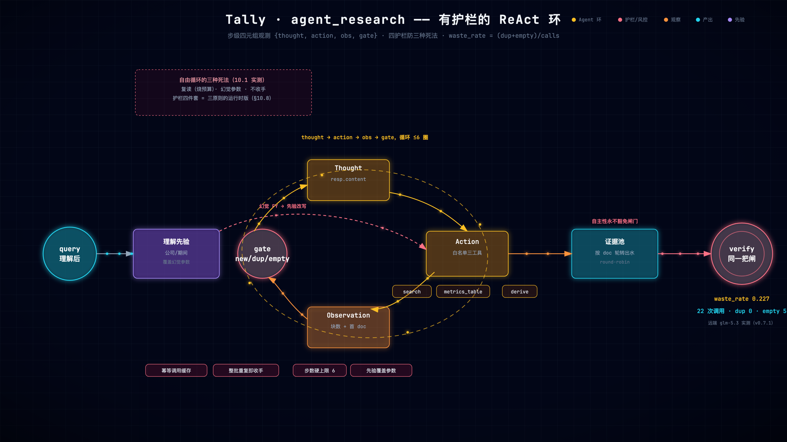

# 第 10 章 工具调用与 ReAct 循环：护栏工程

> 状态：v0.3 · 所属：第三部分 Agent 架构：工具、规划与记忆 · 前置：第 8 章

!!! info "本章导读"

    学完本章你能：①画出 ReAct 循环的状态机并指出三处护栏的位置；
    ②解释工具白名单与「禁止模型心算」的封闭世界依据；③读懂步级
    四元组与 waste_rate；④复述 v0.7.1 远端 function calling 的接通
    过程（消息规范化）；⑤用白盒回放测试验证护栏行为。

## 10.1 失败先行：自主循环的三种死法

让小模型在循环里自主决定「检索什么、何时收手」，实测三种死法
（每种都有白盒回放测试钉死）：

| 死法 | 实测表现 | 预算代价 |
|---|---|---|
| 复读机 | 同一调用原样重复 6 步烧满 | 6× 检索+6× LLM |
| 幻觉参数 | 问「半年度」传参 FY | 年报洪水，检索白做 |
| 不收手 | 证据够了继续换角度检索 | 烧满预算 |

结论：**自主性不是给模型自由，是给模型装护栏。**预算（步数、
检索次数、token）是真实成本，自主循环的每个缺陷都直接换算成钱。

## 10.2 业界视角：从 ReAct 到 function calling

!!! note "背景速览"

    Agent 工具调用的学术谱系：

    - **ReAct**（Yao et al. 2022, [arXiv:2210.03629](https://arxiv.org/abs/2210.03629)）：
      Reasoning 与 Acting 交织——thought → action → observation 循环。
      论文的洞察：让模型「边想边做」，思考给行动定向，观察给思考
      供料。Tally 的 agent_research 是它的工程化。
    - **Toolformer**（[arXiv:2302.04761](https://arxiv.org/abs/2302.04761)）：
      训练模型自己学在哪些位置插 API 调用（训练路线）。
    - **Function calling**（2023 起各家 API 原生支持）：结构化 JSON
      工具调用成为平台能力——开发者的战场从「让模型学会调用」
      移到「调用之后怎么防它闯祸」（本章主题）。

    实践侧，Anthropic 的 [Building Effective Agents](https://www.anthropic.com/engineering/building-effective-agents)
    给出关键区分：**workflow**（代码编排 LLM）适合可预测任务，
    **agent**（LLM 控制循环）留给需要弹性的场景，且必须配护栏。
    Tally 的立场是混合：单跳交给 workflow 承重的固定管线，多跳
    信号才进 agent 环——「自由规划、强制对账」。

## 10.3 工具白名单：封闭世界契约的 Agent 面

```python
# tally/graph.py（节选）
AGENT_TOOLS = [_SEARCH_TOOL, _METRICS_TOOL, _DERIVE_TOOL]   # 就这三个

def _run_tool(name: str, a: dict) -> str:
    if name == "search":        return run_search(a)
    if name == "metrics_table": return run_metrics_table(a)
    if name == "derive":        return run_derive(a)
    return "[]"      # 注册表白名单外：封闭世界契约第 2 条
```

三个工具的设计各有讲究：

- **search**：白名单内最自由的一个，但工具描述里写死纪律（「对比
  多家公司时逐家调用；期间用 H1/Q1/Q3/FY」）；公司/期间缺省时由
  understanding 先验补齐（10.4 护栏四）；
- **metrics_table**：描述里**主动引导模型用它**（「单期单指标数值
  优先用本工具而非 search——直接给对齐好的行」）——工具描述是
  小模型的使用说明书，写得越好模型选得越对；
- **derive**（差分算子）单独一提：

```python
# run_derive：Q2=H1−Q1、Q4=FY−Q3，原币精度；操作数行不可解析时返回
# error 对象（模型可见的保守失败），绝不打印错数。结果登记
# derived_ops——verify 出口按「操作数必须真在场于证据池」重算 ±0.01
```

**禁止模型心算**——封闭世界里算术也是事实。模型算出 Q2 净利，
出口处代码重算：操作数（H1、Q1 的原文数值）必须真在场、
|a−b−value| ≤ 0.01，派生值才允许 pass。「LLM 组织语言、代码拥有
事实」在算术上的落点。原币精度也值得记：亿值四舍五入后差分会
放大到百万级误差——先算后换算，不是先换算后算。

白名单外的调用返回空观测 `"[]"`——模型看得见「此路不存在」，
但走不出去。



*agent_research 全景（[▶ 动画版](anim/react-loop.html)）：Thought → Action（白名单三工具）→ Observation → gate 的循环 ≤6 圈，四件护栏在外圈，证据最终仍过 verify——自主性永不豁免闸门。*

## 10.4 护栏四件套

```python
# tally/graph.py: agent_research（节选）
seen: dict[str, str] = {}   # 幂等缓存：小模型会把同一调用原样重复 6 步（实测）
...
if key in seen:             # 重复调用：回缓存结果并提示换角度
    msgs.append({"role": "tool",
                 "content": seen[key] + "（重复检索：结果同上。请换检索角度或停止调用工具。）"})
    step.update(gate="dup"); continue
...
if not fresh and pool:      # 整批全是重复 = 模型没有新问题要问
    stopped = "重复收手"
    break
```

1. **幂等缓存 + dup 标记**：重复调用不烧检索、不进证据池，还给
   模型一句「换角度」提示——**把模型的失败变成下一步的引导**；
2. **整批重复即收手**：比等步数封顶早止损（模型已无新问题）；
3. **步数硬上限** `MAX_AGENT_STEPS = 6`；
4. **理解先验覆盖工具参数**：understand 抽的期间/公司是「模型对
   原问题的结构化决定」，工具参数只是检索战术——战术不能覆盖
   战略（「半年度幻觉成 FY」的死法 2 由此封堵）。公司缺省时先验
   回填，多公司 understanding 时逐家检索（对比题的正确语义）。

## 10.5 步级观测：waste_rate 是 eₖ 的代理

每步记录四元组 + 耗时：

```python
step = {"i": n_steps, "thought": thought[:80],       # 模型在想什么
        "action": f"{tc['name']}{json.dumps(tc['arguments'])[:64]}",  # 做了什么
        "obs": n_obs, "obs_doc": first_doc,           # 看到了什么（条数+首doc）
        "gate": "new" if n_obs else "empty",          # 闸门判定
        "ms": dt}
```

`-v` 逐行打印、`--json` 可重放；eval 聚合出
**waste_rate = (dup+empty)/calls**——可靠性公理里 eₖ（步错率）的
可测代理（第 13 章把公理讲全）。观测先行的意义：没有这四个字段，
「小模型在循环里表现如何」只能靠感觉争论；有了它，「重复率 30%」
是一个可以盯着的数字。这也是业界 LLM observability（trace/span
体系）在本项目的最小实现——**先让失败可见，才谈得上治理**。

## 10.6 案例：远端 function calling 的接通（v0.7.1）

本书写作时远端通道曾**没有 ReAct**（显式 `NotImplementedError` →
兜底固定管线，DESIGN-v0.7 §8 记录了 8/8 `agent:fallback` 的实测）——
这曾是留给读者的 v1.1 挑战题，作者自己先交了卷，过程值得复盘：

1. **消息规范化是主要工作**：agent 环喂的宽松格式（assistant 的
   tool_calls 只有 `function{name,arguments}`、tool 消息无 id）要转
   OpenAI 协议要求的 `id`+`type`+`tool_call_id`——按会话位置确定性
   编号（call_1..call_N），每个请求自洽即可，且**不就地污染入参**
   （本地通道继续用宽松格式）：

```python
# tally/llm.py: _normalize_tool_messages（节选）
for tc in m["tool_calls"]:
    n += 1
    cid = f"call_{n}"
    pending.append(cid)
    fn = tc.get("function") or {}
    tcs.append({"id": cid, "type": "function",
                "function": {"name": fn.get("name", ""),
                             "arguments": json.dumps(fn.get("arguments", {}),
                                                     ensure_ascii=False)}})
...
elif m.get("role") == "tool":
    cid = pending.pop(0) if pending else f"call_{n}"
    out.append({**m, "tool_call_id": cid})
```

2. **归一化契约不变**：远端返回同样归一为
   `{content, tool_calls:[{name, arguments:dict}]}`——上层 agent 环
   **零改动**（通道差异消化在 llm 层，这是分层的好处）；
3. **Anthropic 通道仍显式失败**（tool_use 块协议不同）——显式失败
   优于半成品协议转换；
4. **实测回报**（智谱 glm-5.3，agent 集 8 题）：22 次工具调用、
   **dup=0**（强档位不复读——0.8b 的幂等缓存护栏在此档位未触发：
   护栏仍在，只是没活干）、waste_rate 0.227（全来自 empty：
   metrics_table 对预告类文档返回空）、两道 compare 题 degraded
   （cov≈0.44）→ 降级抽取式仍全对——**闸门在真实远端生成路径上
   的实弹工作证明**。判定 run 全绿 1.0/1.0/1.0。全表见
   DESIGN-v0.7 §8.3。

你的 v1.1 挑战题换成了：**接通 Anthropic 通道的 tool_use 块**——
协议差异（content 块数组 vs 字符串）比 OpenAI 兼容路更有嚼劲。

## 10.7 动手实验

```bash
bash experiments/ch10-agent-trace.sh
# 输出实录（远端 OpenAI 兼容通道，v0.7.1）：
#   trace: …route:compare(4ms) → agent:2步/2次tool/10块证据/self(8686ms)
#         → decompose:… → generate:llm → verify:pass(0.658)
#   == 白盒回放五场景 ==  1 passed
```

读 trace 的要点：`agent:N步/M次tool/K块证据/收手原因`——收手原因
三种：`self`（模型自己停，最理想）/`重复收手`（护栏救的）/`budget`
（烧满，最差但可控）。

## 10.8 前沿拓展：工具设计三原则与小模型配方

### 三原则审计：AGENT_TOOLS 拿官方指南对答案

Anthropic 的 [define-tools 指南](
https://platform.claude.com/docs/en/agents-and-tools/tool-use/define-tools)
给出工具设计三原则，拿它逐条审计 Tally 的三工具：

1. **描述详尽度是第一因素**（官方原话：*by far the most important
   factor*，建议每个工具 3–4 句起）。审计：Tally 的 description
   讲清了「做什么」；按官方标准还欠「什么时候**别**用」——
   `search` 与 `metrics_table` 的分界（关键词检索 vs 直取主要
   会计数据表）值得各自写明。v0.7.1 远端实测 22 次调用
   waste_rate 0.227——那 5 次 empty 里，可能有几次就是工具
   选择的模糊造成的。
2. **强类型参数（poka-yoke，防呆）**：枚举与格式约束让模型
   「想错都难」。Tally 的 period 参数（Q1/H1/Q3/FY 枚举）正是；
   反例是裸字符串期间——模型随手填「2025年上半年」就要靠
   理解先验救（10.4 第四件套）。
3. **错误返回给模型看，而不是抛异常**：工具失败要以 error
   对象回流（模型可见、可改道）。`run_derive` 操作数不可解析时
   返回 error 对象正是这个形态——保守失败但**不剥夺模型的
   改道权**。

这三条同时解释了护栏四件套为什么长那样：**四件套是三原则的
运行时版**（描述防选错、类型防填错、错误回流防死路、护栏防失控）。

### 小模型 agent 的两条路线：解码器 vs 运行时

- **业界主流：把保证移进解码器**。[Ollama structured outputs](
  https://docs.ollama.com/capabilities/structured-outputs)（GBNF
  受限解码，`format` 参数）与 [vLLM](
  https://docs.vllm.ai/en/latest/features/structured_outputs)
  （xgrammar/guidance 后端）在语法层约束输出——非法 JSON 根本
  **生不成**，保证从 prompt 挪到了解码器。适合结构化抽取：
  `chat_json` 的枚举字段是理想对象。
- **Tally 的路线：把保证留在运行时**。解析失败退规则
  （`understand:llm→fallback`）+ 理解先验覆盖工具参数 + 固定
  管线兜底 + 有界步数。因为**工具选错、参数幻觉是语义问题**，
  解码器管得住「period 不是合法枚举」，管不住「search 了一个
  语料里不存在的期间」。
- 两条互补不互斥：**解码器保证语法，先验保证语义，闸门保证
  事实**——三层各管一段，谁也不越界。

### workflows vs agents：本书全图的业界坐标

[Building Effective Agents](https://www.anthropic.com/engineering/building-effective-agents)
（2024-12）划的线：**workflow** = 代码编排 LLM 走预定义路径；
**agent** = LLM 自己决定过程。五个 workflow 模式 + 一个 agent
loop，对照全书：

| Tally 节点 | 业界形态 |
|---|---|
| understand → route | routing（路由模式） |
| grade ⇄ rewrite | evaluator-optimizer（评估-优化环） |
| compare 按公司分解 | parallelization（sectioning） |
| plan → 子目标 | orchestrator-workers |
| agent_research | agent loop（本意上的 agent） |
| trend 确定性遍历 | 纯 workflow（不给模型） |

原文把 **compounding errors**（错误复利）列为 agent 自主的第一
代价，建议「从 workflow 起步、按评估增量放权」——trend 永不进
agent 环（ch13 公理杠杆①）就是这句的代码版。

**若在 Tally 上继续做**：① `chat_json` 接 Ollama `format` 受限
解码，消灭 `_parse_json` 的解析失败层；② 工具描述重写实验——
按三原则重写三个 description，量尺 = waste_rate 前后对比。
这是 rerank 之外**最便宜的实验：只改字符串**。

## 10.9 小结

- ReAct 循环 = 自由 + 四护栏（幂等缓存/重复收手/步数封顶/先验覆盖）；
- 工具白名单三个，描述即说明书；derive 出口重算，禁止心算；
- 步级四元组让浪费可见，waste_rate 是 eₖ 的代理；
- 通道差异消化在 llm 层（消息规范化），上层零改动；
- 远端实测：强档位不复读、empty 是主要浪费、降级保全对。


## 常见误区

**误区一：「Agent = 让模型自由循环」。**自由循环的三种死法
（复读/幻觉参数/不收手）都是预算问题——每个死法直接换算成 token
和延迟的钱。工程化 Agent 的定义是**自由 + 护栏 + 观测**，三件
缺一不可；只给自由的循环不是 Agent，是碎钞机。

**误区二：「护栏抑制智能」。**护栏四件套没有一条限制模型的决策
空间（它仍可决定查什么、何时停）——它们限制的是**无效动作**
（重复、超步、幻觉参数）。dup=0 的远端实测（§8.3）说明强模型
根本不会触发护栏：护栏是保险绳，不是镣铐。

## 工程检查清单
## 工程检查清单

- [ ] 工具白名单外的调用会发生什么？（自造工具=越狱面）
- [ ] 每步的 thought/action/obs 可观测吗？浪费率可统计吗？
- [ ] 重复调用有幂等缓存吗？整批重复会提前收手吗？
- [ ] 步数/预算有硬上限吗？上限被烧满时可观测吗？
- [ ] 算术类结果有出口重算吗（禁止心算）？
- [ ] 工具描述写给模型看了吗？（描述是使用说明书）

## 延伸阅读

- ReAct：<https://arxiv.org/abs/2210.03629> · Toolformer：<https://arxiv.org/abs/2302.04761>
- Anthropic, *Building Effective Agents*：<https://www.anthropic.com/engineering/building-effective-agents>
- Anthropic, *Define tools*（三原则）：<https://platform.claude.com/docs/en/agents-and-tools/tool-use/define-tools> · OpenAI, *Function calling*：<https://developers.openai.com/api/docs/guides/function-calling>
- Ollama structured outputs（受限解码）：<https://docs.ollama.com/capabilities/structured-outputs> · vLLM：<https://docs.vllm.ai/en/latest/features/structured_outputs>
- tally `docs/DESIGN-v0.6.md` §2 与 `docs/DESIGN-v0.7-agent.md` §4/§8.3
