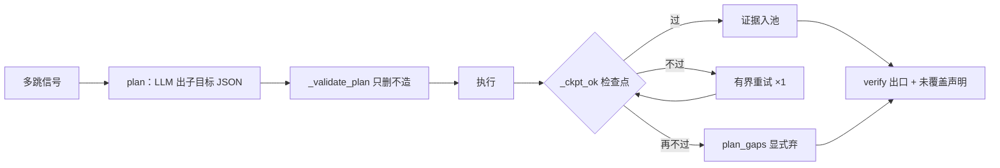

# 第 10 章 任务规划：多跳分解与只删不造

> 状态：v0.8 · 所属：第四部分 Agent 架构：自主而不失控 · 前置：第 9 章

!!! info "本章导读"

    学完本章你能：①复述规划谱系（Plan-and-Solve / ReWoo /
    Plan-and-Execute / ToT）各自的机制与共同问题意识；②按顺序/
    并行/条件给分解策略分类，说出「并行分支不乘法」的可靠性含义；
    ③论证「只删不造」为什么是校验器唯一安全的形态；④设计子目标
    检查点（verify-as-you-go）与部分答案的诚实呈现；⑤看懂案例的
    校验要点、检查点代码与实测对照。

## 10.1 知识：规划谱系与分解策略

**为什么需要规划**：单跳问题一次检索就够；多跳问题（「对比三
家公司两年的营收和净利」）需要拆成多个子目标分别检索再合并——
让模型在单次生成里「一步到位」处理多跳，等于让它把检索、记忆、
算术都用心算完成（第 7 章已证心算不可信）。

谱系（共同的问题意识：**误差累积**——逐步重规划的链越长，单步
误差复利越大）：

| 系统 | 机制 | 关键取舍 |
|---|---|---|
| **Plan-and-Solve**（[arXiv:2305.04091](https://arxiv.org/abs/2305.04091)）| 把 CoT 的「step by step」升级为显式两阶段：先出计划再执行 | 计划质量的方差直接传导 |
| **ReWoo**（[arXiv:2310.18389](https://arxiv.org/abs/2310.18389)）| Reasoning without Observation：**计划一次性生成**，执行时不重规划——每步的观察不回流去改计划 | 砍掉中间重规划 → token 省、误差累积降；代价：计划错了不能中途纠 |
| **Plan-and-Execute**（LangGraph；orchestrator-workers 模式）| planner/executor 分成图节点，planner 可按需重排 | 图形态，可组合；重排频率是设计自由度 |
| **ToT**（Tree of Thoughts，[arXiv:2305.10601](https://arxiv.org/abs/2305.10601)）| 搜索树：多候选思路并行展开、评估、剪枝、回溯 | 为**探索型**任务而生（解题/创作）；事实问答不需要——答案在证据里不在搜索里 |

两个正交减震器：**解耦**（先计划后执行，砍中间重规划的误差
传导）与**确定性校验**（计划过白名单再放行）。ToT 是提醒：
规划 ≠ 越复杂越好，任务性质（可枚举检索 vs 需要探索）决定形态。

**分解策略分类**（怎么拆）：

| 策略 | 适用 | 例 |
|---|---|---|
| 顺序分解 | 后一步依赖前一步结果 | 「先查 A 是谁，再查 A 的营收」|
| **并行分解** | 子问题独立 | 「三家公司各自的净利」——各自执行、各自过闸、结果合并 |
| 条件分解 | 下一步取决于中间结果 | 「若披露单季则直取，否则差分派生」|

并行化的最新工程形态是**函数调用编译器**：LLMCompiler
（[SqueezeAILab/LLMCompiler](https://github.com/SqueezeAILab/LLMCompiler)）
让 LLM 先产出**任务 DAG**（哪些子调用互相独立、哪些有依赖），
运行时按 DAG 并行调度无依赖的调用——对比 ReAct 串行循环，多工具
任务的总延迟接近「最长链」而非「所有调用之和」。它验证了下面的
分解分类学：DAG 就是「顺序/并行/条件」三类的统一表达。


并行分解的可靠性红利常被忽略：**并行分支不乘法**——各自过闸
再合并，一条分支失败不污染其他分支；对比串行链（第 14 章公理的
朴素连乘），分支间错误互不传播。**能并行的拆解是免费的可靠性**。

**触发也要设计**：不是所有问题都值得规划——单跳进规划是浪费
（多一次 LLM 调用 + 校验开销），信号通常是确定性的（实体数 ≥N /
跨时间范围 / 多指标族）。值得规划才规划，与第 9 章判定线同构。

## 10.2 知识：只删不造与部分答案红线

LLM 产出的计划（子目标清单）需要校验。校验哲学只有一条安全
形态：

> **只删不造**：校验器可以删掉模型的任何子目标、修正它的规约
> （枚举/归一/去重/封顶），**永远不替模型补一个**。

为什么禁「补」——三层：①补的内容**没有出处**（模型的目标至少
能对回 query，校验器补的无人认领）；②校验器自己动手造事实 =
把最不可靠的环节换成另一个不可靠环节；③失去可审计性（事后
无法区分「模型想的」与「校验器造的」）。适用一切「LLM 出结构化
清单、代码校验」的场景（子目标、工具参数、抽取字段）：合法
动作只有**放行 / 修正规约 / 丢弃**，没有补全。

**检查点（verify-as-you-go）**：每个子目标执行后立即验证——
「这个子目标的产物满足可判定的成功标准吗」（数字在场 ∧ 指标词
命中，或你的领域等价物）。不过 → 有界重试（扩词重查 ≤1 次，不
是无界改写——改写漂移比检索失败更危险）→ 再不过 → **显式弃**。
价值：把拦截从出口推进到步级——坏子目标当场发现，不攒到总闸
一锅端（第 14 章公理「剪断传播边」的规划层实例）。

**部分答案红线**：多跳允许只答一部分，但缺口必须**显式声明**：
「B 公司 2024 年的数没找到——以上为已覆盖部分」。不编事实，
也不编**完整性**。全有或全无是最差策略（用户丢失已得信息且
不知道缺什么）；沉默的缺口是隐性欺骗。工程形态：`plan_gaps`
清单在答案尾部追加声明，用户看到可追问。

## 10.3 案例研究：Tally 的 plan 节点

!!! abstract "案例研究：Tally（graph.py，v0.7 Phase 2）"

    **触发信号确定性**（`_wants_plan`）：≥3 家公司 / 跨年 / ≥2 个
    指标族——两家对比走更便宜的并行分解（decompose 按公司拆，
    各自过闸再合并——「并行分支不乘法」的实例）。

    **校验器 `_validate_plan`（只删不造的落地，要点走读）**：

    ```python
    # tally/graph.py: _validate_plan（要点）
    # ① 白名单外动作（browse/外部 API/生成代码）→ 丢弃
    # ② 期间规约到枚举（FY/H1/Q1/Q3/E 后缀）
    # ③ 完全重复的子目标 → 去重
    # ④ MAX_SUBGOALS = 5 → 封顶（规划器不知道预算，代码知道）
    # ⑤ 漏掉的公司 → 单公司子目标回填——回填来自规则解析的
    #    query 实体（执行用户问题的字面要求，不是「造」）
    # 校验失败到一条不剩 → 整体回退执行环（现路径，不冒险）
    ```

    规划器的实测输出长什么样（LLM 出的是灵感不是合法清单）：
    白名单外动作（browse）、幻觉公司（语料里不存在）——两类
    事故都有白盒测试锚定。

    **检查点 `_ckpt_ok` 与缺口声明**：

    ```python
    # tally/graph.py: verify_citations（缺口声明节选）
    gaps = [g for g in (state.get("plan_gaps") or []) if g]
    if gaps:
        out["answer"] = (f"{out.get('answer', '').rstrip()}\n（未覆盖："
                         + "；".join(gaps) + "——检索不足，以上为已覆盖部分）")
    ```

    检查点判据 = **财报级数字在场 ∧ 指标词命中**（两条都要，缺一
    即不过）；重试 ×1 扩词重查。**实测对照**（规划器上限 vs 校验器
    下限的活教材）：让小模型自己处理单季差分题（Q2=H1−Q1），模型
    自己差不出——quarters 集 6 道派生题**全灭**；确定性差分 +
    检查点后全对。规划器上限归模型，下限归校验器——**工程资源
    花在下限上**。



### 演练：一道多跳题的子目标全链（构造示例，llm 模式 `-v` 可见同构 trace）

「**对比欧科亿、海伦哲、日联科技 2025 与 2026 的营收和净利润**」
——触发 ≥3 公司 + 跨年：

```text
多跳信号 ✓ → plan 出 12 个子目标（3 公司 × 2 年 × 2 指标）
_validate_plan（只删不造）：去重 2 个 → MAX=5 封顶 → 拆两批
执行 + 检查点（每子目标）：
  欧科亿/2025/营收  ✓ 数字在场∧指标词命中 → 证据入池
  欧科亿/2025/净利  ✓
  海伦哲/2025/营收  ✗ 空返回 → 重试×1（扩词「营业总收入」）→ ✓
  日联科技/2025/净利 ✗ 重试仍空 → plan_gaps 登记
  ……（2026 批次同构）
出口：答案覆盖 10/12 子目标，尾部追加
  （未覆盖：日联科技 2025 净利润——检索不足，以上为已覆盖部分）
```

三个观察点：重试是**扩词**不是改写（语义漂移风险最低的自救）；
gaps 文案让用户知道**下一步追问什么**；12→10 的缺口没有用别家
的数字顶上——部分答案红线。

## 10.4 动手实验

```bash
bash experiments/10-plan-checkpoint.sh
# ① 多跳信号白盒：三家/跨年 → 触发 plan；两家 → 不触发（走分解）
# ② 检查点白盒（4 passed）：数字在场 ∧ 指标词命中，缺一即不过
# ③ multihop 集 heuristic 对照：hit=1.0（确定性分解+差分路径）；
#    llm 模式同一批题过 plan 节点——子目标→检查点→缺口全链
```

!!! example "练习 ★★：设计你自己的子目标 schema"

    检查单：①action 枚举闭集多大？每个都能写清「校验器怎么判它
    执行成功」吗（检查点判据）？②哪些字段规则可判、哪些留给
    模型？③MAX 定几、预算怎么算（每子目标几次调用×单价）？
    ④缺口声明文案——用户看到后知道该追问什么吗？记进画布第
    10 格。

!!! tip "设计清单（规划层）"

    - [ ] 多跳信号的三个阈值（公司数/时间跨度/指标族）定了吗
    - [ ] 子目标 schema：action 枚举 + 每个的检查点判据
    - [ ] 只删不造的红线——校验器里有没有任何「顺手补」的分支
    - [ ] 缺口声明文案：用户读完知道追问什么吗
    - [ ] 值得并行的拆了吗（DAG 思维：哪些子目标真有依赖）


## 10.5 小结

- 谱系共同问题意识是误差累积；解耦（ReWoo 式一次规划）与确定性
  校验是正交减震器；ToT 提醒：任务性质决定形态，事实问答不需要
  搜索树；
- 分解三分类（顺序/并行/条件）；并行分支不乘法——能并行的拆解
  是免费的可靠性；触发信号确定性（值得规划才规划）；
- 只删不造：合法动作只有放行/规约/丢弃，补全是校验器最隐蔽的
  越权（无出处/换不可靠/失审计三层理由）；
- 检查点把拦截推进到步级；部分答案缺口显式声明——不编事实也
  不编完整性；规划器上限归模型、下限归校验器。

## 常见误区

**误区一：「规划器越聪明越好」。**上限是模型的，下限由校验器
兜住——白名单/规约/封顶/检查点是确定性的、可测试锚定的。「让
模型规划得更聪明」是开放问题，今天是明天的技术债。

**误区二：「子目标没找到就整体失败」。**全有或全无让用户丢失
已得信息；显式缺口声明把完整性失败降级为完整性信息。

**误区三：「校验器顺手补上缺的子目标」。**补的目标绕过检查点
验证——顺手补是最隐蔽的越权。

**误区四：「上 ToT 更高级」。**探索型任务才需要搜索树；证据
驱动的问答，树展开的是模型的猜测空间，不是证据空间。

## 延伸阅读

- Plan-and-Solve：<https://arxiv.org/abs/2305.04091> · ReWoo：<https://arxiv.org/abs/2310.18389> · ToT：<https://arxiv.org/abs/2305.10601>
- LangGraph Plan-and-Execute：<https://langchain-ai.github.io/langgraph/> · Anthropic orchestrator-workers：<https://www.anthropic.com/engineering/building-effective-agents>
- 李博杰《深入理解 AI Agent》ch.5（Coding Agent 中的规划实践）：<https://github.com/bojieli/ai-agent-book>
- tally `docs/DESIGN-v0.7-agent.md` §4 Phase 2（Planner 全案）
