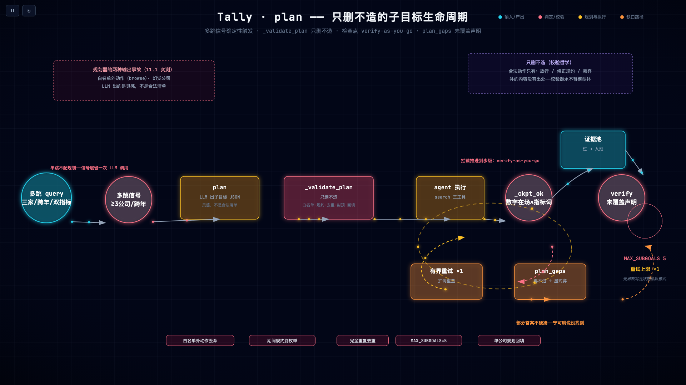
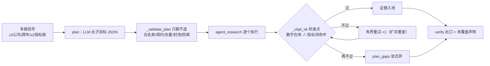

# 第 10 章 任务规划：多跳分解与只删不造

> 状态：v0.5 · 所属：第四部分 Agent 架构：自主而不失控 · 前置：第 9 章

!!! info "本章导读"

    学完本章你能：①说出 Plan-and-Solve / ReWoo / plan-and-execute
    谱系各自的取舍；②解释「只删不造」校验哲学为什么是校验器的
    唯一安全形态；③设计子目标检查点（verify-as-you-go）；④设计
    「部分答案」的诚实呈现（未覆盖红线）。

## 10.1 失败先行：规划器的两种输出事故

多跳问题（「对比 A、B、C 三家 2025 与 2026 的营收和净利」）先让
LLM 出子目标清单，实测它自然产出两类东西：

```json
{"subgoals": [
  {"action": "search", "company": "欧科亿", "period": "Q1", "metric": "营收"},
  {"action": "browse", "company": "欧科亿", "period": "Q1"},          ← 白名单外
  {"action": "search", "company": "不存在的公司", "period": "FY",      ← 幻觉实体
             "metric": "净利润"}
]}
```

白名单外动作 + 幻觉公司——**LLM 出的是灵感，不是合法清单**。

## 10.2 知识点：规划谱系与「只删不造」

让 LLM 先拆解再执行，是一条清晰的谱系：

| 系统 | 核心思想 | 与 Tally 的关系 |
|---|---|---|
| Plan-and-Solve（[arXiv:2305.04091](https://arxiv.org/abs/2305.04091)）| 把「step by step」升级为显式计划再执行 | `plan` 节点的直系思想 |
| ReWoo（[arXiv:2310.18389](https://arxiv.org/abs/2310.18389)）| Reasoning-without-Observation：计划与执行解耦，砍掉逐步重规划 | 解耦降低误差累积；Tally 同向（planner/executor 分节点）|
| LangGraph Plan-and-Execute（orchestrator-workers 模式）| planner 与 executor 分成图节点，planner 可按需重排 | `plan → agent_research` 的图形态 |
| ReAct（下一章）| 不先规划，边走边想 | Tally 在 planner **之下**的执行环 |

谱系共同的问题意识：**误差累积**。逐步重规划的链越长，单步误差
复利越大——解耦（先计划后执行）和确定性校验是两个正交的减震器。
Tally 的差异化在校验侧：

> **只删不造**：校验器可以删掉模型的任何子目标，永远不替模型
> 补一个。补的内容没有出处，违反封闭世界——校验器自己动手造
> 事实，等于把最不可靠的环节换成了另一个不可靠环节，还失去了
> 可审计性。

这条哲学的适用范围远超规划：任何「LLM 产出结构化清单、代码做
校验」的场景（子目标、工具参数、抽取字段）都只有三种合法动作——
**放行、修正规约（枚举/归一）、丢弃**——没有「补全」。

**部分答案红线**是同一哲学的输出侧：多跳问题允许只答出一部分，
但缺口必须显式声明——「不存在的公司 FY 的净利润没找到」优于把
别家的数顶上去。不编事实，也不编**完整性**。

## 10.3 本项目：多跳信号与 _validate_plan

不是所有问题都值得规划——触发信号是确定性的（`_wants_plan`）：
**≥3 家公司 / 跨年 / ≥2 个指标族**。单跳题进规划是浪费（多一次
LLM 调用 + 校验开销），信号层把 planner 留给真正多跳的题。

校验器 `_validate_plan` 是「只删不造」的落地（`tally/graph.py`）：

```python
# tally/graph.py: _validate_plan（要点）
# ① 白名单外动作（browse/生成代码/外部 API）→ 丢弃
# ② 期间规约到枚举（FY/H1/Q1/Q3/E 后缀）
# ③ 完全重复的子目标 → 去重
# ④ MAX_SUBGOALS = 5 → 封顶（规划器不知道预算，代码知道）
# ⑤ 漏掉的公司 → 单公司子目标回填（规则补的是「已验证在语料里」
#    的公司名单——这不是「造」，是执行用户 query 的字面要求）
```

注意⑤的微妙边界：回填的子目标来自**规则解析的公司列表**（第 9 章
守卫的产物），不是模型想象——「不造」禁的是无出处内容，不禁执行
用户问题的字面含义。校验失败到一条不剩 → 整体回退 agent 环
（现路径，不冒险）。



*只删不造的子目标生命周期（[▶ 动画版](anim/plan-cycle.html)，可暂停/重播）：多跳信号 → plan → _validate_plan → 执行 → 检查点——不过有界重试 ×1，再不过显式弃进 plan_gaps，全部汇入唯一出口 verify。*



## 10.4 本项目：检查点与「未覆盖」红线

每个子目标执行后过检查点（`_ckpt_ok`：**财报级数字在场 ∧ 指标词
命中**——两条都要，缺一即不过），不过有界重试 ×1（扩词重查，
非无界改写），再不过**显式弃**——弃掉的进 `plan_gaps`，verify
出口追加声明：

```python
# tally/graph.py: verify_citations（节选）
gaps = [g for g in (state.get("plan_gaps") or []) if g]
if gaps:
    out["answer"] = (f"{out.get('answer', '').rstrip()}\n（未覆盖："
                     + "；".join(gaps) + "——检索不足，以上为已覆盖部分）")
```

检查点的设计密度值得注意：它把拦截从「出口」推进到「步级」——
坏子目标当场发现、当场重试，而不是攒到最后被 verify 一锅端。这
是长链可靠性「verify-as-you-go」杠杆（第 14 章）在规划层的实例：
**剪断传播边，而不是在出口补拍**。

## 10.5 动手实验

```bash
bash experiments/10-plan-checkpoint.sh
# ① 多跳信号白盒：三家公司的对比题触发 plan（trace: plan:N 子目标）
# ② 检查点白盒：注入「指标词不在场」的假证据 → _ckpt_ok 判否
# ③ 缺口声明：跑 multihop 集，观察「（未覆盖：…）」何时出现
```

!!! example "练习 ★★：设计你自己的子目标 schema"

    给你的领域设计子目标 JSON schema（字段 + 每字段的校验规则）。
    检查单：①action 枚举闭集多大？（Tally 只有 3 个——你的领域
    需要几个？每个都能写清「校验器怎么判它执行成功了」吗？）
    ②哪些字段规则可判、哪些必须留给模型？③MAX_SUBGOALS 定几？
    预算怎么算出来的？④缺口声明在答案里长什么样？产物记进
    附录 F 画布第 10 格。

## 10.6 小结

- 规划谱系的共同问题意识是误差累积；解耦 + 确定性校验是两个
  正交减震器；
- 只删不造：校验器的合法动作只有放行/规约/丢弃——补全等于把
  不可靠换成另一种不可靠；
- 多跳信号确定性触发（≥3 公司/跨年/≥2 指标族），单跳不配规划；
- 检查点把拦截推进到步级（verify-as-you-go）；缺口显式声明——
  部分答案不硬凑。

## 常见误区

**误区一：「规划器越聪明越好」。**规划器的产出质量上限是模型的，
下限由校验器兜住。工程资源应该花在下限上：白名单、规约、封顶、
检查点——这些是确定性的，测试可锚定；「让模型规划得更聪明」
是开放问题，今天的最优解明天就变。

**误区二：「子目标没找到就整体失败」。**全有或全无是最差的部分
答案策略：用户拿到一句「检索不足」，不知道三家公司的哪两家其实
已经查到了。显式缺口声明把「完整性失败」降级成「完整性信息」——
用户看到「未覆盖」可以追问。

**误区三：「校验器顺手把缺的子目标补上」。**校验器补的内容没有
出处。规划器至少还能被检查点验证，校验器补的目标绕过了这层——
「顺手补」是校验器最隐蔽的越权。

## 延伸阅读

- Plan-and-Solve：<https://arxiv.org/abs/2305.04091> · ReWoo：<https://arxiv.org/abs/2310.18389>
- LangGraph Plan-and-Execute：<https://langchain-ai.github.io/langgraph/>
- Anthropic orchestrator-workers：<https://www.anthropic.com/engineering/building-effective-agents>
- tally `docs/DESIGN-v0.7-agent.md` §4 Phase 2（Planner 全案）
