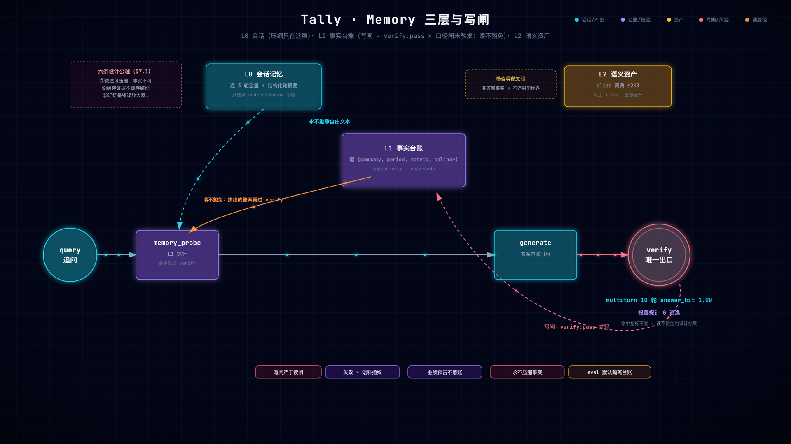

# 第 11 章 规划与记忆：只删不造与三层信任

> 状态：v0.3 · 所属：第三部分 Agent 架构：工具、规划与记忆 · 前置：第 10 章

!!! info "本章导读"

    学完本章你能：①解释「只删不造」校验哲学与检查点验证；②设计
    「部分答案」的诚实呈现（未覆盖红线）；③给记忆系统定三条信任
    规则（写闸/读不豁免/失效）；④复述 L0/L1/L2 各答的「凭什么信」。

## 11.1 失败先行：规划器的两种输出事故

多跳问题（「对比 A、B、C 三家 2025 与 2026 的营收和净利」）先让
LLM 出子目标清单，实测它自然产出两类东西：

```json
{"subgoals": [
  {"action": "search", "company": "欧科亿", "period": "Q1", "metric": "营收"},
  {"action": "browse", "company": "欧科亿", "period": "Q1"},          ← 白名单外
  {"action": "search", "company": "不存在的公司", "period": "FY",      ← 幻觉实体
             "metric": "净利润"}
]}
```

白名单外动作 + 幻觉公司——**LLM 出的是灵感，不是合法清单**。校验
哲学由此定调：**只删不造**（`_validate_plan`）——白名单外动作丢弃、
期间规约到枚举、去重、封顶 MAX_SUBGOALS=5、单公司回填。校验失败
整体回退 agent 环（现路径，不冒险）。「只删不造」的可迁移含义：
**校验器永远不替模型补内容**——补的内容没有出处，违反封闭世界。

## 11.2 业界视角：规划与记忆的谱系

!!! note "背景速览"

    **规划**：让 LLM 先拆解再执行——Plan-and-Solve（
    [arXiv:2305.04091](https://arxiv.org/abs/2305.04091)）把
    「step by step」升级为显式计划；LangGraph 的 Plan-and-Execute
    把 planner 与 executor 分成节点。Tally 的差异化在**校验**：
    计划不是拿到就用，过确定性白名单——「LLM 出灵感、代码裁合法」。

    **记忆**：业界三家代表 + Tally 各取什么——

    | 系统 | 核心思想 | Tally 取什么 |
    |---|---|---|
    | [MemGPT](https://arxiv.org/abs/2310.08560)（→ Letta） | OS 式内存分页，LLM 自管理上下文 | 分层思想（热/冷）|
    | [Mem0](https://mem0.ai) | 抽取-合并的事实记忆，冲突解析 | 事实级合并算子 |
    | [Zep](https://www.getzep.com) | 时序知识图谱 | 时效意识（指纹失效）|
    | **Tally 三层** | L0 会话 / L1 台账 / L2 资产 | —— |

    与通用记忆系统的根本分野：Tally 的记忆**只存结构化、已过闸的
    事实**，不存对话向量、不存自由文本——封闭世界契约的记忆版。

## 11.3 检查点与「未覆盖」红线

每个子目标执行后过检查点（`_ckpt_ok`：**财报级数字在场 ∧ 指标词
命中**——两条都要，缺一即不过），不过有界重试 ×1（扩词重查，
非无界改写），再不过**显式弃**——弃掉的进 `plan_gaps`，verify
出口追加声明：

```python
# tally/graph.py: verify_citations（节选）
gaps = [g for g in (state.get("plan_gaps") or []) if g]
if gaps:
    out["answer"] = (f"{out.get('answer', '').rstrip()}\n（未覆盖："
                     + "；".join(gaps) + "——检索不足，以上为已覆盖部分）")
```

**部分答案不硬凑**——宁可明说「不存在的公司 FY 的净利润没找到」，
不把别家的数顶上去。这是 verify 精神在多跳场景的延伸：不编事实，
也不编**完整性**。用户看到「未覆盖」可以追问，比沉默地错好一个
数量级。



*Memory 三层全景（[▶ 动画版](anim/memory-tiers.html)）：L0 只继承结构化字段；L1 台账读不豁免（命中答案再过 verify）、写闸严于读闸（verify:pass 才写）；L2 人工维护的导航知识。*

## 11.4 Memory 三层：每层回答一个「凭什么信」

| 层 | 是什么 | 凭什么信 |
|---|---|---|
| L0 会话 | 轮摘要继承（公司/期间/年份/指标词） | **永不继承自由文本**——只继承结构化理解字段，切断叙述传播边 |
| L1 台账 | verified_facts 表（公司+期间+指标+口径 四元键） | **写闸严于读闸；读不豁免** |
| L2 资产 | alias 词典等检索导航知识 | 人工维护 + eval 全绿才晋升；非答案事实 |

L1 的两道闸值得逐行读：

```python
# tally/graph.py: _memory_write（写闸节选）
tr = "→".join(state.get("trace") or [])
if any(bad in tr for bad in ("caliber-mismatch", "fallback(",
                             "no-evidence", "derived-mismatch")):
    return []          # 口径闸触发过的一律不写——D22 闸保「数字在场」，
                       # 写闸要的是「行也对」
```

**写闸** = verify:pass ∧ 口径闸未触发 ∧ 非台账命中——只有最干净的
结构化事实进长期记忆（五算子：noop/insert/conflict/restated/
reingest，append-only supersede，value_std 比对）。

**读不豁免**更关键——memory_probe 命中拼出的答案**照样内联过
verify**（缓存证据不缓存结论）。投毒测试为证：

```python
# tests/test_v07.py: test_poisoned_fact_read_not_exempt（思想）
# 往台账写一条假事实（跳过写闸直接 SQL 注入）
# → 读路径命中它 → verify 对账证据池 → 假事实没有真证据支撑
# → 答案 degraded/拒答，假事实出不了门
```

**记忆是加速器，不是后门**——这条性质由测试钉死。失效机制：
语料指纹漂移 → probe 时校验 → 自动 supersede reingest——语料变了，
旧事实不作数，记忆的生命周期跟着证据走。

L0 的「永不继承自由文本」也值得咀嚼：多轮对话里上一轮的**叙述**
（可能带着错误措辞）绝不流入下一轮——只继承 understanding 字段
与指标词（结构化、可校验）。叙述的传播边被剪断，这正是第 13 章
公理的杠杆三。

## 11.5 eₖ·gₖ 视角（先埋个钩子）

三层共享同一直觉：**长链的失败不该按 pⁿ 复利**。L0 不继承自由文本
= 剪断「叙述错误」的传播边；L1 结构化键 + 读不豁免 = 错误事实要么
进不来（写闸）、要么出不去（verify）。结构化传递的本质是「字段
复制，不文本重释」。第 13 章把这写成公理。

## 11.6 动手实验（实测修正版）

```bash
bash experiments/ch11-memory-toggle.sh
# 输出实录（2026-10-22）：
#   == ① 常态 ask：L1 台账在工作 ==
#   memory:hit
#   == ② eval 默认隔离 vs 放开（TALLY_EVAL_MEMORY=on）==
#   answer_hit 两次都是 1.0（不变），citation_coverage 0.941→0.736
#   == ③ 记忆总闸关 ==
#   （无 memory 标记——台账已关）
```

**②的反直觉结果是本章最重要的一课（作者亲踩后才写对）**：想用
「eval 外面设 `TALLY_MEMORY=off` 做对照」根本不生效——evalx 内部
默认强制隔离（除非 `TALLY_EVAL_MEMORY=on`）。而放开后台账命中
**answer_hit 不变**：命中的是同一个已过闸事实，读不豁免、照样过
verify——**指标不变正是「读不豁免」的设计结果**。记忆的可见差异
在 trace（`memory:hit`）、coverage 分布与延迟，不在答案对错。这也
解释了 eval 默认隔离的动机：**防止检索指标被记忆命中测虚高**。

## 11.7 前沿拓展：记忆谱系的最新一段——从 MemGPT 到 memory tool

11.2 给了谱系表；这一节补 2023–2025 的三段最新演进，Tally 的
分野在哪会看得更清楚。

**① generative agents（斯坦福小镇，[arXiv:2304.03442](
https://arxiv.org/abs/2304.03442)）——记忆流的鼻祖**：观察流水
（memory stream）按 **recency × importance × relevance** 检索，
定期 reflection 蒸馏高层结论。L0 轮摘要的近亲——都是「把历史
压缩成可检索的摘要」；分野在内容形态：小镇存自由文本（开放
世界），L0 只继承结构化字段（公理①：叙述可压缩，**事实不可
压缩**——压缩一个数字等于捏造一个数字）。

**② LangGraph memory（2024–2025）——分层的工程标准化**：短期
= checkpointer（会话状态），长期 = BaseStore，按 semantic
（事实）/ episodic（经历）/ procedural（怎么做）三分
（[文档](https://docs.langchain.com/oss/python/concepts/memory)）。
对照：L1 台账 = semantic 事实库、L0 = episodic 会话史、L2 资产
= procedural 导航知识——**三层几乎同名不同置**，差异在写闸：
通用 store 谁都能写，L1 只有 verify:pass 能写。

**③ Anthropic memory tool（2025-08）——记忆的官方化**：模型
自己调 `memory` 工具读写客户端文件目录
（[文档](https://platform.claude.com/docs/en/agents-and-tools/tool-use/memory-tool)）。
与 L1 的对照最锋利：memory tool 把「记什么」交给**模型判断**；
Tally 把「记什么」交给**确定性写闸**。理由是公理⑤——记忆是
错误放大器：通用助手域写错一条偏好（「用户喜欢简洁」）代价
小；事实域写错一个数字，后续每一轮都在读它、每一次对账都
失败。**记忆的公信力 = 写入门槛 × 可审计**，不是「记性好」。

**Reflexion（[arXiv:2303.11366](
https://arxiv.org/abs/2303.11366)）——Tally 明确不收的一段**：
把失败反馈转成语言自我反思、存进情景记忆、下轮更好（verbal
RL）。不收的理由：①反思是自由文本——既非事实也非导航知识，
违反公理①的内容纪律；②跨试次自我改进 = 让上次行为影响下次
输出，这是**相关性风险**——闸门防的恰恰是系统性相关错误
（ch13 相关性警告）。「不学上次为什么错」在通用域是损失，
在封闭世界是安全设计。

**若在 Tally 上继续做**：① L2 晋升半自动化——从 query log 挖
「非子串别名」（检索命中低、被理解归一救回的 query），人工审
后进 alias 表，晋升闸保持「人工 + eval 全绿」；② L1 天生跨会话
但缺审计入口——加一个 `tally.cli facts` 只读视图（谁写的/哪次
run/什么 coverage），让「每条记忆都能对账」从设计变成可查证。

## 11.8 小结

- Planner：LLM 出灵感（子目标清单）、代码裁合法（只删不造白名单）、
  检查点逐个验、缺口显式声明；
- 记忆三层各答一个凭什么信：L0 不继承自由文本、L1 写闸严于读闸+
  读不豁免、L2 人工维护；
- 投毒测试是记忆安全性的形态证明；
- eval 默认隔离台账：防检索指标虚高——对照实验要开 TALLY_EVAL_MEMORY。


## 常见误区

**误区一：「记忆 = 把对话存进向量库」。**对话向量库检索出的
「相关历史」是**自由文本**——它带着上文的错误措辞、过期的上下文、
无关的枝节，注入新问题是新增一条传播边。Tally 的 L1 只存
**结构化、已过闸**的事实（四元键寻址），L0 只继承 understanding
字段——记忆的内容形态决定了它的可信形态。

**误区二：「记忆越多越好」。**每一条记忆都是潜在的污染源。
Tally 的取舍：写闸严于读闸（不干净的不进来）、读不豁免（进来
的照样过 verify）、指纹失效（语料变了旧账作废）。三条规则下，
记忆只会加速、不会污染——加速器要有断电开关。

## 工程检查清单
## 工程检查清单

- [ ] 记忆里存的是结构化事实还是自由文本？
- [ ] 写入有闸吗？闸的条件比输出闸更严吗？
- [ ] 读出的内容会重新验证吗？（投毒测试写过吗？）
- [ ] 记忆有失效机制吗？上游变了它会跟着作废吗？
- [ ] 多轮继承里，哪些字段允许传、哪些被明令禁止？
- [ ] 评测时记忆默认隔离吗？（防止把检索测成记忆命中）

## 延伸阅读

- Plan-and-Solve：<https://arxiv.org/abs/2305.04091> · LangGraph：<https://langchain-ai.github.io/langgraph/> · LangGraph memory：<https://docs.langchain.com/oss/python/concepts/memory>
- MemGPT：<https://arxiv.org/abs/2310.08560> · Mem0：<https://mem0.ai> · Zep：<https://www.getzep.com>
- Generative agents（记忆流）：<https://arxiv.org/abs/2304.03442> · Reflexion：<https://arxiv.org/abs/2303.11366> · Anthropic memory tool：<https://platform.claude.com/docs/en/agents-and-tools/tool-use/memory-tool>
- tally `docs/DESIGN-v0.7-agent.md` §4 Phase 2 与 §7（Memory 全案）
