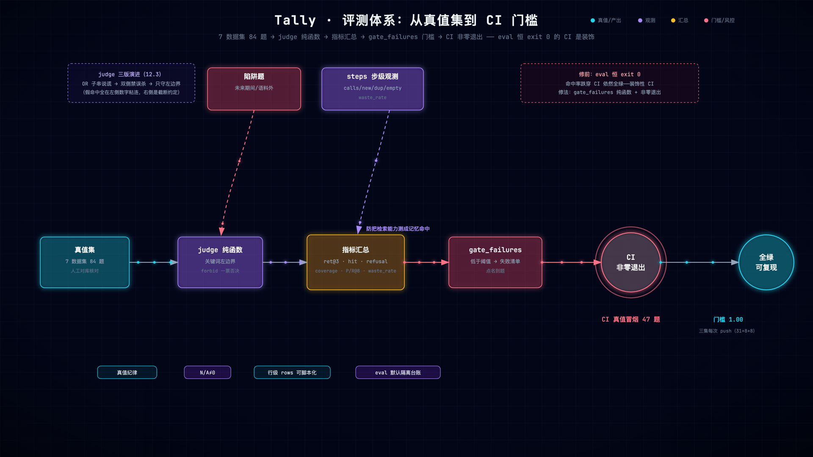

# 第 12 章 评测工程：真值集、陷阱题与 CI 门槛

> 状态：v0.3 · 所属：第四部分 评测与可靠性：度量并守住系统 · 前置：第 8、9 章

!!! info "本章导读"

    学完本章你能：①诊断「装饰性 CI」；②给自己的系统设计真值集
    （真值纪律/陷阱题/反向断言/N-A 诚实）；③复述 judge 三版演进史
    及每版翻的车；④解释关键词判定 vs LLM-as-judge 的取舍；⑤把
    eval 挂上 CI 门槛。

## 12.1 失败先行：装饰性 CI 的解剖

本项目自己踩过的坑：CI 里跑了三个真值集 eval，看起来很严格——
直到有人问「指标跌到 0.3，CI 会红吗？」**不会**：`cmd_eval` 只打印，
永远 exit 0。CI 从「只防崩溃」到「防退化」，差一个非零退出码：

```python
# tally/cli.py: cmd_eval（修复后节选）
if any(v is not None for v in mins.values()):
    fails = gate_failures(summary, **mins)     # 纯函数，可单测
    if fails:
        print(f"✗ eval 门槛未过（dataset={args.dataset}）：\n  "
              + "\n  ".join(fails), file=sys.stderr)
        sys.exit(1)
```

`.github/workflows/ci.yml` 四处 eval 全挂 `--min-retrieval 1.0
--min-hit 1.0`。**门槛通电当天就抓到一次真实回归**（12.3 的 0.963）。
教训：没有门槛的评测是仪表盘，不是防线——仪表盘不会在深夜叫醒
任何人。



*评测体系全景（[▶ 动画版](anim/eval.html)）：真值集 → judge 纯函数 → 指标汇总 → gate_failures 门槛 → CI 非零退出——陷阱题与 steps 步级观测是两条支线。*

## 12.2 业界视角：RAG 评测的三代方法

!!! note "背景速览"

    | 代 | 方法 | 代表 | 取舍 |
    |---|---|---|---|
    | 人工/规则 | 关键词、精确匹配 | 传统 IR 的 P/R | 零成本可解释；覆盖窄 |
    | 框架指标 | 检索/生成/忠实分项 | [RAGAS](https://docs.ragas.io)（faithfulness、context P/R）、TruLens | 全面；依赖 LLM 裁判，有方差 |
    | 领域真值集 | 人工核对答案 + CI 门槛 | Tally 84 题 / 业务 golden set | 最可信；搭建成本高 |

    Hamel Husain 的名文 [*Your AI Product Needs Evals*](https://hamelhusain.substack.com/p/evals)
    （[博客版](https://hamel.dev)）主张：**领域专属评测集 + 错误分析
    驱动迭代**，比通用基准重要——你的用户不问 MMLU，问的是你领域
    的问题。Tally 的 84 题就是这个主张的实践。通用框架不是不用：
    RAGAS 的指标定义值得抄（citation_coverage 与其 faithfulness
    同源不同实现——我们用 token 重叠，它用 NLI 裁判）；LLM-as-judge
    有方差，Tally 只在 trend 叙述层用且**非对称信任**（只能否决，
    不能解锁——裁判不比被裁判者更可信，只给它刹车不给油门）。

## 12.3 judge 的演进史：一学期踩完的坑

**v1：OR 子串。** `any(k in answer)`——关键词 `"3.6"` 能以子串命中
答案里的任何 `13.68`、`3.68`、页码日期。**评测在说谎**：分数
虚高，你据此做的所有决策都被污染。

**v2：左右都禁数字粘连。** 堵假命中——innolight 掉到 **0.963**，
门槛当场红。定位：关键词 `51.7`，答案 `51.71 亿元`——**数据集
约定是前缀截断**（`38,239` 对 `38,239,935,640`，`1,568,385,287`
对 `…287.19`），右边界一禁误杀过半真值题。

**v3（现状）：只守左边界。** 假命中实测全在**左侧**粘连（`3.6` 撞
`13.68`、`36,000` 撞 `136,000`）；右侧延续恰是截断约定：

```python
# tally/evalx.py: _kw_in
if re.search(r"\d", kw):
    return re.search(rf"(?<!\d){re.escape(kw)}", answer) is not None
return kw in answer
```

教学价值超过规则本身：**没有门槛的评测，你连自己的量尺坏了都
不知道**——v2 的误杀如果没有门槛，只会表现为「指标莫名掉了」，
大概率被当成系统回归去查检索层。量尺的 bug 和系统的 bug，
只有门槛能区分。

## 12.4 评测集设计的四个要素

`evals/*.json` 七个数据集、84 题（default 10 / innolight 31 /
maotai 9 / agent 8 / multihop 8 / quarters 8 / multiturn 10 轮）：

1. **真值纪律**：关键词是人工核对到分位的原文数字（与年报分季度
   表交叉验证），不是「大概对」——真值错一题，整条防线错位；
2. **陷阱题**（`expect_refused`）：期间外（2030）、域外（天气）、
   语义陷阱（「预计…多少」不是趋势）——**拒答正确率是一等指标**，
   一个不会说「不知道」的系统不值得信任；
3. **反向断言**（`forbid_keywords`）：第 9 章的口径负向断言——
   问扣非的答案不得出现归母的数；
4. **N/A 的诚实**：无陷阱题的数据集 refusal 记 None（打印 N/A）
   不记 0——「不适用」和「零分」是两回事（0 分会被未来 CI 门槛
   误判）。

指标口径名实相符：`faithfulness → citation_coverage`（它测引用
对账，不测语义忠实——名字吹的牛会被 RAGAS 用户一眼拆穿）。

## 12.5 动手实验：门槛通电（实测）

亲手触发一次 CI 红灯。注意一个坑（作者亲踩）：第一题的
expect_keywords 是 **OR 语义的四个备选**（36,000 / 42,000 / 4.19亿
/ 3.6）——只改坏其中一个，其余三个照样命中，门槛纹丝不动。
**要触发必须报废整组关键词**：

```bash
bash experiments/ch12-gate-trip.sh
# 实测输出（2026-10-22）：
#   exit=1（预期 1）
#   ✗ eval 门槛未过（dataset=default）：
#     answer_hit=0.875 < 1.0
#     ✗ 欧科亿 2026 年半年度预计净利润多少  top1=欧科亿_2026H1E  kw=N doc=Y refused=N
#   还原后 exit=0 OK
```

改坏一道题 → 指标掉到 0.875 → 非零退出 + **指名道姓列出失败题**。
这个「单毁一个 OR 备选无效」的坑本身就是 12.3 judge 语义的现场
复习。

!!! note "前沿一瞥：无参考评估的边界，与 judge 的脾气"

    - **RAGAS**（[arXiv:2309.15217](https://arxiv.org/abs/2309.15217)）
      是「无参考评估」的代表：faithfulness 把答案拆成 claims 逐条
      判蕴含、context precision/recall 量检索质量——不需要人工
      真值，代价是**裁判模型自带方差**。Tally 的 `chunk P/R@8` 与
      RAGAS 的 context precision 同问一个问题（检索噪声），但量尺
      是确定性关键词（人工核对过的原文数字）。
    - **LLM-as-judge**（[MT-Bench, arXiv:2306.05685](
      https://arxiv.org/abs/2306.05685)）给 judge 画了像：强 judge
      与人一致率可超 80%，但有**位置偏、冗长偏、自增强偏**三类
      系统性偏差——这是 Tally 非对称信任（只能否决不能解锁）的
      理论根：有偏的裁判只配坐刹车位，不配坐油门位。

## 12.6 小结

- eval 恒 exit 0 的 CI 是装饰；门槛=gate_failures 纯函数+非零退出；
- 三代评测方法，领域真值集最可信也最贵；LLM-judge 只给刹车；
- judge 三版演进：OR 子串说谎 → 双侧禁误杀（门槛当场抓回）→
  只守左边界（假命中在左、截断约定在右）；
- 评测集四要素：真值纪律/陷阱题/forbid/N-A 诚实；
- 指标名实相符（faithfulness→citation_coverage）。


## 常见误区

**误区一：「有了 RAGAS 这类框架就不需要自建评测」。**框架指标
（faithfulness、context P/R）给你通用体温计，但你的用户问的是
领域问题——扣非答归母在通用 faithfulness 下可能满分。领域真值集
贵（人工核对）但它是唯一能抓住领域错误的尺子；框架是补充，
不是替代。

**误区二：「LLM-as-judge 更先进」。**judge 是另一个 LLM——它有
自己的分布、自己的盲区、自己的口径混淆。Tally 只在 trend 叙述层
用它，且**非对称信任**（只能否决不能解锁）。关键词判定看着
原始，但它确定性、可 diff、可回归——评测层的可复现性比先进性
重要。

## 工程检查清单
## 工程检查清单

- [ ] 你的评测在 CI 里跑吗？指标跌了会红吗？（exit code 查一遍）
- [ ] 真值是人工核对过的原文，还是「大概对」？
- [ ] 有陷阱题（应拒答）吗？拒答率是一等指标吗？
- [ ] 判定量尺本身测过吗？（关键词边界的假阳/假阴）
- [ ] 指标名字与它实际测的东西一致吗？
- [ ] N/A 和 0 分区分了吗？

## 延伸阅读

- Hamel Husain, *Your AI Product Needs Evals*：<https://hamelhusain.substack.com/p/evals> · <https://hamel.dev>
- RAGAS：<https://docs.ragas.io>（论文 <https://arxiv.org/abs/2309.15217>） · ALCE：<https://arxiv.org/abs/2305.14627>
- MT-Bench, *Judging LLM-as-a-Judge*：<https://arxiv.org/abs/2306.05685>
- tally `docs/RAG-EVAL-CASES.md`（评测集设计全案）
