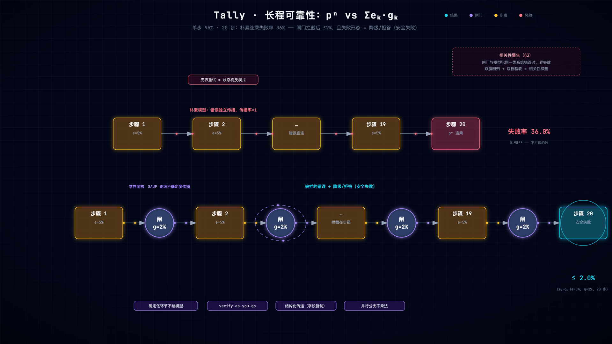

# 第 14 章 可靠性与系统总装：错误传播、安全失败与设计迁移

> 状态：v0.5 · 所属：第五部分 评测与可靠性：可度量，才可控 · 前置：全书
> ◆ 里程碑三：能证明、能迁移——结业章：边界诚实 + 全链总装 + 毕业设计

!!! info "本章导读"

    学完本章你能：①亲跑并解释三个越界样本（gate ≠ correctness 的
    活体）；②推导并运用可靠性公理（四个杠杆各对应全书哪章）；
    ③拿一条真实 trace 逐行走读，说出 14 个模块各在哪个时刻干了
    什么；④解释组装顺序为什么是「RAG 先行、自主最后」；⑤带着
    附录 F 画布完成换语料的毕业设计。

## 14.1 失败先行：亲跑三个越界样本

DESIGN-v0.6 §9 记录了三道**今天仍然会错**的题：

| 样本 | 现象 | 为什么闸门管不住 |
|---|---|---|
| A 口径镜像 | 问扣非答归母，verify:pass(0.529) | 两个数都在证据池——闸门管「有出处」，行选择发生在生成侧（修在 prompt 口径镜像指令，D22 是第二道网）|
| B compare 撞上限 | 多跳对比结论句 cov 虚高（0.95），答非所问仍 pass | 覆盖率管句子级出处，不管「结论是否回应问句」|
| C 每股收益断标签 | `每股收益 1.23 元` 标签被 PDF 抽取撕碎，大数模式匹配不到 | 断标签修复（SPLIT_FIX）覆盖了「利润 」家族，没覆盖这只 |

```bash
bash experiments/ch14-boundary-samples.sh   # 亲跑样本 A + 读账本原文
```

跑一遍，亲眼看它们穿过闸门。**这不是失败，这是系统的诚实**——
边界账本（§9）的存在，正是 Tally 和「全绿 demo」的本质区别。面试
官问「你的系统有什么问题」时，能翻出账本逐条讲的候选人，比说
「没什么问题」的可信一个数量级。



*同一串 20 步的两种命运（[▶ 动画版](anim/ek-gk.html)）：上路朴素连乘，错误独立传播（36% 失败）；下路每步跟闸，被拦的错误变成降级/拒答（≤2%，安全失败）。*

## 14.2 知识点：安全失败设计与传播公理

工程界早有同构思想，先认亲再推导：

- **级联与降级**：微服务的 fallback / circuit-breaker——部分失败
  时退到次优路径而不是整体错误。Tally 的 degraded→抽取式是它的
  RAG 版：**降级产物仍满足不变量**（每句有出处）。安全失败设计
  的通则：**拒答 / 降级 / 显式缺口，都好过沉默错**——失败形态
  本身是接口的一部分。
- **事后复盘文化**：Google SRE 的 postmortem 制度（
  [SRE Book](https://sre.google/sre-book/postmortem-culture/)）——
  不指责个人、写清根因、行动项进跟踪。Tally 的三则事故复盘 +
  每事故一条永久测试，是这个制度的单人版。

在此基座上，全书的可靠性公理：

```
P(错误答案) ≤ Σₖ eₖ·gₖ
  eₖ = 第 k 步出错率（模型决定）
  gₖ = 错误穿过该步闸门的存活率（代码决定）

e=5%、g=2%、20 步 → ≤2%（朴素 pⁿ 模型：0.95²⁰ ≈ 36% 失败）
且失败形态 = 降级/拒答（安全失败），不是错误答案
```

推导直觉：朴素模型假设错误**独立传播**（每步 5% 错，连乘出 36%）；
公理说错误要**穿过闸门才算数**——每步错误率 eₖ 乘以它穿过第 k 道
闸门的存活率 gₖ。**错的不是链的长度，是传播的结构**。四个杠杆，
全书各章各兑现一个：

| 杠杆 | 一句话 | 兑现处 |
|---|---|---|
| ① 能确定化的环节不给模型 | 模型做不了的确定性收走 | trend 确定性遍历（第 9 章）、derive 差分出口重算（第 7/11 章）|
| ② verify-as-you-go | 拦截推进到步级，不留到最后 | 子目标检查点（第 10 章）、verify 唯一出口（第 7 章）|
| ③ 结构化传递 | 字段复制，不文本重释 | L0 继承、L1 结构化键（第 12 章）|
| ④ 并行分支不乘法 | 分解后各自过闸再合并 | compare 按公司分解（第 9 章）|

可测代理：`eval --json` 的 `steps.waste_rate` 是 eₖ 侧；verify
verdict 分布（citation_coverage）是 gₖ 侧。**度量先行——没有数字
的可靠性是玄学**。v0.7.1 的远端实测（§8.3）给了公理一张真实的
快照：22 次调用里 5 次 empty（eₖ 可见），2 例 degraded 被闸门拦下
（gₖ 可见）——公理的每个字母都对应一笔可观测的账。

**相关性警告**（公理的失效条件）：闸门与模型犯**同一类系统性
错误**时，gₖ 不再独立于 eₖ，界失效——这就是双脑回归 + 双档验收
的深层理由：不是冗余，是**相关性探测**。

## 14.3 本项目：总装走读——一条多跳 query 的全链

把全书拆开的 14 个模块装回去。一条真实的多跳对比 query（llm 模式，
远端 glm-5.3 通道，v0.7.1 实测）：

```text
trace: start(3140ms) → mode:llm(3ms) → understand:llm(5352ms)
     → memory_probe:miss(12ms) → route:compare(4ms) → decompose:海伦哲|欧科亿
     → agent:2步/2次tool/10块证据/self(8686ms)
     → generate:llm(6210ms) → verify:pass(0.658)   总耗时 24.2s
```

逐行对账，14 个模块各出现一次：

| trace 行 | 模块 | 此刻在干什么 |
|---|---|---|
| （离线已就位）| `source.py` | 目录指纹扫描——今天 query 命中的 doc 能被找到，始于当天的 `{path: mtime_ns-size}` 清单 |
| （离线）| `ingest.py` | 文件名三段契约定了 doc 的公司/期间；`海伦哲` 这个词能命中，靠 num_notes 与表格保全 |
| （离线）| `index.py` / `fts.py` | 词/字双轨倒排建好——`agent` 环里每次 search 都是这两张影子索引在服务 |
| （离线）| `embed.py` | 向量轨默认关——此刻沉默（opt-in 的第三路，D19 消融后按兵不动）|
| `start` | `cli.py` | 参数解析、模式判定（auto→llm，key 在 .env）|
| 全程 | `schemas.py` | GraphState 窄接口——每个节点只读所需、只写所责，trace 的 append 语义就是它 |
| `understand:llm` | `llm.py` | chat_json 结构化抽取 + `_parse_json` 容错；八守卫在 `graph.py` 侧裁决 |
| 全程 | `graph.py` | 状态机本体——route/decompose/agent/verify 全是它的节点与边 |
| `memory_probe:miss` | `memory.py` | L1 台账查无此键（首问）——命中时也照样内联过 verify |
| `agent:2步` | （`graph.py` 环内）| ReAct 两步：search 海伦哲 → search 欧科亿，幂等缓存与先验覆盖各就位 |
| `decompose` | （`graph.py`）| compare 按公司分解——杠杆④：并行分支不乘法 |
| `generate:llm` | `answer.py` | SPLIT_FIX 断词修复三方共用之一；证据组装的抽取式打分也住在这 |
| `verify:pass(0.658)` | （`graph.py` + `answer.py`）| 覆盖率对账 + `_derived_ok` 派生重算——全书唯一出口 |
| （事后）| `evalx.py` | 这条 trace 若在 eval 里，waste_rate/verdict 正在入账 |

读走读的方法：**在线每一行都踩在离线某层的红利上**——第 2 章的
文件名契约是 route 期间守卫的根据，第 3 章的表格保全决定 agent 的
search 有没有真值可捞。层的红利会延迟兑现，但一定兑现（第 1 章的
论断在此总装）。

## 14.4 本项目：组装顺序回顾——为什么 RAG 先行、自主最后

回看 Tally 的版本史，组装顺序本身是个设计决策：

```text
v0.4–v0.5  检索/写入架构 + agentic 地基（检索双轨、Store 唯一写入口）
v0.6       固定管线全绿（gate 体系、trend 确定性遍历、CI 真值冒烟）
v0.6.5     trend 叙述层双闸 + 裁判（叙述可以 LLM 化了——因为骨架先硬）
v0.7       四支柱（Planner / Memory / Tool Use / ReAct 观测）
v0.7.1     远端 function calling 接通
```

反过来装（先 agent 后闸门）会发生什么：自主循环的每种死法
（复读/幻觉参数/不收手）没有 waste_rate 可观测、没有 verify 兜底、
没有 heuristic 基线可对照——你在没有地基的地上盖楼，每个「智能」
都是不可复现的。Anthropic 的建议（
[Building Effective Agents](https://www.anthropic.com/engineering/building-effective-agents)）
同向：从最简单能工作的结构开始，只在评估证明需要时加自主性。
Tally 的版本史是这条建议的逐版本实例——**自主性是买来的，付的
货币是闸门和评测**。

## 14.5 毕业设计：换语料，用画布造你自己的挽具

◆ 里程碑三的验收件。任务：把全书的决策重做一遍，载体换成**非财经
语料**（法律判决书 / 医疗指南 / 内部 wiki / 药品说明书）：

1. **画布走完 14 格**（附录 F）：每格是一章的「你的设计清单」
   迁移版——文件名契约怎么定？口径家族是什么？引用粒度到条还是
   页？工具白名单留几个？写闸按错误代价怎么分级？
2. **20 题真值集**（第 13 章毕业练习①已备好方法：12 单跳含 4
   口径 + 4 陷阱 + 2 对比 + 2 趋势，每个数字指得出页与行）；
3. **跑出三态出口**：你的系统必须至少产生一次诚实的 degraded 与
   一次诚实的 refused——**能拒答是验收项，不是缺陷**。全 pass
   的毕业设计反而可疑（闸门没通电）。

三个迁移盒（第 3/7/12 章）是起点不是终点。评估自己：如果某一格
你写不出答案，回那一章重读——画布就是全书的目录反转。

## 14.6 待办账本（同样写下来）

- ~~远端通道 function calling~~ ✅ v0.7.1 已收口（第 11 章的作者
  答卷）；
- **runs.jsonl 轨迹持久化**（eₖ/gₖ 长期趋势的数据源——现在只有
  单次 eval 快照）；
- **P2 算术恒等探针**——资产=负债+所有者权益类恒等式可校验抽取层
  的口径正确性。**口径识别不可靠之前，数值对账是空中楼阁**（§9
  原话——它排后不是「忘了做」，是前提未成熟）。

## 14.7 前沿拓展：多步失败的科学——MAST 与 SAUP

14.2 的公理是本书自己的推导；2024–2025 学界交出了两份同构作业。

**MAST：多智能体系统的失败分类学**（[*Why Do Multi-Agent LLM
Systems Fail?*](https://arxiv.org/abs/2503.13657)，UC Berkeley
2025）：挖掘 AutoGen / CrewAI / LangGraph 的真实失败轨迹，归纳出
**14 类失败模式**、三大类——规格与系统设计缺陷、单 agent 行为
失当（幻觉指令、幻觉工具参数……）、agent 间失配。拿它对照公理
四杠杆，杠杆就是对清单的逐类釜底抽薪：

| MAST 失败类 | Tally 对策 |
|---|---|
| 幻觉工具参数 | 理解先验覆盖 + 强类型枚举（第 11 章）|
| 指令幻觉（干没让干的事）| 只删不造白名单 + MAX_SUBGOALS 封顶（第 10 章）|
| agent 间失配（信息传递走样）| 结构化传递：字段复制不文本重释（杠杆③）|
| 规格缺陷（任务定义错）| 封闭世界契约：任务的边界先写死（第 1 章）|

**SAUP：不确定度的逐级传播**（[*Situation Awareness Uncertainty
Propagation*](https://arxiv.org/abs/2412.01033)，ACL 2025）：把
每步的不确定度沿轨迹**带权重传播**，证明只看最后一步的估计
会漏掉累积的不确定度（AUROC 差距最高 ~20%）。这是 eₖ·gₖ 的
学界同构：错误与不确定必须在**步级**观测和拦截，不能等终点
裁决——verify-as-you-go 的理论背书，也是 waste_rate 做成步级
指标而不是端到端指标的原因。

一句收束：公理不是发明，是**把学界两份作业翻译成了一个仓库的
代码**——MAST 给了失败清单（防什么），SAUP 给了传播原理（在哪
防），Tally 给了工程件（怎么防：闸门/先验/结构化传递/有界）。

**若在 Tally 上继续做**：① eₖ/gₖ 实测表按**动作类型**聚合
（search / metrics_table / derive 分列 dup/empty）进 CI；② 拿
MAST 的 14 类做一次自查表：哪些类已有对策、哪些是盲区——**盲区
就是下一个 D 记录**。

## 14.8 结业：harness 是产品

回第 1 章的立论收口。三条带走的东西：

1. **对账思想**：LLM 组织语言，确定性代码拥有事实——刻痕对得上
   才出门；
2. **实测文化**：每个决策一张表、每次失败一条测试、每条护栏一个
   事故存档——D1–D26 就是这么攒出来的；
3. **边界诚实**：主动写下管不住什么。面试、评审、深夜排查——
   边界账本永远比全绿可信。

最后一条论点送给毕业后的你：**harness 是产品——模型会换，挽具
沉淀。**你在本书造的 14 个模块里，没有一个的寿命短于当前最强的
模型档位；你换过三次脑（本地 0.8b / 远端 glm / 更强档），闸门
一行没改。行业每季度都在重写「怎么调用模型」的教程，而「怎么让
答案可靠地出门」的这套结构，正在成为下一代系统的地基——你手里
已经有了。

## 常见误区

**误区一：「可靠性 = 多写测试」。**测试锁已知失败模式；可靠性
设计改变**未知失败的传播结构**——错误穿不透闸门、不跨分支复利、
失败以安全形态落地。第 13 章的门槛是测试的事；本章的公理是结构
的事，两者互补不互替。

**误区二：「边界账本是示弱」。**恰好相反：能精确说出系统管不住
什么，证明你度量过、思考过失败面。全绿的演示随时可以被一道题
戳穿；边界账本里的每一条都是你已经知道并管理着的风险。

## 延伸阅读

- Google SRE Book, *Postmortem Culture*：<https://sre.google/sre-book/postmortem-culture/>
- Anthropic, *Building Effective Agents*：<https://www.anthropic.com/engineering/building-effective-agents>
- MAST, *Why Do Multi-Agent LLM Systems Fail?*：<https://arxiv.org/abs/2503.13657> · SAUP：<https://arxiv.org/abs/2412.01033>
- tally `docs/DESIGN-v0.6.md` §9（边界账本）与 `docs/DESIGN-v0.7-agent.md` §3+§8.3
